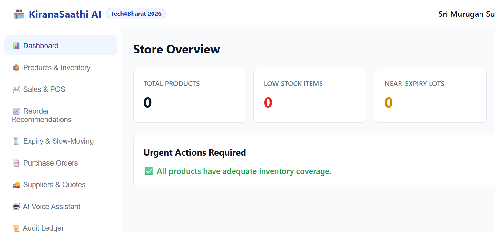
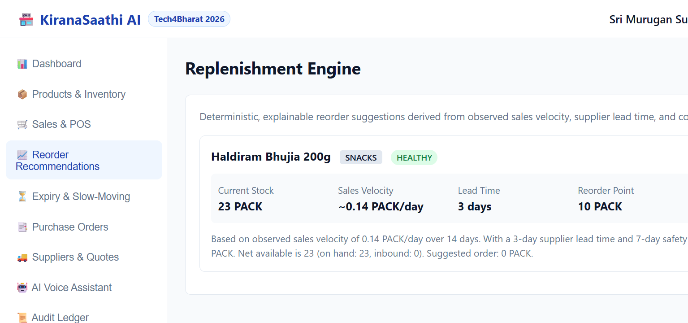
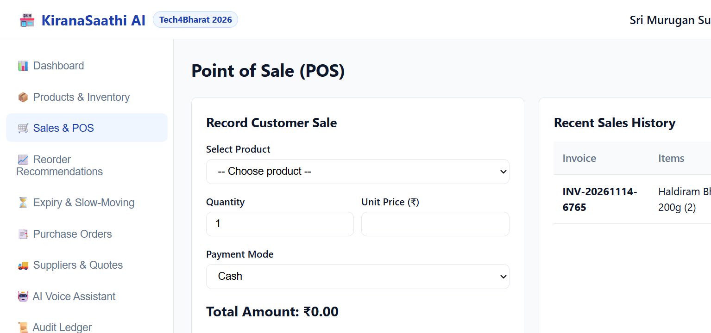
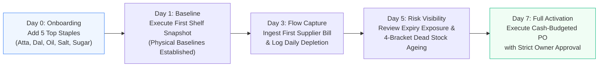
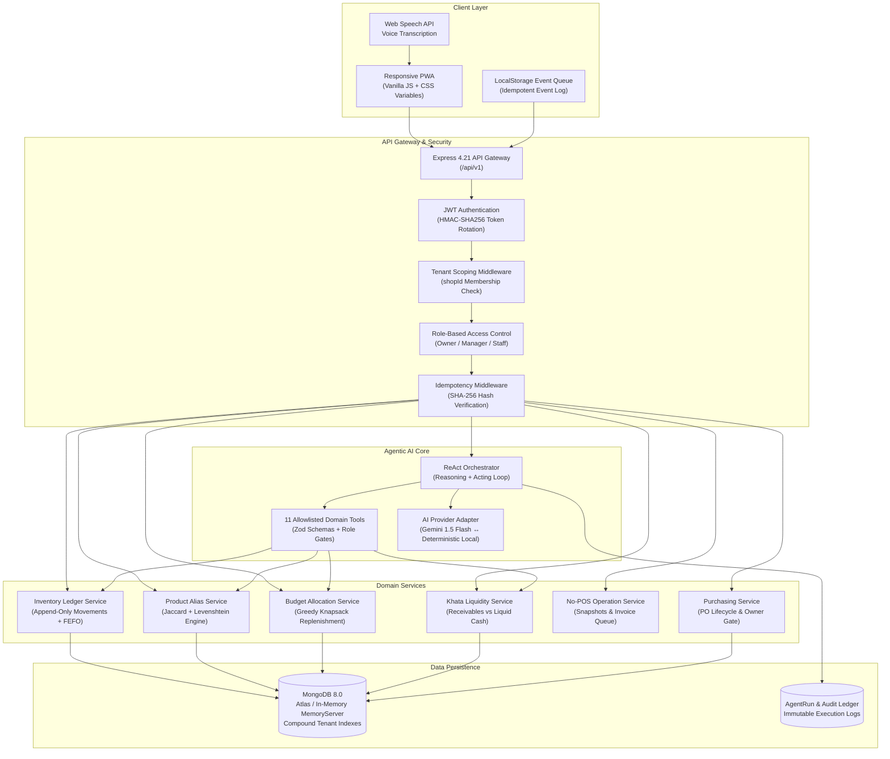
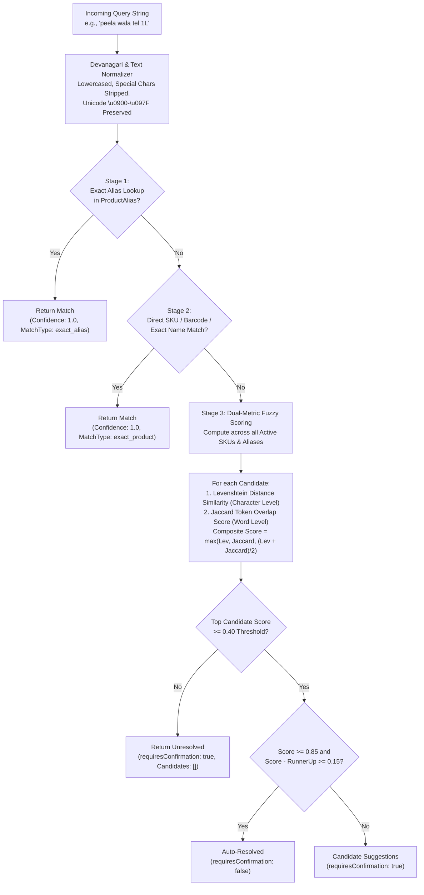
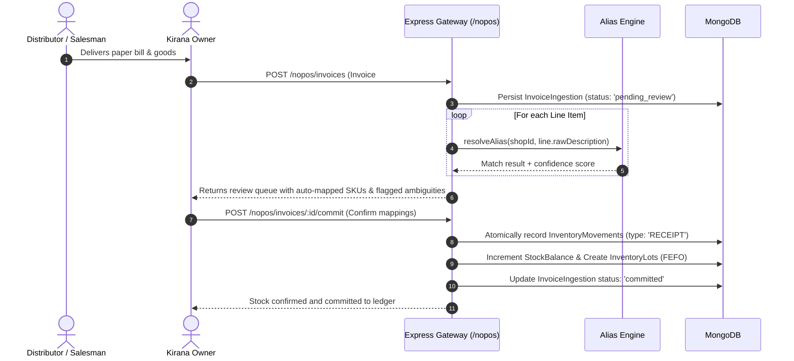
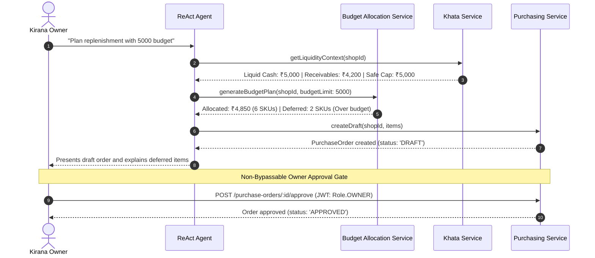
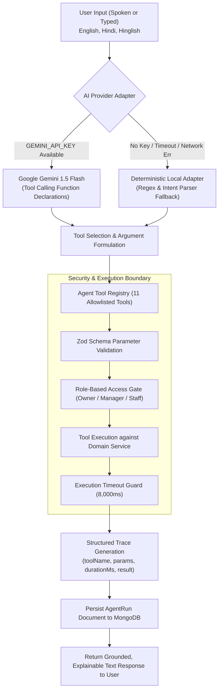
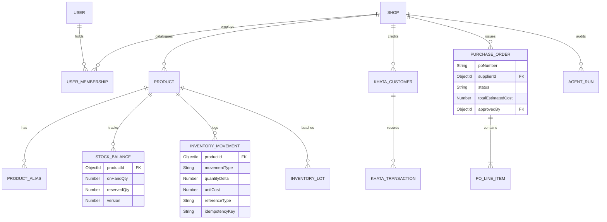

# KiranaSaathi AI

```text
██╗  ██╗██╗██████╗  █████╗ ███╗   ██╗ █████╗ ███████╗ █████╗  █████╗ ████████╗██╗  ██╗██╗   █████╗ ██╗
██║ ██╔╝██║██╔══██╗██╔══██╗████╗  ██║██╔══██╗██╔════╝██╔══██╗██╔══██╗╚══██╔══╝██║  ██║██║  ██╔══██╗██║
█████╔╝ ██║██████╔╝███████║██╔██╗ ██║███████║███████╗███████║███████║   ██║   ███████║██║  ███████║██║
██╔═██╗ ██║██╔══██╗██╔══██║██║╚██╗██║██╔══██║╚════██║██╔══██║██╔══██║   ██║   ██╔══██║██║  ██╔══██║██║
██║  ██╗██║██║  ██║██║  ██║██║ ╚████║██║  ██║███████║██║  ██║██║  ██║   ██║   ██║  ██║██║  ██║  ██║██║
╚═╝  ╚═╝╚═╝╚═╝  ╚═╝╚═╝  ╚═╝╚═╝  ╚═══╝╚═╝  ╚═╝╚══════╝╚═╝  ╚═╝╚═╝  ╚═╝   ╚═╝   ╚═╝  ╚═╝╚═╝  ╚═╝  ╚═╝╚═╝
```

<div align="center">

### A Voice-First Replenishment Agent & Stock Intelligence for Kirana Retailers
**Official Submission for Tech4Bharat 2026 (GAVS HackCulture) — Problem Statement 5.1**

[](https://opensource.org/licenses/ISC)
[](https://nodejs.org/)
[](https://www.typescriptlang.org/)
[](https://expressjs.com/)
[](#8-system-architecture)

[](#11-agentic-ai-architecture)
[](https://www.mongodb.com/)
[](#9-engineering-decisions--algorithms)
[](#14-testing-and-verification-evidence)

[](#5-application-screenshots)
[](#6-feature-implementation-matrix)
[](#14-testing-and-verification-evidence)

<br>

[Executive Summary](#1-executive-project-introduction) • [Problem Alignment](#2-official-problem-statement-alignment) • [Live Screenshots](#5-application-screenshots) • [Feature Matrix](#6-feature-implementation-matrix) • [Architecture](#8-system-architecture) • [Algorithms](#9-engineering-decisions--algorithms) • [REST API](#13-rest-api-reference) • [Testing Evidence](#14-testing-and-verification-evidence) • [Quick Start](#16-quick-start)

</div>

---

## 1. Executive Project Introduction

**KiranaSaathi AI** is a production-grade, event-sourced stock intelligence and automated replenishment platform engineered specifically for the operational constraints of India's 13 million micro-retailers (*kirana stores*).

Unlike conventional retail inventory management software (ERP) built on the assumption of modern point-of-sale (POS) barcode scanning, clean item masters, and unconstrained purchasing capital, KiranaSaathi AI is built on a **No-POS-first architecture**:
- It extracts inventory movement signals from **supplier delivery invoices**, **periodic physical shelf count snapshots**, and **spoken Hinglish observations** (*"5 packet cheeni nikle"*).
- It resolves messy, colloquial regional product names to canonical catalogue SKUs using a **3-tier resolution engine** (Normalized Exact Alias $\rightarrow$ Product/SKU/Barcode regex $\rightarrow$ Dual-Metric Fuzzy Jaccard Token Overlap & Levenshtein Similarity with Devanagari Unicode support).
- It formulates purchase orders using a **cash-constrained greedy discrete allocation algorithm** that enforces the owner's hard weekly cash budget ceiling, mathematical guarantees against spend overruns, and plain-language deferral rationale.
- It enforces a strict **Khata Liquidity Invariant**, mathematically isolating uncollected informal customer credit from available purchasing capital.
- It operates under a **governed ReAct (Reasoning + Acting) Agentic AI loop** restricted to an allowlist of 11 Zod-validated domain tools. The agent has zero direct database write access and cannot approve expenditure; only verified shop owners possess cryptographic authorization to approve purchase orders.

---

## 2. Official Problem Statement Alignment

- **Competition:** Tech4Bharat 2026 (GAVS HackCulture)
- **Track / Theme:** Theme 5: Rural FMCG and Logistics
- **Problem Statement:** **5.1 Kiranas tie up cash in dead stock while running out of fast-moving essentials**

### Core Challenges Identified in PS 5.1
1. **Working Capital Imbalance:** Kiranas frequently tie up 15–20% of their working capital in slow-moving or seasonal dead stock, triggering severe cash flow crunches.
2. **Frequent Stockouts on High-Velocity Staples:** Essential commodities (Atta, Dal, Oil, Salt, Sugar, Milk) deplete unpredictably due to reliance on manual memory, casual shelf glances, and distributor visits.
3. **Silent Expiry Losses:** ₹5,000–₹10,000 worth of packaged goods expire monthly on back-room shelves due to lack of batch and First-Expired-First-Out (FEFO) visibility.
4. **Informal Operating Reality:** Barcode scanning at counter checkout is rejected in fast-paced neighbourhood environments where customers purchase loose goods or unbilled single items during evening peak rushes.
5. **Colloquial Dialect & Invoice Chaos:** Suppliers and retailers write shorthand notations (*"FRTN SUN OIL 1L"*, *"Tata namak chota"*, *"Peela wala tel"*), preventing standard software cataloguing.

---

## 3. Problem Analysis: The Informal Retail Reality

Small kirana stores operate in an environment structurally distinct from modern organized trade:

```mermaid
flowchart TD
    subgraph Informal Retail Environment
        C1["Customer Rush (No-POS Checkout)"] -->|Manual Billing / Memory| S1["Unrecorded Stock Depletions"]
        C2["Distributor Delivery Bills"] -->|Messy Handwritten / Regional Shorthand| S2["Unstructured Stock Receipts"]
        C3["Informal Customer Khata"] -->|Illiquid Receivables (Uncollected)| S3["Distorted Cash Perception"]
    end

    S1 --> CONSEQ["Financial Consequences"]
    S2 --> CONSEQ
    S3 --> CONSEQ

    subgraph Operational Breakdown
        CONSEQ --> F1["15-20% Locked in Stagnant Dead Stock"]
        CONSEQ --> F2["₹5,000-₹10,000/mo Silent Expiry Write-Offs"]
        CONSEQ --> F3["Mid-Week Stockouts on Essential Staples"]
        CONSEQ --> F4["Cash Flow Depletion When Ordering"]
    end
```

Attempts to solve this by imposing supermarket ERPs fail because:
- Demanding barcode scanning causes customer checkout queues and walkouts.
- Requiring upfront digitization of 2,000+ SKUs results in immediate abandonment during onboarding.
- Standard Economic Order Quantity (EOQ) formulas assume unconstrained bank lines of credit, whereas kirana owners operate under hard weekly cash ceilings (e.g., ₹5,000–₹25,000 cash in hand).

---

## 4. Product Solution and Differentiation

KiranaSaathi AI bridges the informal operating model with mathematical inventory rigor:

| Capability | Legacy Retail ERPs / POS | Modern B2B E-Commerce Apps | KiranaSaathi AI (This Project) |
|---|---|---|---|
| **Primary Input Model** | Mandatory barcode scanning at POS | In-app catalogue browsing | **No-POS First**: Physical shelf snapshots, supplier invoice queue, voice depletion |
| **Product Recognition** | Strict UPC / EAN barcode required | Standard standardized catalogue | **3-Tier Colloquial Alias Engine**: Resolves Hinglish, regional shorthand, Devanagari |
| **Replenishment Strategy** | Unconstrained EOQ / Min-Max | Vendor push promotions | **Hard Owner Cash Budget Knapsack**: $O(N \log N)$ greedy allocation with explainable deferrals |
| **Customer Credit (Khata)** | Separate unlinked ledger | Not supported | **Khata Liquidity Invariant**: Receivables discounted and isolated from purchasing budget |
| **Inventory Accounting** | Mutable balance counters | Simple warehouse stock | **Immutable Append-Only Movement Ledger** with strict FEFO batch allocation |
| **Order Authorization** | Auto-EDI purchase orders | Auto-debit distributor credit | **Strict Owner-Only Approval Gate**: Non-bypassable API/DB invariant; Manager/AI blocked |
| **Onboarding Horizon** | 2–4 weeks catalogue setup | 1–2 days account setup | **7-Day Guided Activation**: Operational value delivered from first 20 staples on Day 1 |

---

## 5. Application Screenshots

The screenshots below show the genuine, running UI components of KiranaSaathi AI served locally at `http://localhost:4000`:

### 1. Store Overview & Operational KPI Dashboard

*Real-time store overview displaying 7-Day Guided Activation roadmap (PS-11), live stock KPIs (Total Products, Low Stock Alerts, Near-Expiry Lots, Safe Cash Buffer), and the top header with dual Dark/Light mode and English/हिन्दी vernacular language toggles.*

### 2. Multi-Role Authentication & Quick Switcher Modal

*Interactive multi-role authentication modal supporting instant persona switching between Owner (`murugan.owner@kirana.in`), Manager (`manager@kirana.in`), and Staff (`staff@kirana.in`), custom credential authentication, and new store onboarding.*

### 3. Explainable Reorder Recommendations & Demand Velocity

*Deterministic replenishment intelligence calculating average daily sales velocity, days of stock cover remaining, suggested reorder quantities, and data quality confidence tiers.*

### 4. Product Catalogue & Real-Time Stock Management

*Product inventory catalogue featuring instantaneous search, on-hand balances, reorder thresholds, ledger reconciliation triggers, and modal workflow for adding products with opening stock balances.*

### 5. POS Checkout with Atomic FEFO Lot Deductions

*Optional POS checkout interface supporting cash, UPI, and customer credit (Khata) transactions with database-level race protection and automatic First-Expired-First-Out batch deduction.*

### 6. Conversational AI Voice Assistant

*Bilingual AI assistant supporting English, Hindi, and Hinglish queries, executing allowlisted domain tools, and generating structured execution traces with zero direct database write access.*

---

## 6. Feature Implementation Matrix

Every feature is classified with explicit factual verification:
- `[VERIFIED]`: Implemented in source code and proven by automated test suites.
- `[IMPLEMENTED]`: Fully implemented in backend and UI; manual/browser verification completed.
- `[PARTIAL]`: Backend capabilities implemented; frontend or external integration partially mocked/pending.
- `[PLANNED]`: Architectural roadmap item not yet implemented.

| ID | Feature Description | Scope & Module | Status | Verification Evidence |
|---|---|---|:---:|---|
| **PS-01** | Dead Stock Landed-Cost Valuation & 4-Bracket Ageing (0-30, 31-60, 61-90, 90+ days) | `src/modules/analytics/forecasting.service.ts` | `[VERIFIED]` | `tests/integration/forecasting.test.ts` |
| **PS-02** | Near-Expiry Lot Detection & FEFO Allocation Guidance | `src/modules/inventory/inventory.service.ts` | `[VERIFIED]` | `tests/integration/inventory-ledger.test.ts` |
| **PS-03** | Explainable Daily Reorder Recommendations & Velocity Metrics | `src/modules/analytics/forecasting.service.ts` | `[VERIFIED]` | `tests/integration/forecasting.test.ts` |
| **PS-04** | Regional Festival Demand Surge Scenarios (+25%, +60%, +120%) | `src/modules/analytics/festival.service.ts` | `[VERIFIED]` | `tests/integration/festival.test.ts` |
| **PS-05** | No-POS Physical Shelf Count Snapshots & Ledger Reconciliation | `src/modules/nopos/nopos.service.ts` | `[VERIFIED]` | `tests/integration/nopos-workflow.test.ts` |
| **PS-06** | Atomic POS Multi-Item Checkout & Concurrency Oversell Guard | `src/modules/sales/sale.service.ts` | `[VERIFIED]` | `tests/integration/concurrency-race.test.ts` |
| **PS-07** | Idempotent Stock Receipts & Inventory Audit Movements | `src/modules/inventory/inventory.service.ts` | `[VERIFIED]` | `tests/integration/inventory-ledger.test.ts` |
| **PS-08** | Customer Khata Ledger & Core Liquidity Invariant Enforcement | `src/modules/khata/khata.service.ts` | `[VERIFIED]` | `tests/integration/khata.test.ts` |
| **PS-09** | Supplier Bill Review Queue & Daily Voice Depletion Logging | `src/modules/nopos/nopos.service.ts` | `[VERIFIED]` | `tests/integration/nopos-workflow.test.ts` |
| **PS-10** | Colloquial Product Alias Resolution Engine (Jaccard + Levenshtein) | `src/modules/products/product-alias.service.ts` | `[VERIFIED]` | `tests/integration/product-alias.test.ts` |
| **PS-11** | 7-Day Guided Activation Roadmap & Milestone Tracker | `src/modules/shops/activation.service.ts` | `[IMPLEMENTED]` | `tests/e2e/complete-kirana-workflow.test.ts` |
| **PS-12** | Hard Owner Cash Budget Ceiling & Multi-SKU Greedy Allocation | `src/modules/analytics/budget-allocation.service.ts` | `[VERIFIED]` | `tests/integration/budget-replenishment.test.ts` |
| **PS-13** | Strict Owner-Only PO Approval & Anti-Tamper Reversion Invariant | `src/modules/purchasing/purchasing.service.ts` | `[VERIFIED]` | `tests/integration/purchasing-approval.test.ts` |
| **PS-14** | Supplier Directory & Quotation Lead-Time Comparison | `src/modules/suppliers/supplier.service.ts` | `[VERIFIED]` | `tests/integration/purchasing-approval.test.ts` |
| **PS-15** | Pooled Bulk Purchasing Proposals & Joint Order Splitting | `src/modules/purchasing/pooled-purchase.service.ts` | `[VERIFIED]` | `tests/integration/pooled-and-aggregate.test.ts` |
| **PS-16** | Privacy-Preserving Aggregate Demand Intelligence ($k$-Anonymity) | `src/modules/analytics/aggregate-demand.service.ts` | `[VERIFIED]` | `tests/integration/pooled-and-aggregate.test.ts` |
| **PS-17** | Governed ReAct Agentic AI Tool Orchestration & Audit Logs | `src/modules/agent/agent.service.ts` | `[VERIFIED]` | `tests/integration/agent-tools.test.ts` |
| **PS-18** | Complete 12-Step Business Lifecycle E2E Workflow | `tests/e2e/complete-kirana-workflow.test.ts` | `[VERIFIED]` | `tests/e2e/complete-kirana-workflow.test.ts` |
| **PS-19** | Offline Event Batch Synchronization & Conflict Detection | `src/modules/sync/sync.service.ts` | `[VERIFIED]` | `tests/integration/offline-voice.test.ts` |
| **PS-20** | Vernacular UI Localization (English & हिन्दी Dictionary) | `public/js/app.js` | `[IMPLEMENTED]` | Browser-verified UI toggle |
| **PS-21** | Persistent Theme Switching (Dark & Light Mode via CSS Tokens) | `public/css/styles.css` | `[IMPLEMENTED]` | Browser-verified UI toggle |
| **PS-22** | PWA Service Worker Offline Static Asset Caching | `public/sw.js` | `[PLANNED]` | Roadmap item |
| **PS-23** | Optical Character Recognition (OCR) for Paper Invoices | `src/modules/nopos/` | `[PLANNED]` | Roadmap item |

---

## 7. Seven-Day Guided Activation Journey

To eliminate the friction of enterprise ERP onboarding, KiranaSaathi AI implements a 5-milestone activation progression tracked by `ActivationService`:



- **Milestone 1 (Day 0 — `DAY_0_STAPLES`):** Requires $\ge 5$ active products in store catalogue.
- **Milestone 2 (Day 1 — `DAY_1_SHELF_AUDIT`):** Requires $\ge 1$ physical shelf snapshot count.
- **Milestone 3 (Day 3 — `DAY_3_INVOICE_DEPLETION`):** Requires $\ge 1$ supplier invoice ingested and $\ge 1$ informal depletion logged.
- **Milestone 4 (Day 5 — `DAY_5_EXPIRY_REVIEW`):** Real-time activation of FEFO near-expiry alerts and dead stock landed-cost valuation.
- **Milestone 5 (Day 7 — `DAY_7_BUDGET_PO`):** Formulation of first cash-constrained purchase order approved by the store owner.

---

## 8. System Architecture

The application is structured following modular hexagonal design principles:



---

## 9. Engineering Decisions and Algorithms

### 9.1 Colloquial Product Alias Resolution Pipeline
Indian retail operates across dialects, phonetic transliterations, and supplier shorthand. `ProductAliasService` implements a deterministic 3-tier matching pipeline:



#### Mathematical Formulation
- **Levenshtein Distance Similarity:**
  $$\text{Sim}_{\text{Lev}}(s_1, s_2) = 1 - \frac{\text{Lev}(s_1, s_2)}{\max(|s_1|, |s_2|)}$$
- **Jaccard Token Overlap:**
  $$J(T_1, T_2) = \frac{|T_1 \cap T_2|}{|T_1 \cup T_2|}$$
- **Composite Score:**
  $$S = \max\left(\text{Sim}_{\text{Lev}}, J, \frac{\text{Sim}_{\text{Lev}} + J}{2}\right)$$

### 9.2 Cash-Constrained Replenishment Allocation Algorithm
Standard ERPs calculate unconstrained replenishment orders using basic Min-Max logic. KiranaSaathi AI models replenishment as a **bounded greedy discrete knapsack allocation problem** (`BudgetAllocationService`):

1. **Deficit Identification:** Candidates are identified where on-hand stock $S \le R$ (reorder point) or suggested reorder quantity $Q_{\text{sugg}} > 0$.
2. **Multi-Factor Priority Scoring (0 to 100):**
   $$P_i = \text{round}\left( (U_i \times 0.45 + V_i \times 0.35 + M_i \times 0.20) \times 100 \right)$$
   Where:
   - **Urgency ($U_i \in [0.3, 1.0]$):** Based on days of cover left ($D \le 1\text{d} \rightarrow 1.0$; $D \le 3\text{d} \rightarrow 0.8$; $D \le 7\text{d} \rightarrow 0.6$; else $0.3$).
   - **Velocity ($V_i \in [0.2, 1.0]$):** Average daily turnover ($V \ge 10\text{ units/day} \rightarrow 1.0$; $V \ge 5 \rightarrow 0.8$; $V \ge 1 \rightarrow 0.5$; else $0.2$).
   - **Gross Margin ($M_i \in [0.1, 1.0]$):** Profit contribution factor $\min(1.0, \max(0.1, 2 \times \text{margin}))$.
3. **Greedy Allocation under Hard Cash Ceiling:**
   - Sort candidates descending by $P_i$.
   - For each candidate $i$ with unit cost $c_i$ and needed quantity $q_i$:
     $$u_i = \left\lfloor \frac{B_{\text{rem}}}{c_i} \right\rfloor$$
   - If $u_i \ge q_i$: Allocate $q_i$ units. Decrement $B_{\text{rem}} \leftarrow B_{\text{rem}} - (q_i \cdot c_i)$.
   - Else if $u_i > 0$: Partially allocate $u_i$ units. Decrement $B_{\text{rem}} \leftarrow B_{\text{rem}} - (u_i \cdot c_i)$.
   - Else: Defer item to `deferredItems[]` with an explicit reason (*"Unit cost ₹X exceeds available cash buffer of ₹Y"*).

### 9.3 Immutable Ledger & Atomic FEFO Stock Deductions
- Stock balances are not raw numbers mutated directly in the database.
- Every receipt, sale, adjustment, or write-off creates an immutable `InventoryMovement` entry.
- The `StockBalance` projection is updated atomically using MongoDB `$inc` operators with strict database-level preconditions:
  ```typescript
  StockBalance.findOneAndUpdate(
    { shopId, productId, onHandQty: { $gte: requiredQty } },
    { $inc: { onHandQty: -requiredQty } }
  );
  ```
- FEFO (First-Expired-First-Out) iterates active `InventoryLot` documents sorted by `expiryDate: 1`, deducting stock sequentially from the oldest valid batch.

---

## 10. Inventory and Cash Workflows

### 10.1 Supplier Invoice Ingestion & Verification Queue


### 10.2 Cash-Constrained Replenishment Lifecycle


---

## 11. Agentic AI Architecture

The agent runs as a deterministic, bounded ReAct state machine (`src/modules/agent/agent.service.ts`):



### Allowlisted Tool Registry

| Tool Identifier | Description | Required Role | Backing Service |
|---|---|:---:|---|
| `get_inventory_summary` | On-hand stock balances and low-stock alerts for all active SKUs | Any Member | `InventoryService` |
| `get_low_stock_items` | Filter products currently at or below reorder points | Any Member | `InventoryService` |
| `get_expiry_risks` | Identify inventory lots approaching expiry within $N$ days | Any Member | `ForecastingService` |
| `calculate_reorder` | Compute velocity metrics and explainable replenishment needs | Owner / Manager | `ForecastingService` |
| `get_dead_stock_summary` | 4-bracket ageing analysis (0-30d, 31-60d, 61-90d, 90+d) | Owner / Manager | `ForecastingService` |
| `get_cash_budget_plan` | Bounded discrete allocation respecting hard cash budget cap | Owner / Manager | `BudgetAllocationService` |
| `get_khata_summary` | Review customer credit and enforce liquidity invariants | Owner / Manager | `KhataService` |
| `plan_festival_demand` | Demand surge projections (+25%, +60%, +120%) for major festivals | Owner / Manager | `FestivalService` |
| `resolve_local_alias` | Resolve colloquial regional aliases to canonical catalogue SKUs | Any Member | `ProductAliasService` |
| `compare_suppliers` | Compare distributor quotations and delivery lead times | Owner / Manager | `SupplierService` |
| `create_purchase_order_draft` | Formulate supplier draft PO (*stays DRAFT until owner approves*) | Owner / Manager | `PurchasingService` |

---

## 12. Database and Security Model

### 12.1 Schema Entity Relationships


### 12.2 Security Architecture & Hardened Defenses
- **Multi-Tenant Isolation:** Enforced via `tenantMiddleware`. Every query explicitly injects `{ shopId: new mongoose.Types.ObjectId(req.shopContext.shopId) }`. Zero cross-tenant data bleed.
- **Authentication:** Salted password hashing with `bcryptjs` (cost factor: 10). Dual JWT lifecycle with 15-minute access tokens and 7-day refresh tokens protected by cryptographic JTI revocation.
- **Non-Bypassable Owner Approval Invariant:** Only users verified with `membership.role === 'owner'` can transition a Purchase Order from `DRAFT` to `APPROVED`. Any modification to an approved PO immediately reverts its status to `DRAFT`.
- **Concurrency & Anti-Overselling Guard:** Atomic MongoDB `$inc` operations with precondition checks prevent overselling during simultaneous racing checkouts.
- **Idempotency Protection:** `idempotencyMiddleware` hashes request bodies via SHA-256. Identical retries return cached responses; modified payloads return `HTTP 409 Conflict`.

---

## 13. REST API Reference

All routes are prefixed with `/api/v1`:

### Authentication & Shop Onboarding
| Method | Endpoint | Description | Auth / Role |
|---|---|---|---|
| `POST` | `/auth/register` | Register new user account | Public |
| `POST` | `/auth/login` | Authenticate using identifier (email/phone) + password | Public |
| `POST` | `/auth/refresh` | Rotate refresh token with JTI revocation check | Public |
| `GET` | `/auth/me` | Fetch active user profile and shop memberships | Bearer Token |
| `POST` | `/shops` | Onboard a new kirana store | Bearer Token |
| `GET` | `/shops/:shopId/activation-status` | Track 7-day guided activation milestones | Any Shop Member |

### Product Catalogue & Alias Resolution
| Method | Endpoint | Description | Auth / Role |
|---|---|---|---|
| `GET` | `/shops/:shopId/products` | Search and list shop products | Any Shop Member |
| `POST` | `/shops/:shopId/products` | Create new product with optional opening balance | Owner / Manager |
| `POST` | `/shops/:shopId/products/resolve-alias` | Resolve colloquial Hinglish alias to canonical SKU | Any Shop Member |
| `POST` | `/shops/:shopId/products/:id/aliases` | Register local shorthand alias for a product | Owner / Manager |

### Inventory & No-POS Operations
| Method | Endpoint | Description | Auth / Role |
|---|---|---|---|
| `GET` | `/shops/:shopId/inventory` | Real-time stock balance overview and status alerts | Any Shop Member |
| `POST` | `/shops/:shopId/inventory/receipts` | Record supplier stock delivery (Idempotent) | Staff / Manager / Owner |
| `GET` | `/shops/:shopId/inventory/movements` | Query immutable append-only movement ledger | Any Shop Member |
| `GET` | `/shops/:shopId/inventory/reconcile` | Audit balance consistency against ledger movements | Owner / Manager |
| `POST` | `/shops/:shopId/nopos/snapshots` | Record physical shelf count snapshot | Owner / Manager |
| `POST` | `/shops/:shopId/nopos/depletions` | Record informal voice/text depletion observation | Staff / Manager / Owner |
| `POST` | `/shops/:shopId/nopos/invoices` | Ingest supplier bill into verification queue | Owner / Manager |
| `POST` | `/shops/:shopId/nopos/invoices/:id/commit` | Commit verified supplier invoice to inventory ledger | Owner / Manager |

### POS Checkout & Sales
| Method | Endpoint | Description | Auth / Role |
|---|---|---|---|
| `POST` | `/shops/:shopId/sales` | Record sale and atomically deduct FEFO stock | Staff / Manager / Owner |

### Analytics & Replenishment
| Method | Endpoint | Description | Auth / Role |
|---|---|---|---|
| `POST` | `/shops/:shopId/analytics/budget-replenishment` | Compute cash-constrained multi-SKU purchase plan | Owner / Manager |
| `GET` | `/shops/:shopId/analytics/dead-stock-analysis` | 4-bracket ageing and landed-cost dead stock | Any Shop Member |
| `GET` | `/shops/:shopId/analytics/reorder-recommendations`| Explainable velocity-based replenishment needs | Any Shop Member |
| `GET` | `/shops/:shopId/analytics/expiry-risks` | Near-expiry lots and capital exposure | Any Shop Member |
| `GET` | `/shops/:shopId/analytics/festival-scenarios` | Festive surge demand scenario projections | Any Shop Member |
| `GET` | `/shops/:shopId/analytics/aggregate-demand` | Privacy-preserving $k$-anonymity market demand | Any Shop Member |

### Khata Customer Credit Ledger
| Method | Endpoint | Description | Auth / Role |
|---|---|---|---|
| `GET` | `/shops/:shopId/khata/liquidity-context` | Liquid cash vs uncollected receivables invariant | Any Shop Member |
| `POST` | `/shops/:shopId/khata/customers` | Open customer credit account with spending limit | Owner / Manager |
| `POST` | `/shops/:shopId/khata/customers/:id/credit` | Record credit sale to customer | Staff / Manager / Owner |
| `POST` | `/shops/:shopId/khata/customers/:id/collect` | Record cash or UPI debt collection | Staff / Manager / Owner |

### Purchasing & Supplier Relations
| Method | Endpoint | Description | Auth / Role |
|---|---|---|---|
| `POST` | `/shops/:shopId/purchase-orders` | Create draft purchase order | Owner / Manager |
| `POST` | `/shops/:shopId/purchase-orders/:id/approve` | **Approve purchase order** | **Owner Only** |
| `POST` | `/shops/:shopId/purchase-orders/:id/receive` | Receive goods against purchase order | Owner / Manager |
| `POST` | `/shops/:shopId/purchase-orders/pooled/proposals` | Create pooled bulk order proposal | Owner / Manager |

### Agentic AI & Sync
| Method | Endpoint | Description | Auth / Role |
|---|---|---|---|
| `POST` | `/shops/:shopId/agent/chat` | Send conversational prompt to ReAct agent | Any Shop Member |
| `POST` | `/shops/:shopId/voice/transcribe-intent` | Parse speech transcript into structured intent | Any Shop Member |
| `POST` | `/shops/:shopId/sync/batch` | Ingest offline event queue with conflict detection | Authenticated Device |
| `GET` | `/health/live` | Container and process liveness health probe | Public |

---

## 14. Testing and Verification Evidence

The system is validated by an automated integration and end-to-end test suite executed on Node.js v22.14.0 using Vitest v3.2.7:

### Test Execution Summary
```
 Test Files  15 passed (15)
      Tests  31 passed (31)
   Duration  65.09s (transform 792ms, setup 0ms, collect 35.89s, tests 23.42s)
```

### Verified Test Suites Breakdown

| Suite File | Scope & Assertions Verified |
|---|---|
| `tests/integration/concurrency-race.test.ts` | **High-Concurrency Race Defense**: 10 simultaneous HTTP sales racing for 1 on-hand unit. Exactly 1 succeeds; 9 receive `HTTP 409 Insufficient Stock`. Zero overselling. |
| `tests/integration/auth-tenancy.test.ts` | **Security & Tenant Isolation**: User registration, JWT refresh rotation, revoked token rejection, and cross-tenant data denial (`HTTP 403 Forbidden`). |
| `tests/integration/inventory-ledger.test.ts` | **Ledger Integrity**: Append-only movement records, initial opening balances, idempotency key replay caching, and reconciliation audits. |
| `tests/integration/sales-receiving.test.ts` | **Sales & FEFO Deduction**: Multi-item sales atomically decrement stock balances and consume oldest inventory lots first. |
| `tests/integration/purchasing-approval.test.ts` | **Owner Approval Invariant**: Verifies Managers/Staff receive `HTTP 403` on PO approval; only verified Owners can approve; stock increments upon receiving. |
| `tests/integration/budget-replenishment.test.ts` | **Hard Cash Ceiling (PS-12)**: Budget cap is strictly enforced; prioritized SKUs allocated; unaffordable SKUs deferred with plain-language explanations. |
| `tests/integration/product-alias.test.ts` | **Alias Resolution (PS-10)**: Normalization, exact alias matching, and dual-metric fuzzy scoring across Hinglish terms and Devanagari text. |
| `tests/integration/nopos-workflow.test.ts` | **No-POS Workflows (PS-05 & PS-09)**: Shelf count snapshot variance reconciliation and supplier invoice ingestion review queues. |
| `tests/integration/khata.test.ts` | **Khata Liquidity (PS-08)**: Credit accounts, repayments, and exclusion of uncollected receivables from liquid purchasing budgets. |
| `tests/integration/forecasting.test.ts` | **Forecasting & Expiry (PS-01, PS-02, PS-03)**: Demand estimation, near-expiry alerts, and 4-bracket dead stock ageing calculations. |
| `tests/integration/festival.test.ts` | **Festival Surge Planner (PS-04)**: Demand projections for Diwali, Eid, and Holi across Conservative, Moderate, and Aggressive scenarios. |
| `tests/integration/pooled-and-aggregate.test.ts` | **Pooled Orders & Privacy (PS-15 & PS-16)**: Joint purchase order proposals and $k$-anonymized aggregate demand benchmarks. |
| `tests/integration/offline-voice.test.ts` | **Offline Sync & Voice**: Event queue replay, conflict handling, and speech intent classification. |
| `tests/integration/agent-tools.test.ts` | **Agentic Tool Governance**: Parameter schema validation, allowlisted tool execution, and persistent audit logging. |
| `tests/e2e/complete-kirana-workflow.test.ts` | **Full 12-Step Business Lifecycle**: End-to-end simulation from store onboarding to invoice ingestion, alias mapping, replenishment, and owner PO approval. |

---

## 15. Business Model and Scalability

### 15.1 Commercialization Strategy
KiranaSaathi AI is designed for scalable adoption without infrastructure barriers:
- **Freemium Micro-SaaS:** Free tier supporting up to 50 active catalogue staples, physical shelf snapshots, and basic low-stock warnings.
- **Pro Tier (₹199–₹349 / month):** Full AI voice assistant, supplier invoice review queue, automated budget allocation engine, and Khata liquidity analytics.
- **B2B Demand Insights (Privacy-Preserving):** Anonymized, high-level aggregate consumption trends ($k \ge 5$) delivered to FMCG brands and distributors. Shop-level individual transaction data is never sold.

### 15.2 Unit Economics for the Retailer
A typical Indian kirana store generating ₹3,00,000 monthly turnover experiences:
- **Dead Stock Recovery:** Frees ₹15,000–₹30,000 in frozen working capital through 4-bracket ageing visibility and markdown triggers.
- **Expiry Loss Mitigation:** Eliminates ₹5,000–₹10,000 monthly write-offs via proactive FEFO alerts.
- **Stockout Reduction:** Recovers ₹8,000–₹12,000 in lost gross margin by preventing out-of-stock events on top-20 staples.
- **ROI:** Retailer achieves estimated $>10\times$ net return on subscription cost in the first month.

---

## 16. Quick Start

### Prerequisites
- **Node.js:** v18.0.0 or higher (Tested on v22.14.0)
- **npm:** v9.0.0 or higher
- **MongoDB:** Optional (Automatically launches embedded `mongodb-memory-server` if no external URI is provided)

### Step 1: Clone and Install
```bash
git clone https://github.com/rajat552/KiranaSaathi-AI.git
cd KiranaSaathi-AI
npm install
```

### Step 2: Configure Environment
Copy the pre-configured development environment template:
```bash
cp .env.example .env
```
*(By default, `USE_MEMORY_DB=true` and `MONGODB_URI` is blank, allowing the application to run immediately with zero external dependencies).*

### Step 3: Seed Realistic Kirana Demo Data
Populates the database with realistic Indian FMCG staples, regional aliases, near-expiry lots, khata credit accounts, and supplier quotations:
```bash
npm run seed
```

### Step 4: Run the Application
```bash
# Development Mode (Hot-reload with tsx watch):
npm run dev

# OR Production Mode:
npm run build
npm start
```
Open **`http://localhost:4000`** in your browser.

---

## 17. Demo Configuration & Test Personas

When running with demo seed data (`npm run seed`), authenticate using the credentials below:

| Role | Email / Phone | Password | Capabilities & Access Bounds |
|---|---|---|---|
| **Owner** | `murugan.owner@kirana.in` | `KiranaPassword2026!` | **Full Access**: Approve POs, modify catalogue, run budget allocations, view Khata liquidity. |
| **Manager** | `manager@kirana.in` | `KiranaPassword2026!` | **Operational**: Ingest invoices, perform shelf snapshots, draft POs. *PO approval blocked (`403`).* |
| **Staff** | `staff@kirana.in` | `KiranaPassword2026!` | **Counter**: Log daily voice depletions, process POS checkout, record customer credit payments. |

*Quick Switcher Modal: You can instantly switch between these personas by clicking your store name or role badge in the top-right header.*

---

## 18. Environment Variables Reference

| Variable | Description | Required in Prod | Default / Development Value |
|---|---|:---:|---|
| `PORT` | HTTP server port | No | `4000` |
| `NODE_ENV` | Runtime environment (`development`, `production`, `test`) | No | `development` |
| `API_PREFIX` | REST API routing prefix | No | `/api/v1` |
| `MONGODB_URI` | MongoDB connection string | **Yes** (in Prod) | Blank *(Triggers in-memory MongoDB)* |
| `USE_MEMORY_DB` | Force in-memory MongoDB engine | No | `true` |
| `JWT_ACCESS_SECRET` | Secret for HMAC-SHA256 access tokens | **Yes** | `kiranasaathi_super_secret_jwt_access_key_2026_demo` |
| `JWT_REFRESH_SECRET` | Secret for HMAC-SHA256 refresh tokens | **Yes** | `kiranasaathi_super_secret_jwt_refresh_key_2026_demo` |
| `JWT_ACCESS_EXPIRY` | Access token lifespan | No | `15m` |
| `JWT_REFRESH_EXPIRY` | Refresh token lifespan | No | `7d` |
| `CORS_ORIGIN` | Allowed Cross-Origin Resource Sharing origins | No | `*` |
| `GEMINI_API_KEY` | Google Gemini API key for LLM intent parsing | No | Blank *(Falls back to deterministic local adapter)* |
| `LYZR_API_KEY` | Optional alternative agent provider key | No | Blank |

---

## 19. Deployment Guide

### Standalone Production Deployment
```bash
# 1. Compile TypeScript source to dist/
npm run build

# 2. Set production environment variables
export NODE_ENV=production
export MONGODB_URI="mongodb+srv://<user>:<password>@cluster.mongodb.net/kiranasaathi?retryWrites=true&w=majority"
export USE_MEMORY_DB=false
export JWT_ACCESS_SECRET="<generate-secure-64-char-secret>"
export JWT_REFRESH_SECRET="<generate-secure-64-char-secret>"

# 3. Launch the production server
npm start
```

### Containerized Platforms (Railway / Render / Fly.io / AWS ECS)
1. Configure Node.js 22 runtime environment.
2. Build command: `npm run build`
3. Start command: `npm start`
4. Inject production environment variables via platform secret manager.
5. Provide a valid external MongoDB Atlas 8.0 cluster URI.

---

## 20. Known Limitations and Future Roadmap

### Disclosed Technical Trade-Offs
1. **Invoice OCR:** Current implementation processes structured supplier bills via manual review queues and JSON/text ingestion; direct camera-based physical paper invoice OCR is currently in roadmap.
2. **Offline Client Cache:** Backend supports idempotent batch offline event ingestion (`/sync/batch`); full offline client-side caching via Service Worker & IndexedDB is partially implemented.
3. **Double Metaphone Phonetic Scoring:** Current product alias resolution relies on exact token matching, Jaccard overlap, and Levenshtein distance; phonetic Double Metaphone indexing is scheduled for V2.1.
4. **LLM Dependency:** When `GEMINI_API_KEY` is not supplied, the AI assistant utilizes deterministic regex and keyword intent routing. While 100% reliable and zero-cost, it lacks conversational elasticity.

### Architectural Roadmap
- [ ] **On-Device Invoice Scanning:** Integration of lightweight on-device Tesseract OCR for camera scanning of handwritten distributor receipts.
- [ ] **WhatsApp Business Channel:** Direct voice-note depletion ingestion via WhatsApp Webhooks for zero-app friction.
- [ ] **Multi-Dialect Phonetic Embeddings:** Domain-trained Devanagari, Tamil, and Telugu sentence-transformers for vernacular product embeddings.
- [ ] **Distributor Pooling Hub:** Direct B2B supplier integration for automated group purchase aggregation across neighbouring pin codes.

---

## 21. License and Acknowledgements

This project is licensed under the **ISC License**. See [LICENSE](LICENSE) for details.

Developed for **Tech4Bharat 2026** (GAVS HackCulture).  
**Track:** Rural FMCG and Logistics | **Problem Statement:** 5.1

**Public Code Repository:** [https://github.com/rajat552/KiranaSaathi-AI](https://github.com/rajat552/KiranaSaathi-AI)
