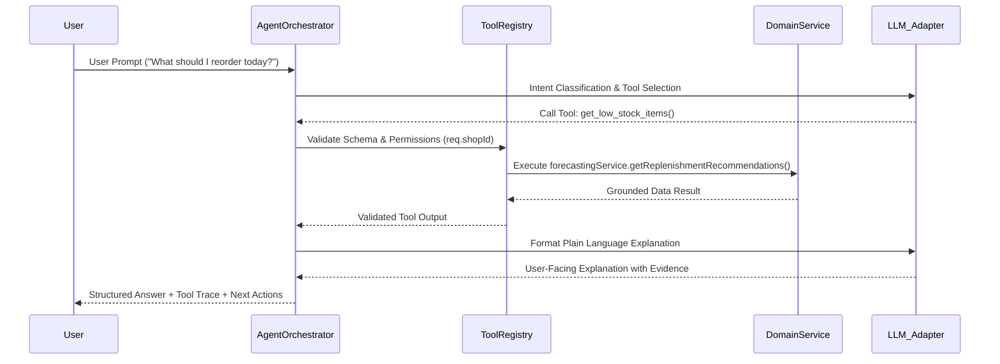

# KiranaSaathi AI — Agent Policy & Guardrails Specification

**Standard:** Tech4Bharat 2026  
**Document Version:** 1.0  
**Security Classification:** Strict Internal Control  

---

## 1. Core Operating Principles

1. **Zero Direct Database Authority:** The agent model is strictly forbidden from executing direct database queries (NoSQL/SQL) or system commands.
2. **Domain Service Sandbox:** All agent actions must route exclusively through approved, type-checked backend domain services.
3. **Mandatory Tenant Context:** Every tool call automatically injects and enforces the authenticated user's `shopId` and role from server session context.
4. **Approval Gate for Consequential Actions:** The agent may create draft purchase orders, but **CANNOT** approve or execute purchase orders autonomously. Approvals must be executed by an authenticated shop owner.
5. **No Hallucinated Business Truth:** The agent must ground every response in verified tool execution outputs. If data is absent or ambiguous, it must clarify rather than speculate.
6. **Provider Resiliency:** If external LLM APIs (Gemini/Lyzr) fail, are rate-limited, or offline, the system falls back gracefully to a deterministic local intent processor, ensuring Kirana operations never stall.

---

## 2. Allowlisted Tool Registry

| Tool Name | Type | Minimum Role | Description |
|---|---|---|---|
| `get_inventory_summary` | Read-only | `staff`, `manager`, `owner` | Returns current on-hand stock and low-stock alerts. |
| `get_low_stock_items` | Read-only | `staff`, `manager`, `owner` | Lists all products currently at or below reorder threshold. |
| `get_expiry_risks` | Read-only | `staff`, `manager`, `owner` | Identifies lots expiring within specified horizon days. |
| `calculate_reorder` | Read-only | `manager`, `owner` | Generates deterministic reorder recommendation with velocity & rationale. |
| `compare_suppliers` | Read-only | `manager`, `owner` | Returns recorded supplier prices and lead times for a product. |
| `create_purchase_order_draft` | Mutating (Draft) | `manager`, `owner` | Generates a draft PO. Sets status to `DRAFT`. |
| `get_purchase_order` | Read-only | `manager`, `owner` | Retrieves status and details of an existing purchase order. |

---

## 3. Execution Lifecycle & Safety Guardrails

### Constraints:
- **Maximum Tool Calls per Run:** 5 calls.
- **Execution Timeout:** 10,000 ms.
- **Prompt Injection Defense:** Untrusted user input is passed as isolated data arguments, never directly interpolated into system instructions.
