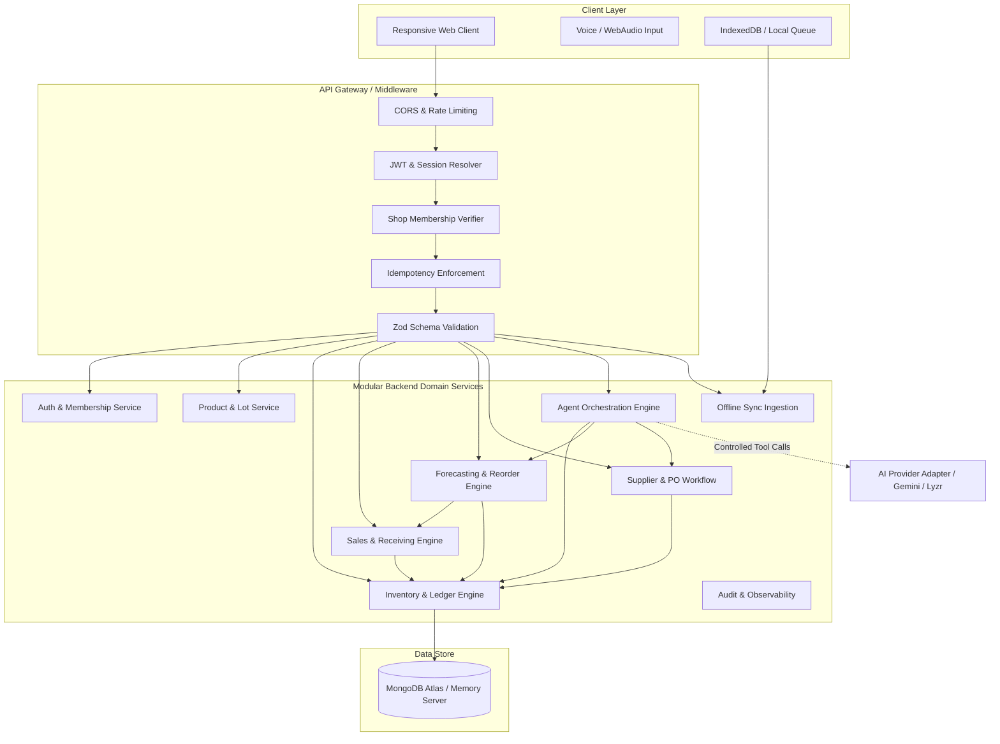

# KiranaSaathi AI — System Architecture & Design

**Document Version:** 1.0  
**Target Environment:** Node.js (TypeScript) + Express + MongoDB + React Frontend  

---

## 1. Architectural Philosophy

KiranaSaathi AI follows a **modular monolith** architecture adhering to clean architectural boundaries:
- **Backend as System of Record:** Business logic, inventory reconciliation, tenancy boundaries, and approval state machines are 100% owned and verified by the backend.
- **Deterministic Core, Probabilistic Edge:** AI provides natural language understanding and orchestrates allowlisted backend tools. The AI model has no direct database access and cannot bypass business invariants.
- **Event-Sourced Ledger for Inventory:** Balances are fast projections (`stockBalances`) calculated from an immutable ledger (`inventoryMovements`).
- **Fail-Safe Offline Contract:** Offline clients push queued events with unique client event IDs; the server guarantees idempotent ingestion.



---

## 2. Module Boundaries & Request Lifecycle

Every API request follows a strict unidirectional pipeline:

```text
HTTP Request 
  -> Rate Limiter & Request ID Generator
  -> Authentication Middleware (Validates Bearer token / Session)
  -> Tenant Isolation Middleware (Resolves req.shopId from User Membership)
  -> Role-Based Authorization Guard (Verifies Role permissions for endpoint)
  -> Idempotency Middleware (Locks / retrieves idempotency key if mutation)
  -> Input Validation (Zod Schema parsing)
  -> Controller (Orchestrates HTTP parameters to Domain inputs)
  -> Domain Service (Executes transactional business logic & invariants)
  -> Repository Layer (Executes MongoDB operations within Transaction)
  -> Response Serializer (Formats output DTO, attaches meta requestId)
  -> Audit Logger (Emits background structured audit log)
```

### Module Responsibilities:
1. `modules/auth`: User registration, login, refresh tokens, password hashing with bcrypt, session revocation.
2. `modules/shops`: Shop creation, settings, currency, timezone, membership invitations, and role management.
3. `modules/products`: Products catalogue, barcode/SKU indexing, category, unit conversions, and lot/expiry tracking.
4. `modules/inventory`: Immutable ledger (`inventoryMovements`), balance projection (`stockBalances`), FEFO lot allocation, reconciliation service.
5. `modules/sales`: POS sales recording, atomic stock deductions, customer returns, and receipt summaries.
6. `modules/receiving`: Supplier goods receiving, batch creation, PO reconciliation.
7. `modules/forecasting`: Sales velocity calculation, safety stock, lead-time demand, explainable reorder recommendations.
8. `modules/suppliers`: Supplier directory, quote recording, lead-time tracking.
9. `modules/purchasing`: Purchase order draft creation, approval workflow, status transitions, receiving updates.
10. `modules/agent`: Sandboxed tool registry, intent parser, human-in-the-loop approval requests, execution logs.
11. `modules/sync`: Offline event ingestion with conflict detection and idempotency.
12. `modules/audit`: Central audit trails and operational logging.

---

## 3. Concurrency, Atomicity & Consistency Strategy

1. **MongoDB Transactions:**
   - Supported when running on a replica set (local replica set or MongoDB Atlas).
   - In environments where multi-document transactions are disabled, the system utilizes atomic document versioning (`$inc`, optimistic concurrency locking with `version`, and compensating undo events).
2. **Idempotency Strategy:**
   - Mutations (`POST /sales`, `POST /inventory/receipts`, `POST /purchase-orders`, `POST /sync/batch`) require an `Idempotency-Key`.
   - Keys are cached in `idempotencyRecords` with `{ shopId, key, requestHash, status, responseBody, expiresAt }`.
   - Repeated requests return the cached response verbatim; mismatching payloads on the same key trigger `409 Conflict`.
3. **Inventory Balance Integrity:**
   - Current stock is never updated with raw unvalidated overrides.
   - Any modification creates an `inventoryMovement` and increments/decrements `stockBalances.onHandQty`.
   - Periodic or on-demand reconciliation aggregates all movements and verifies exact match with projected balances.
