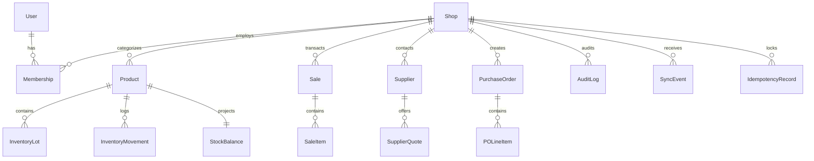

# KiranaSaathi AI — Database Data Model Specification

**Target Database:** MongoDB 6.0+ / 7.0+ (Mongoose ODM)  
**Schema Rules:** Strongly typed, validated, shop-scoped multi-tenancy.  

---

## 1. Entity Relationship Diagram (ERD)



---

## 2. Collections & Schema Details

### 2.1 `users`
Represents authentication identity.
```typescript
{
  _id: ObjectId,
  email: { type: String, unique: true, sparse: true, lowercase: true, trim: true },
  phone: { type: String, unique: true, sparse: true, trim: true },
  name: { type: String, required: true, trim: true },
  passwordHash: { type: String, required: true },
  status: { type: String, enum: ['active', 'suspended'], default: 'active' },
  createdAt: Date,
  updatedAt: Date
}
```

### 2.2 `shops`
Represents individual kirana retail store.
```typescript
{
  _id: ObjectId,
  name: { type: String, required: true, trim: true },
  ownerId: { type: ObjectId, ref: 'User', required: true },
  address: { type: String },
  timezone: { type: String, default: 'Asia/Kolkata' },
  defaultCurrency: { type: String, default: 'INR' },
  settings: {
    defaultLeadTimeDays: { type: Number, default: 3 },
    defaultSafetyCoverDays: { type: Number, default: 7 },
    lowStockThresholdDefault: { type: Number, default: 10 }
  },
  createdAt: Date,
  updatedAt: Date
}
```

### 2.3 `memberships`
Maps users to shops with distinct RBAC roles.
```typescript
{
  _id: ObjectId,
  shopId: { type: ObjectId, ref: 'Shop', required: true, index: true },
  userId: { type: ObjectId, ref: 'User', required: true, index: true },
  role: { type: String, enum: ['owner', 'manager', 'staff'], required: true },
  status: { type: String, enum: ['active', 'invited', 'deactivated'], default: 'active' },
  createdAt: Date,
  updatedAt: Date
}
// Unique compound index: { shopId: 1, userId: 1 }
```

### 2.4 `products`
The master catalogue for each shop.
```typescript
{
  _id: ObjectId,
  shopId: { type: ObjectId, ref: 'Shop', required: true, index: true },
  name: { type: String, required: true, trim: true },
  brand: { type: String, trim: true },
  sku: { type: String, trim: true },
  barcode: { type: String, trim: true },
  category: { type: String, required: true, trim: true },
  unit: { type: String, enum: ['PCS', 'KG', 'G', 'L', 'ML', 'PACK', 'BOX'], default: 'PCS' },
  costPrice: { type: Number, required: true, min: 0 }, // in rupees / decimal
  sellingPrice: { type: Number, required: true, min: 0 },
  reorderPoint: { type: Number, default: 10 },
  targetCoverDays: { type: Number, default: 7 },
  expiryTracked: { type: Boolean, default: false },
  status: { type: String, enum: ['active', 'archived'], default: 'active' },
  createdAt: Date,
  updatedAt: Date
}
// Compound unique index: { shopId: 1, sku: 1 } (partial where sku exists)
// Compound unique index: { shopId: 1, barcode: 1 } (partial where barcode exists)
```

### 2.5 `inventoryLots`
Tracks individual batches for expiry-tracked products.
```typescript
{
  _id: ObjectId,
  shopId: { type: ObjectId, ref: 'Shop', required: true, index: true },
  productId: { type: ObjectId, ref: 'Product', required: true, index: true },
  batchCode: { type: String, required: true, trim: true },
  initialQty: { type: Number, required: true, min: 0 },
  remainingQty: { type: Number, required: true, min: 0 },
  unitCost: { type: Number, required: true },
  receivedAt: { type: Date, default: Date.now },
  expiryDate: { type: Date, required: true, index: true },
  createdAt: Date,
  updatedAt: Date
}
```

### 2.6 `inventoryMovements` (Immutable Ledger)
Append-only historical record of all physical quantity shifts.
```typescript
{
  _id: ObjectId,
  shopId: { type: ObjectId, ref: 'Shop', required: true, index: true },
  productId: { type: ObjectId, ref: 'Product', required: true, index: true },
  lotId: { type: ObjectId, ref: 'InventoryLot', default: null },
  movementType: { 
    type: String, 
    enum: [
      'opening_balance',
      'sale',
      'purchase_receipt',
      'customer_return',
      'supplier_return',
      'wastage',
      'manual_adjustment'
    ], 
    required: true 
  },
  quantityDelta: { type: Number, required: true }, // Negative for deduction, Positive for addition
  unitCost: { type: Number, default: 0 },
  referenceType: { type: String, enum: ['sale', 'purchase_order', 'manual', 'sync'], default: 'manual' },
  referenceId: { type: String, default: null },
  actorId: { type: ObjectId, ref: 'User', required: true },
  reason: { type: String, trim: true },
  idempotencyKey: { type: String, index: true },
  createdAt: { type: Date, default: Date.now, immutable: true }
}
// Compound index: { shopId: 1, productId: 1, createdAt: -1 }
```

### 2.7 `stockBalances` (Rebuildable Projection)
Fast cache of on-hand inventory balances.
```typescript
{
  _id: ObjectId,
  shopId: { type: ObjectId, ref: 'Shop', required: true },
  productId: { type: ObjectId, ref: 'Product', required: true },
  onHandQty: { type: Number, required: true, default: 0, min: 0 },
  reservedQty: { type: Number, required: true, default: 0, min: 0 },
  version: { type: Number, default: 0 }, // For optimistic concurrency
  updatedAt: { type: Date, default: Date.now }
}
// Unique compound index: { shopId: 1, productId: 1 }
```

### 2.8 `sales`
Master sale ticket records.
```typescript
{
  _id: ObjectId,
  shopId: { type: ObjectId, ref: 'Shop', required: true, index: true },
  invoiceNumber: { type: String, required: true },
  items: [{
    productId: { type: ObjectId, ref: 'Product', required: true },
    lotId: { type: ObjectId, ref: 'InventoryLot' },
    quantity: { type: Number, required: true, min: 0.001 },
    unitPrice: { type: Number, required: true, min: 0 },
    subtotal: { type: Number, required: true, min: 0 }
  }],
  totalAmount: { type: Number, required: true, min: 0 },
  paymentMethod: { type: String, enum: ['CASH', 'UPI', 'CREDIT'], default: 'CASH' },
  actorId: { type: ObjectId, ref: 'User', required: true },
  source: { type: String, enum: ['POS', 'VOICE', 'SYNC'], default: 'POS' },
  idempotencyKey: { type: String, index: true },
  createdAt: { type: Date, default: Date.now }
}
```

### 2.9 `suppliers` & `supplierQuotes`
Supplier directory and historical quotation cards.
```typescript
// suppliers
{
  _id: ObjectId,
  shopId: { type: ObjectId, ref: 'Shop', required: true, index: true },
  name: { type: String, required: true, trim: true },
  phone: { type: String, trim: true },
  email: { type: String, trim: true },
  leadTimeDays: { type: Number, default: 3 },
  status: { type: String, enum: ['active', 'inactive'], default: 'active' },
  createdAt: Date
}

// supplierQuotes
{
  _id: ObjectId,
  shopId: { type: ObjectId, ref: 'Shop', required: true, index: true },
  supplierId: { type: ObjectId, ref: 'Supplier', required: true, index: true },
  productId: { type: ObjectId, ref: 'Product', required: true, index: true },
  price: { type: Number, required: true, min: 0 },
  minOrderQty: { type: Number, default: 1 },
  observedAt: { type: Date, default: Date.now }
}
```

### 2.10 `purchaseOrders`
```typescript
{
  _id: ObjectId,
  shopId: { type: ObjectId, ref: 'Shop', required: true, index: true },
  orderNumber: { type: String, required: true },
  supplierId: { type: ObjectId, ref: 'Supplier', required: true },
  status: { 
    type: String, 
    enum: [
      'DRAFT', 
      'PENDING_APPROVAL', 
      'APPROVED', 
      'PLACED_MANUALLY', 
      'PARTIALLY_RECEIVED', 
      'RECEIVED', 
      'REJECTED', 
      'CANCELLED'
    ], 
    default: 'DRAFT' 
  },
  items: [{
    productId: { type: ObjectId, ref: 'Product', required: true },
    requestedQty: { type: Number, required: true, min: 1 },
    unitPrice: { type: Number, required: true, min: 0 },
    receivedQty: { type: Number, default: 0 }
  }],
  totalCost: { type: Number, required: true },
  createdBy: { type: ObjectId, ref: 'User', required: true },
  approvedBy: { type: ObjectId, ref: 'User' },
  approvedAt: Date,
  rejectionReason: String,
  version: { type: Number, default: 1 },
  createdAt: { type: Date, default: Date.now },
  updatedAt: Date
}
```

### 2.11 `idempotencyRecords` & `auditLogs`
```typescript
// idempotencyRecords
{
  _id: ObjectId,
  shopId: { type: ObjectId, ref: 'Shop', required: true },
  key: { type: String, required: true },
  requestHash: { type: String, required: true },
  status: { type: String, enum: ['processing', 'completed', 'failed'], default: 'processing' },
  statusCode: Number,
  responseBody: Object,
  expiresAt: { type: Date, required: true, index: { expires: 0 } }
}
// Unique compound index: { shopId: 1, key: 1 }

// auditLogs
{
  _id: ObjectId,
  shopId: { type: ObjectId, ref: 'Shop', required: true, index: true },
  actorId: { type: ObjectId, ref: 'User', required: true },
  action: { type: String, required: true },
  entityType: { type: String, required: true },
  entityId: { type: String, required: true },
  details: Object,
  requestId: String,
  createdAt: { type: Date, default: Date.now, immutable: true }
}
```
