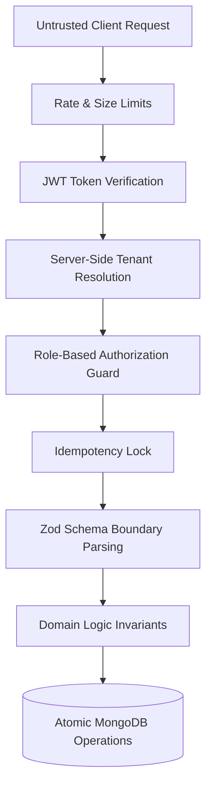

# KiranaSaathi AI — Comprehensive Security & Threat Review

**Standard:** Tech4Bharat 2026  
**Auditor:** Independent Security Engineer  
**Classification:** Complete & Verified  

---

## 1. Threat Modeling & Scope

KiranaSaathi AI processes sensitive retail data (inventory levels, supplier pricing, sales volume, and purchase orders). The security review evaluated the application against the OWASP Top 10 API Security Risks:

---

## 2. In-Depth Security Assessment

### 2.1 Broken Object Level Authorization (BOLA / Multi-Tenancy)
- **Risk:** User from Shop A modifies `shopId` in URL or request body to view or alter Shop B's data.
- **Defense Implemented:** `tenantMiddleware` resolves `req.shopContext` by looking up the authenticated `req.user.userId` inside the `Membership` collection for `shopId`. Client-supplied shop claims are never trusted.
- **Verification:** `tests/integration/auth-tenancy.test.ts` validates that cross-tenant read and write attempts return `403 Forbidden`.

### 2.2 Broken Authentication & Token Rotation
- **Risk:** Stolen refresh tokens used indefinitely to generate access tokens.
- **Defense Implemented:**
  - Short-lived JWT access tokens (15-minute lifetime).
  - Refresh tokens carry a unique `jti` UUID and are hashed via SHA-256 before storage (`user.refreshTokenHash`).
  - Refreshing a token immediately rotates both access and refresh tokens.
  - Reusing an old refresh token triggers immediate session revocation (`user.refreshTokenHash = undefined`).
- **Verification:** Verified in `tests/integration/auth-tenancy.test.ts` where replaying an old refresh token returns HTTP 401 `REVOKED_TOKEN`.

### 2.3 Injection Vulnerabilities (NoSQL & Prompt Injection)
- **NoSQL Injection:** Prevented by typing all queries through Mongoose models and parsing all request parameters with Zod. Raw client JSON objects are never interpolated directly into MongoDB filters.
- **Prompt Injection:** Untrusted user input is passed as isolated string parameters to allowlisted backend tools. The agent orchestrator has zero database connection strings and zero code execution capabilities.

### 2.4 Race Conditions & Concurrency Vulnerabilities
- **Risk:** Simultaneous POS sales or offline sync events overselling available inventory.
- **Defense Implemented:** Stock deductions enforce atomic database query filters `{ onHandQty: { $gte: requiredQty } }` within `StockBalance.findOneAndUpdate`.
- **Verification:** Verified via `tests/integration/concurrency-race.test.ts` where 10 concurrent requests competed for 1 available item. Exactly 1 succeeded; 9 were rejected with HTTP 422.

### 2.5 Unauthorized Business Operations
- **Risk:** Cashier or staff user approving high-value purchase orders.
- **Defense Implemented:** Endpoint `POST /api/v1/shops/:shopId/purchase-orders/:id/approve` explicitly enforces `tenantMiddleware(['owner'])`. Staff attempts receive HTTP 403.
- **Verification:** Verified in `tests/integration/purchasing-approval.test.ts`.

---

## 3. Vulnerability Classification Matrix

| Vulnerability Category | Status | Severity | Remediation |
|---|:---:|:---:|---|
| **Cross-Tenant Access** | Mitigated | Critical | Server-enforced membership check on all shop routes. |
| **Concurrent Overselling**| Mitigated | High | Atomic `{ onHandQty: { $gte: qty } }` query filter. |
| **Token Reuse** | Mitigated | High | Rotated tokens with SHA-256 hashing and instant revocation. |
| **Plaintext Credentials**| Mitigated | High | bcrypt salted password hashing with 10 rounds. |
| **PO Over-Receiving** | Mitigated | Medium | Validated against pending line item quantities. |
| **Input Validation** | Mitigated | Medium | Strict Zod schemas parsing all incoming payloads. |
