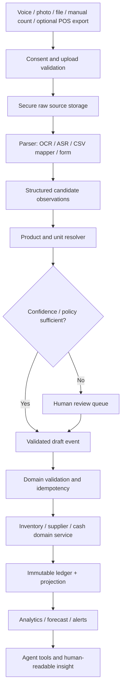
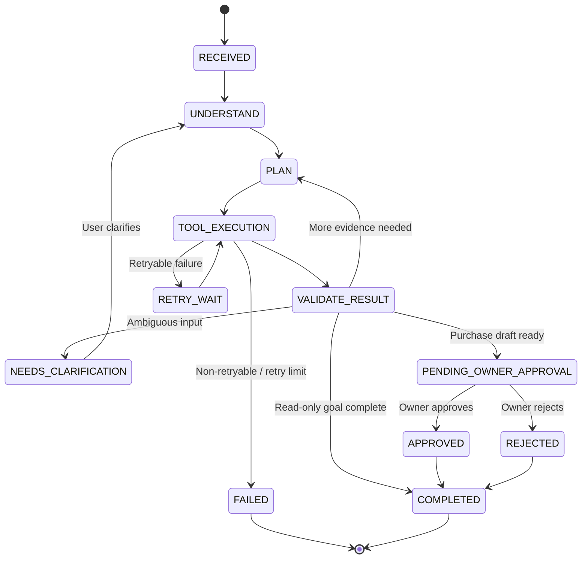
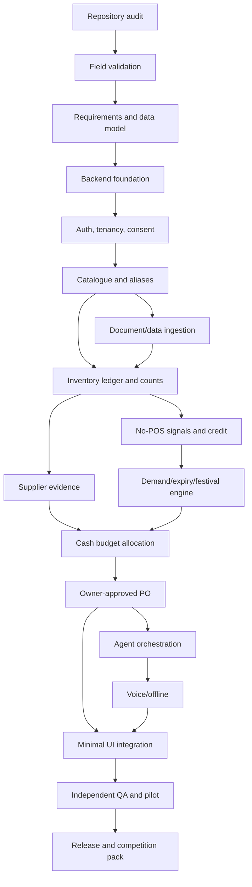

# WORKFLOWS.md

# KiranaSaathi AI — Problem-Statement-Aligned Product & Engineering Execution Blueprint

| Document control | Value |
|---|---|
| Product working name | KiranaSaathi AI (rename only after checking repo/product naming and team decision) |
| Competition | Tech4Bharat — GAVS Hackathon 2026 |
| Exact challenge | Theme 5: Retail, FMCG & Logistics — Problem Statement 5.1: “Kiranas tie up cash in dead stock while running out of what sells” |
| Technical track | Agentic AI |
| Workflow version | 2.0 — Problem-statement-aligned revision |
| Prepared | 15 November 2026 |
| Supersedes | Previous `WORKFLOWS.md` Version 1.0 as execution authority; retain V1 for audit/history, not as a parallel instruction set |
| Status | Detailed proposed execution specification; repository and implementation status MUST be established by Phase 0 |
| Engineering priority | Field truth → backend correctness → reliable data capture → cash-safe decision engine → constrained agent → QA → simple accessible interface |

> **Source-of-truth rule:** This document is a project specification, not evidence that the features, integrations, datasets, model, pilot or deployment already exist. Inspect the actual repository before changing code. Mark every feature as verified, partial, defective, missing or unverified. Never convert a proposed capability into a completion claim.

> **Competition boundary:** Use the supplied `problemHackculture.pdf` as the exact Problem Statement 5.1 reference. The current official Tech4Bharat website supplies general Agentic AI, accessibility, judging and competition conditions. Recheck the live official terms before submission because dates, eligibility, IP and other rules can change.

---

# 0. How This Version Revises the Previous Workflow

The previous workflow had a sound engineering foundation: modular monolith, Node/TypeScript API, MongoDB, authentication, tenant isolation, immutable inventory movements, idempotency, explainable baseline forecasting, suppliers, purchase-order drafts, constrained AI tools, offline sync, test strategy and release documentation. Preserve those principles unless the actual repository provides a stronger verified implementation.

The previous version was not sufficiently specific to the exact challenge. This version adds the missing product and backend requirements below.

| Problem-statement requirement | V1 coverage | V2 required implementation |
|---|---|---|
| Most shops have no billing system | Partial | A **no-POS operating mode**; no mandatory checkout/billing workflow; stock snapshots, manual/voice observations, invoices and available records are first-class inputs |
| No clean data | Partial | Source ingestion, provenance, confidence, review queues, reconciliation and explicit unknown states |
| Thousands of products use local names | Missing | Multilingual aliases, transliteration, phonetic/token matching, brand/pack/unit disambiguation and human-confirmed SKU resolution |
| Useful within one week | Missing | Day 0–7 activation plan with useful outputs from the first validated stock/invoice inputs; no false promise of statistically reliable forecasts in seven days |
| Dead stock ties up working capital | Partial | Ageing, movement-based stagnation, landed-cost valuation, capital-at-risk and verified write-off tracking |
| ₹5,000–₹10,000 monthly expiry problem | Partial | Lot/batch capture, missing-expiry status, expiry exposure and measured write-off; the problem statement range is not a user-specific result |
| Festival demand is guessed | Partial | Regional calendar, event-category mapping, scenario planning, explicit evidence and uncertainty; no invented festival uplift |
| Cash budget set by owner | Missing | Hard purchase-cycle cash cap and a deterministic multi-SKU allocation engine which never recommends an order above the approved cap |
| Owner approves every order | Partial | Owner-only final approval invariant at API/service/database-command boundary; any edited order requires new approval |
| Customer credit affects purchase ability | Missing | Khata/receivable/collection records and liquidity context; uncollected credit is never counted as cash |
| Distributor salesmen, wholesale markets and FMCG brands | Partial | Supplier visit/quote history, wholesale price observations, lead time, MOQ, source and freshness |
| Neighbouring shops | Missing | Optional, consent-based pooled-buy pilot as a stretch feature; each shop owner approves their own obligation |
| “Following the money” | Missing | Future, opt-in, privacy-preserving aggregate demand intelligence for distributors/wholesalers/brands; never sell identifiable shop data |
| Field-research questions | Partial | Structured interview guide, baseline measurement, pilot design and evidence log |
| General Agentic AI requirement | Partial | Explicit plan–tool–memory–retry–approval state machine, external-action boundaries and evaluation traces |
| Low literacy, voice-first, low-end Android, intermittent connectivity | Partial | Measured voice interaction, minimal interface, low-bandwidth mode and safe offline queue with explicit pending states |

**Do not delete V1 strengths.** Extend its architecture and tests. Avoid implementing a full ERP/POS simply because the old workflow had sales endpoints: recording a few sales/depletion observations is not the same as forcing the retailer to replace their current billing process.

---

# 1. Executive Summary

## 1.1 The actual product to build

KiranaSaathi AI is a **cash-aware, low-data retail replenishment agent** for owner-run kirana stores. It helps an owner decide, with evidence, what to restock, how much to buy, which supplier/wholesale option is suitable, what can wait, and how the entire proposed purchase stays within the owner's cash budget.

The application must work when there is no POS, no clean item master and no usable historical sales file. It should build a progressively better shop record from available signals:

- Owner-confirmed opening and periodic stock counts.
- Supplier/distributor invoices and delivery notes (photo or file, then human-verified extraction).
- Distributor/salesman visits, handwritten order notes and manually recorded quotations.
- Short voice/text observations such as “kal 8 packet nikle”, “sugar khatam ho gayi”, or “customer ko 2 kg udhaar diya”.
- Optional sales/POS exports if the shop already has them.
- Optional khata/credit notes and confirmed collections.
- Optional UPI/payment summaries as cash-flow evidence only, never as proof of which SKUs sold.
- Owner estimates and existing notebooks, clearly labelled as estimates/manual evidence.

It must convert these noisy observations into a reliable stock ledger and decision record, not assume every input is accurate.

## 1.2 Main product promise

> “A shopkeeper can begin with the records and stock they already have, get a useful first stock-risk and purchase-planning view within the first week, and approve every purchase while staying inside the cash limit they set.”

This is a product goal to validate, not a proven performance claim. If a shop has too little evidence for a trustworthy forecast, the application must say so and offer a conservative rule-based/manual plan rather than fabricate a prediction.

## 1.3 Main differentiator to test

Inventory, expiry alerts, invoice OCR, voice commands and forecasts already appear in existing products. The product must not claim those basics as unique.

Build around this challenge-specific combination:

1. **No-POS onboarding:** usable without switching the shop to a full billing system.
2. **Messy-data reconciliation:** combine shelf counts, supplier bills, local names, voice observations and available khata records while preserving source and confidence.
3. **Local product identity:** resolve aliases and pack/unit variants safely, learning shop-specific names only after confirmation.
4. **Cash-constrained multi-item replenishment:** prioritise across SKUs under a hard owner-set budget and explain what is deferred and why.
5. **Credit-aware liquidity context:** show how outstanding khata and supplier obligations affect affordability without counting uncollected credit as cash.
6. **Strict owner approval:** every order requires a current owner approval; no agent can bypass it.
7. **One-week evidence:** give initial stock/expiry/reorder visibility quickly, then improve recommendations as observations accumulate.
8. **Measured store outcomes:** calculate actual capital at risk, recorded expiry write-offs, stockout incidents and budget compliance from verified pilot data.

The market review identifies direct overlaps, especially Outlet AI and Bharat AI. Differentiation is a hypothesis to prove in the field, not an unsupported “first/only” claim.

## 1.4 Engineering priority

| Priority | Area | Required result |
|---|---|---|
| P0 | Exact problem coverage | Every requirement in Section 2 mapped to features, tests and evidence |
| P0 | No-POS data capture | Useful onboarding without mandatory billing transactions |
| P0 | Catalogue/alias resolution | No silent wrong-SKU updates |
| P0 | Inventory ledger | Atomic, idempotent, auditable quantity changes |
| P0 | Cash budget + owner approval | Hard cap, no overspend, owner-only approval |
| P0 | Data quality and provenance | Every signal carries source, timestamp, confidence and review state |
| P0 | Reorder engine | Explainable recommendations with uncertainty and constraints |
| P0 | Security/tenant isolation | No cross-shop leakage or unapproved action |
| P0 | Agent governance | Multi-step tool execution, retries, memory, approval gates; no raw DB access |
| P0 | One-week pilot | Demonstrable first-week value without fictitious metrics |
| P1 | Voice/vernacular | Tested language and local product phrase handling |
| P1 | Offline support | Safe queue, idempotent sync and conflict review |
| P1 | Supplier comparison | Verified prices, MOQ, delivery, lead time and quote recency |
| P2 | Joint buying / market intelligence | Only after core single-shop workflow is proven and consent/legal review is completed |
| P2 | UI polish | Minimal, high-usability interface; no decorative-first development |

---

# 2. Exact Problem Statement and Requirement Traceability

## 2.1 Primary source: Problem Statement 5.1

The supplied one-page PDF describes:

- Kiranas tie up **15–20% of working capital** in dead stock while running out of fast movers.
- **₹5,000–₹10,000** of stock expires every month (as stated by the challenge brief).
- Festival demand is guessed.
- Most shops have no billing system to learn from.
- The target shop is owner-run, often with one or two helpers, extends credit to regular customers and buys from multiple distributors and wholesale markets.
- Current stock control relies on memory and looking at the shelf; ordering happens when salesmen visit; expiry is often discovered after the stock is already on the shelf.
- Empty shelves lose sales and customers to quick commerce.
- Distributors/salesmen, wholesale markets, FMCG brands and neighbouring shops are part of the ecosystem.
- Difficulties: no clean data, thousands of items known by local names, and the solution must prove useful within a week.
- Boundary: purchase must stay within a cash budget set by the owner, and the owner approves every order.

These are challenge-brief claims and framing. **They are not measurements for any pilot store.** Never show 15–20% or ₹5,000–₹10,000 as KiranaSaathi's achieved impact unless independently measured for that store and period.

## 2.2 Requirement-to-implementation matrix

| ID | Source requirement | Product capability | Backend capability | Acceptance evidence |
|---|---|---|---|---|
| PS-01 | Reduce dead stock / blocked capital | Slow-moving and ageing stock view | Stock-age and movement analytics with cost basis | Reconcile ageing stock value to lot/balance records |
| PS-02 | Reduce expiry | Batch/expiry capture and action alerts | Inventory lot model, FEFO, expiry scheduler | Lot-level expiry cases and recorded write-off |
| PS-03 | Avoid fast-mover stockouts | Stockout risk and reorder plan | Demand signals, lead time, stock projection | Correct recommendation on known fixtures |
| PS-04 | Festival demand is guessed | Festival scenario planner | Region/event/category calendar + historical evidence | Scenario shows evidence and uncertainty; no invented uplift |
| PS-05 | No billing system | No-POS mode | Stock snapshots, manual observations, invoice ingestion | Complete core journey without creating a sale invoice |
| PS-06 | Owner-run with helper(s) | Owner/manager/helper experience | RBAC, action ownership and audit | Helpers cannot approve an order |
| PS-07 | Multiple distributors and wholesale market | Supplier directory and quote comparison | Supplier-product offer, quote, MOQ and lead-time records | Compare only recorded, fresh quotes |
| PS-08 | Customer credit | Khata/credit overview and collections | Receivable ledger, collection events and cash context | Uncollected amount never increases available cash |
| PS-09 | No clean data | Capture/import/review/reconcile | Provenance, extraction confidence and exception queues | Unverified import cannot mutate canonical stock |
| PS-10 | Local product names | Speak/search in shop terms | Alias dictionary, SKU resolution, confirmation threshold | Ambiguous name asks user; no wrong stock mutation |
| PS-11 | Useful within one week | Guided seven-day activation | Setup progress, first-week alerts and data sufficiency status | Day-1/3/7 outputs with measured usability feedback |
| PS-12 | Cash budget set by owner | Budget slider/amount and buy-plan trade-offs | Hard cap, reservation ledger and budget validator | No approved order exceeds current cycle cap |
| PS-13 | Owner approves every order | Owner approval inbox | Owner-only state transition; immutable approval record | Non-owner approval returns 403; edited order loses approval |
| PS-14 | Stakeholders/distributors | Salesman visit, quote and delivery capture | Source-tagged supplier interactions | Quote comparison traceable to observer/time |
| PS-15 | Neighbour shops | Optional joint purchase proposal | Multi-shop pooled request, separate approvals | One shop cannot commit another shop's cash |
| PS-16 | Who values 1,000 shops' demand? | Future demand intelligence offering | Consent-based, aggregate-only data mart | No individual shop data released; opt-in and aggregation controls |
| PS-17 | Agentic AI track | Agent pursues replenishment task across steps | Planner, approved tools, durable run state, retries, approval gate | E2E agent trace with actual tool results and owner confirmation |
| PS-18 | Accessibility conditions | Voice-first vernacular and minimal screens | Language-aware intent, offline event envelope, low-bandwidth APIs | Real speaker test on target Android device and weak network |

## 2.3 General official competition requirements

The official challenge site states that Agentic AI solutions should pursue a goal through multiple steps, plan and act using tools/external systems, maintain case memory, recover from failures and seek human approval before actions involving money, legal commitment or personal data. Sandboxed/simulated integrations may be used only when explicitly disclosed. General conditions include voice-first/vernacular use, limited literacy, entry-level Android devices, intermittent connectivity, consent and data minimisation.

Translate these into engineering rules:

- The LLM may plan and select allowlisted tools, but backend services own all business decisions and writes.
- The agent run must persist status, plan summary, tool calls, retries, approvals and final outcome.
- The agent must recover safely from transient provider/network failures without duplicate writes.
- Purchase draft generation is not purchase approval.
- Only the authenticated shop owner may approve a purchase order.
- The agent cannot approve its own action, infer approval, or treat a vague “yes” without verified owner context as permission.
- Every integration that is mocked must have a visible “SIMULATED/DEMO” label in UI, logs and pitch.
- Consent must be captured for invoices, voice, khata and any external sharing.

---

# 3. Market and Existing-Solution Assessment

## 3.1 Research conclusion

Solutions with meaningful overlap already exist. Building “inventory + AI chatbot + voice + expiry + reorder” is not a defensible differentiator by itself.

The sources reviewed during this workflow include official product pages/listings for the following:

| Product | Publicly advertised capabilities relevant to PS 5.1 | Evidence status / implication |
|---|---|---|
| Vyapar | Inventory, stock updates linked to sales/purchases, low-stock alerts, barcode, batch/expiry, offline mode, reporting | Mature adjacent inventory/billing baseline. Do not claim stock alerts/offline inventory as new |
| myBillBook | Stock, alternate units, barcodes, batches, expiry, low-stock visibility and stock reports | Existing small-business inventory functionality |
| Outlet AI | Kirana billing/POS, AI shelf/counter scanning, invoice extraction, voice orders, low-stock/expiry/dead-stock alerts, next-week forecasts, udhaar, supplier and PO features, seven Indian languages (as listed) | Very close direct overlap. Google Play listing researched showed 5K+ downloads and 4.3 stars from 6 reviews; these are listing metrics, not verified active users or performance |
| Bharat AI | Website describes a WhatsApp/voice Virtual COO, supplier invoice photo onboarding, stock intelligence, reorder, expiry, festival planning and margin analysis; website says private pilot | Very close concept competitor. Treat all feature/performance statements as vendor claims, not independently audited results |
| Samaan-Bol | Voice billing/stock, local languages, supplier purchases, batch/expiry, udhaar and offline outbox/AI restock features in app listings | Direct feature overlap; published app listing capabilities require actual product test to verify |
| Open-source prototypes (Dukaan Mitra AI, KiranaIQ, Kirana Assistant, Inventa) | Voice inventory, local SKU matching, demand forecasting, festival estimates, reorder drafts | Shows the idea is already explored by builders; GitHub/Devpost claims do not prove commercial quality or adoption |

### Feature-level comparison (based only on reviewed public sources)

| Capability advertised in reviewed sources | Vyapar | myBillBook | Outlet AI | Bharat AI | Samaan-Bol |
|---|---|---|---|---|---|
| Inventory tracking / stock updates | Yes | Yes | Yes | Yes (claimed) | Yes |
| Batch/expiry or expiry alerts | Yes | Yes | Yes | Yes (claimed) | Yes |
| Voice / vernacular workflow | Not established in reviewed page | Not established in reviewed page | Yes (listed) | Yes (claimed) | Yes (listed) |
| Invoice/photo inputs | Not established in reviewed page | Not established in reviewed page | Supplier invoice/shelf photos listed | Supplier invoice photo onboarding described | Supplier purchase invoice records listed |
| AI forecast / reorder | Low-stock thresholds and restock alerts | Low-stock thresholds | Forecasts/reorder described | Forecast/reorder described | AI restock suggestions listed |
| Customer credit / khata | Not established in reviewed page | Not established in reviewed page | Digital udhaar listed | Not established in reviewed page | Udhaar listed |
| Supplier / purchase workflows | Inventory purchase flows | Purchase/inventory flows | Supplier directory and POs | Supplier/reorder workflow described | Supplier purchase records |
| Offline / weak-network support | Offline mode advertised | Not established in reviewed page | Not established in reviewed page | Low-bandwidth/voice-first claims | Offline outbox described |
| Hard owner-set cash cap allocated across a multi-SKU basket | Not established in reviewed source | Not established in reviewed source | Not established in reviewed source | Not established in reviewed source | Not established in reviewed source |
| Owner-only approval enforced for every order | Not established in reviewed source | Not established in reviewed source | Not established in reviewed source | One-tap confirmation described; exact owner-only enforcement not established | Owner role listed; per-order approval rule not established |
| No mandatory POS required for first useful output | Not established in reviewed source | Not established in reviewed source | Not established in reviewed source | Website describes a non-POS Virtual COO and invoice/stock-list onboarding | Not established in reviewed source |

“Not established” means the reviewed source did not prove the capability; it does not prove that the product lacks it. Product-page and app-store statements are vendor/developer claims unless independently tested. The strongest evidence-based opportunity for KiranaSaathi is therefore to make cash-budget allocation, credit-aware liquidity, no-POS activation, local-name reconciliation and mandatory owner approval first-class, measurable backend behaviours—not merely marketing bullet points. Even these should not be called unique until direct competitor testing is completed.

## 3.2 Competitor research rules

Before submission and again before the finale:

1. Revisit each source URL and record the date accessed.
2. Install/test relevant public apps where feasible; do not infer implementation quality from marketing copy alone.
3. Capture screenshots/short notes for workflows that overlap the prototype.
4. Record pricing and platform support only from current product sources.
5. Distinguish public claims, live tested behaviour, app-store metadata and independent user feedback.
6. Never claim a feature is absent merely because the reviewed page does not mention it.
7. Do not copy proprietary code, UI assets or confidential product behaviour.

## 3.3 Differentiation strategy — what KiranaSaathi should do better

Do not compete on feature count. Make a narrower, stronger promise and prove it:

### A. No-POS, progressive onboarding

- Do not make billing/POS adoption compulsory.
- Start from current stock count, recent supplier bills, known fast movers and the owner's current reorder list.
- Let the shop add only the items that matter most first; progressively expand the catalogue.
- Support CSV/import only when the retailer already has a file.
- Treat paper registers and verbal reports as source material with confidence labels, not as exact transaction data.

### B. Data reconciliation rather than blind AI extraction

- Extract candidate item, pack, quantity, unit, rate, invoice date and supplier from an uploaded bill.
- Match each line to a canonical shop SKU or put it in a review queue.
- Show source image/crop and extracted value beside the proposed record.
- Require confirmation for low-confidence or financially meaningful fields.
- Never create stock from an OCR result that has not been accepted.

### C. Shop-specific local catalogue resolution

- Store aliases such as colloquial/local names, transliterations, shorthand and salesman terminology.
- Preserve brand, variant, pack-size and unit as separate attributes.
- Resolve speech/text to candidate SKUs with deterministic features and optional embeddings.
- Ask before mutation when two products are plausible.
- Learn an alias only after the owner selects the correct product.

### D. Budget-constrained buying plan

- Generate proposed quantities for multiple products, not isolated low-stock alerts only.
- Rank by stockout urgency, demand evidence, shelf-life, margin/cost where known, supplier lead time and owner priorities.
- Allocate the budget as a hard constraint.
- Explain which items were fully funded, reduced or deferred.
- Never exceed owner cap; never use uncollected khata as cash.
- Require owner approval for each order.

### E. One-week proof, not a training-heavy POS rollout

- Provide a useful stock/expiry/buy-list view as soon as the first validated data exists.
- Make the first-week workflow manageable for owner/helper with a phone and no special hardware.
- Be honest about low-confidence forecasts until evidence accumulates.

### F. Measured results

Track actual opening/closing counts, expiries, stockout incidents, supplier lead times, budget adherence and recommendation overrides. Report results with sample size and time window. Do not claim that a forecast caused improvement unless pilot design can support that conclusion.

## 3.4 Differentiation claims that are prohibited until proven

Do not say:

- “India's first AI kirana agent.”
- “No competitor does this.”
- “Predicts demand accurately from day one.”
- “Eliminates dead stock.”
- “Cuts losses by 20%.”
- “Works completely offline” if voice/LLM/OCR still requires network.
- “Automatic supplier ordering” when the system only generates a draft.

Use measurable claims only after a documented pilot.

---

# 4. Field Discovery and User Validation

Official challenge guidance says teams should take the problem statement into the field, meet the people affected, test the stated problem and only then define the product. This is a build gate, not a presentation formality.

## 4.1 Target sample for the first discovery cycle

Aim for 5–8 shop conversations if access allows; at least 3 should include direct observation of the current stock/reorder process. These are practical project targets, not organiser-mandated sample sizes.

Cover variation where possible:

- Owner-run single outlet.
- One/two helpers.
- Stores with paper-only records.
- Stores using a basic billing/POS application.
- Stores with several distributors or wholesale buying.
- Stores that extend customer credit.
- Stores in different local language contexts.

## 4.2 Interview and observation script

Ask without leading the owner toward the proposed solution:

1. How do you decide what to reorder today?
2. Show how you identify current quantity for 5–10 fast-moving items.
3. What expired last month? Can you show the record, package or write-off?
4. Which products run out most often? What happens when they run out?
5. What changes around local festivals, school openings, weather or paydays?
6. What records exist: UPI alerts, khata book, supplier bills, sale notebook, WhatsApp messages, POS, memory?
7. How often does each distributor/salesman visit? Who determines price and delivery?
8. How do you compare two distributors or a wholesale-market purchase?
9. How much money do you normally have available for the next purchase cycle?
10. Does customer udhaar reduce the cash available for purchases? When is it collected?
11. Which supplier payments or credit commitments are due soon?
12. Would you buy jointly with a neighbouring shop? What would make that safe or unacceptable?
13. What language and words do you use for common items and pack sizes?
14. Would you spend 2–5 minutes per day giving stock updates? What input method would be easiest?
15. What would make this useful within the first seven days? What would make you stop using it?

Observe the current process; do not collect customer identities, phone numbers, bank details or full ledgers unless strictly required, consented and protected.

## 4.3 Field evidence record

Create `docs/FIELD_RESEARCH.md` with:

- Interview ID, date and broad store type (avoid publishing precise address).
- Consent status and permitted use of notes/photos.
- Current reorder workflow.
- Product naming examples (remove personal data).
- Available data sources.
- Example lead times/MOQs/quote variation.
- Cash budget process and owner-approval steps.
- Credit/khata impact.
- Expiry discovery process.
- Festival/seasonality observations.
- What a useful first week means to that owner.
- Pain-point frequency and severity.
- Contradictions with the problem statement.
- Product changes decided from the evidence.

Never fabricate interview responses. Seed demo examples must be labelled as synthetic.

## 4.4 Problem-validation exit gate

Do not lock the MVP until the team can state:

- The specific task that causes the largest observed pain.
- What the owner currently uses to complete it.
- Which records can be obtained with consent.
- What minimal daily input is realistic.
- What budget/approval rule the owner uses.
- What result the owner would recognise as useful within seven days.

---

# 5. Product Scope and User Journeys

## 5.1 Primary user roles

| Role | Capabilities | Restricted actions |
|---|---|---|
| Owner | Full shop access, configure budget, manage catalog/users, review all recommendations, approve/reject every order, manage data-sharing consent | Cannot be bypassed by agent or other roles |
| Manager | Record counts/receipts/observations, maintain catalogue and supplier quotes, prepare purchase drafts, view allowed reports | Cannot approve any purchase order unless the actual challenge rule is formally changed; V2 default is owner-only |
| Helper/staff | Record stock observation, receipt/count evidence and permitted operational inputs | Cannot set shop cash cap, approve orders, export sensitive data or manage members |
| Assisted operator (if JanAI Café path is available) | Help with onboarding under explicit owner consent | No standing permission to approve orders or access unrelated shop data |
| Supplier/salesman | External party in MVP; quote/visit data can be recorded by shop member | No implicit login or cross-shop data access |

## 5.2 Core user journeys

### Journey A — First shop activation without POS

Owner chooses language → verifies phone/login → creates shop → sets cash budget → adds a few high-priority products by voice/manual/photo → records approximate on-hand stock → captures supplier invoice(s) if available → confirms item matches → sees stock-risk/expiry/reorder board with confidence labels.

### Journey B — Record an observation

User speaks/types an observation → backend parses fields → catalogue resolver returns candidates → user confirms SKU, quantity, unit and event type → domain service validates → immutable ledger/event record is created idempotently → balances/analytics update → confirmation is read back in the selected language.

### Journey C — Supplier invoice capture

Photo/PDF upload → malware/type/size validation → private object storage → OCR/extraction → line-level candidate mapping → review queue → user confirms supplier/date/price/quantity/product/batch/expiry → receipt draft → authorised user posts receipt → inventory ledger updates exactly once.

### Journey D — Weekly replenishment plan

Collect current stock and pending receipts → estimate demand with evidence tier → calculate need over lead time/review period → compare supplier offers → apply pack/MOQ and shelf-life constraints → allocate under owner budget → show funded/deferred items and reasons → owner reviews the complete basket → owner approves each order → mark ready for manual placement or call a real disclosed supplier adapter only if genuinely integrated.

### Journey E — Festival what-if

Select region/event/date → identify relevant categories/items → load past event evidence if available → owner inputs expected footfall/demand scenario if no history → calculate low/base/high scenarios → apply expiry and cash constraints → show incremental stock recommendation separately from regular replenishment → owner may accept/reject items.

### Journey F — Customer credit and cash position

Record an optional khata amount or credit sale with minimal data → record collections as they actually occur → display outstanding receivables and ageing → do not count outstanding receivable as spendable cash → owner enters/updates purchase-cycle cash cap → budget engine uses only owner-approved available budget.

### Journey G — Optional neighbour pooling

Each participating owner opts in → each shop submits an aggregate item/quantity request → system calculates combined requirement and supplier MOQ → each shop receives its own cost allocation → each owner independently approves its own obligation → pooled order becomes eligible only when all required approvals exist. No store can commit another store's cash.

---

# 6. Seven-Day Activation and Cold-Start Plan

The challenge demands usefulness within one week. The application must not wait for 30 days of billing history before delivering any value, and it must not pretend a seven-day cold start produces high-confidence demand forecasts.

## Day 0 — Consent and shop setup

- Verify owner identity/session using the chosen safe authentication method.
- Select preferred language and local terminology.
- Record broad operating hours, local area/region and typical supplier visit cycles.
- Ask owner to set a purchase-cycle cash cap and define what it includes.
- Explain data use, retention and optional integrations.
- No invoice, khata, UPI or voice recording is uploaded without explicit consent.

**Output:** active shop profile, owner-defined budget policy, language and data consent record.

## Day 1 — Useful starting stock baseline

- Let owner select the products most important to their business; do not require full catalogue digitisation.
- Support voice entry, quick search, barcode where available, simple manual count and supplier-bill photo.
- Capture current quantity, unit and source; use “approximate” state if the owner estimates.
- Start with a practical priority set agreed with the shop (e.g. top fast movers/important expiry-sensitive items); do not hardcode a universal SKU count.

**Output:** first validated stock board, items with low quantity, unknown data and immediate expiry exposure where evidence exists.

## Day 2 — Supplier and purchase evidence

- Import/photograph recent supplier invoices where consented.
- Capture distributor/salesman name, visit day, product availability, quote date, delivery lead time and minimum order where known.
- Match invoice lines to existing products; create new product only after review.

**Output:** supplier directory and verified or review-needed purchase history.

## Day 3 — Product identity and local names

- Add shop-specific aliases for local pronunciation, shorthand and alternate pack names.
- Resolve ambiguous product terms with a short visual/voice confirmation.
- Collect top products and pack conversions.

**Output:** usable local search/voice catalogue; unresolved aliases remain in a queue.

## Day 4 — Stock movement observation

- Record simple daily depletion/sales observations for priority items where owner can provide them.
- Reconcile current shelf counts with receipts, returns, wastage and known sales.
- Log stockout/lost-demand incidents (e.g. customer asked for unavailable product) separately from completed sales.

**Output:** first demand evidence and stock discrepancy report.

## Day 5 — First conservative recommendations

- Generate baseline reorder suggestions from current stock, owner-set minimums, supplier lead times and recorded observations.
- Use LOW_DATA where history is insufficient.
- Avoid data-driven festival uplift without past evidence or an explicitly owner-entered scenario.
- Show the recommendation reason, source freshness and what is unknown.

**Output:** conservative buy-list; no order is created or approved automatically.

## Day 6 — Cash-constrained purchase plan

- Owner confirms the cash budget for the next buying cycle.
- Calculate current budget reservations/committed approved orders.
- Optimise the candidate basket using transparent priority rules.
- Show items deferred because of budget, MOQ, unknown quote, low confidence, expiry or low urgency.

**Output:** a budget-safe purchase proposal with explicit trade-offs.

## Day 7 — Review and usefulness check

- Compare the plan with what the owner actually bought, postponed or rejected.
- Capture reasons for overrides.
- Reconcile actual stock and expiry observations.
- Ask whether this saved time, prevented a stockout, reduced uncertainty or improved buying discipline.
- Produce a one-week report with sample size, data coverage and known gaps.

**Output:** shop-specific baseline and next-week action plan.

### Seven-day acceptance criteria

- Owner can complete basic setup without a billing/POS migration.
- At least one useful stock/expiry/buy-list insight is shown from verified data.
- Every recommendation displays data coverage/confidence.
- Budget is applied as a hard constraint.
- An order cannot reach APPROVED without owner action.
- User can explain why the system recommended (or did not recommend) a purchase.
- No claim of forecasting accuracy is made without an evaluation set.

---

# 7. Data Capture, Ingestion and Provenance Architecture

## 7.1 First-class data source types

Every observation must carry `sourceType`, `sourceReference`, `observedAt`, `capturedAt`, `capturedBy`, `confidence`, `reviewStatus` and `dataQualityFlags`.

| Source | What it can reliably show | What it cannot prove by itself |
|---|---|---|
| Physical stock count | Quantity present at a point in time, if counted correctly | Exact past sales or demand |
| Supplier invoice | Purchased item, quantity, price/date, supplier; batch/expiry if present | Actual current on-hand quantity after sales/returns |
| Delivery note | Goods reportedly delivered | Receipt quantity unless physically confirmed |
| Manual/voice depletion note | Owner/helper observation of sold/used quantity | Complete transaction-level sales record |
| POS/CSV export | Sales history if mapped and validated | Physical stock accuracy if wastage/returns are missing |
| Khata book | Credit/receivable record; item detail only if written | Cash available until collection is confirmed |
| UPI alert/screenshot/import | Payment amount, time, reference/merchant when visible | Product/SKU sales, cash balance or complete daily turnover |
| Distributor quote/message | Offered price/availability/lead time as recorded | Future availability beyond quote validity |
| Festival calendar | Event/date/region | Product-specific uplift without shop/region evidence |
| Shopkeeper estimate | Local knowledge and expected demand | Audited measured demand |

**Critical data rule:** UPI amounts must not be converted into product-level sales or inventory deductions. A payment often covers multiple products, credit repayment or other transactions. Use it only as an optional payment/cash-flow observation after owner review.

## 7.2 Ingestion pipeline



## 7.3 Document handling

For invoices, receipts, stock sheets and khata images:

- Accept a bounded list of MIME types and file sizes.
- Verify actual file signature, not just file extension.
- Scan uploaded files where infrastructure permits.
- Store original objects privately with encrypted access and time-limited signed URLs.
- Keep extracted structured fields separately from original document.
- Extract supplier, invoice date/number, line text, brand/product, pack, quantity, unit, rate, tax/discount where visible, batch, expiry and total.
- Maintain per-field OCR confidence and page/region reference.
- Validate arithmetic totals where possible; report mismatches.
- Map item lines to candidate product aliases; do not auto-create a canonical SKU on uncertain match.
- User confirms accepted values before posting a receipt.
- Keep a trace from each stock movement to the source document and accepted line.
- Define retention/deletion policy; do not retain source photos indefinitely by default.

## 7.4 OCR and extraction safeguards

- OCR output is untrusted input, not a database command.
- Prompt injection inside invoices/notes must be ignored as data.
- LLM may structure a line item but must not invent missing amounts, unit or expiry.
- If quantity/pack/price is unclear, queue for correction.
- Distinguish `missing`, `not_applicable`, `unreadable` and `estimated` values.
- An accepted invoice receipt is a human-approved business event; an OCR parse alone is not.

## 7.5 Manual/voice observation types

Support controlled event types such as:

- `stock_count_observation`
- `manual_sale_observation`
- `stockout_request` (customer asked for unavailable item)
- `supplier_delivery_observation`
- `wastage_observation`
- `expiry_observation`
- `supplier_quote_observation`
- `credit_given_observation`
- `credit_collection_observation`
- `festival_demand_note`

Every observation is typed, timestamped, attributable and reviewable. Do not merge an estimated depletion observation with a verified sale invoice without preserving the original source.

## 7.6 Data-quality and provenance model

Each relevant observation needs:

```json
{
  "sourceType": "manual_voice_observation",
  "sourceId": "source_...",
  "observedAt": "ISO-8601",
  "capturedAt": "ISO-8601",
  "capturedBy": "user_id",
  "confidence": 0.82,
  "reviewStatus": "accepted",
  "qualityFlags": [],
  "isEstimated": false,
  "supersedesObservationId": null
}
```

The values above are illustrative. Define enums and validation centrally.

Never overwrite conflicting values silently. Preserve both observations and resolve with an auditable correction/reconciliation event.

---

# 8. Product Catalogue, Local Names and Unit Resolution

The exact problem says thousands of products are referred to by local names. This is a core domain capability, not just a search UI feature.

## 8.1 Canonical product identity

A product must keep separate attributes for:

- Canonical display name.
- Brand/manufacturer, if known.
- Category.
- Variant/flavour/size.
- Pack size and pack type (single, multipack, carton, sack, bottle, loose).
- Base unit and purchase/sale units.
- Conversion ratios where verified.
- Barcode/GTIN if available.
- Shop SKU (optional).
- Expiry tracking flag.
- Storage/location note if useful.
- Active/discontinued status.

Never treat “1 box”, “1 packet” and “1 kg” as interchangeable without a known conversion.

## 8.2 Shop-specific aliases

Create an alias record with:

- `shopId`, `productId`, `aliasText`, `normalizedAlias`, `language`, `script`, `aliasType`, `source`, `confirmedBy`, `confirmedAt`, `matchCount`, `lastUsedAt`, `status`.
- Alias types: local name, transliteration, pronunciation variant, abbreviation, salesman label, invoice label, old product name.
- Retain the raw utterance/document line for traceability only as permitted by retention/consent policy.

Examples such as `chini`, `cheeni`, `sugar`, or a shop's shorthand must be mapped only after the owner confirms which product and pack variant they mean.

## 8.3 Resolution pipeline

1. Normalize Unicode, punctuation, spaces and common spelling variants.
2. Generate transliteration candidates for supported scripts/languages.
3. Search exact canonical name and exact shop alias.
4. Search token, prefix, phonetic and fuzzy candidates.
5. Filter/rerank using brand, pack size, variant, unit and current shop catalogue.
6. Optionally use embeddings/semantic search as candidate generation, not final write authority.
7. Return ranked candidates plus match reasons.
8. Apply confidence/ambiguity thresholds.
9. If ambiguous, ask the user to select/confirm; do not mutate inventory.
10. Save a new alias only after confirmation.

## 8.4 Match policy

- Exact barcode + pack match: high-confidence candidate, still validate shop's configured item.
- Exact shop alias: high-confidence if alias is active and not conflicting.
- Fuzzy/phonetic or model-assisted match: show confirmation unless measured precision meets the agreed risk threshold for a read-only query; mutation always needs deterministic entity resolution.
- Similar names with different pack sizes/variants: ask a clarifying question.
- New/unmatched item: create `unmapped_line` review task, never auto-merge with a similar SKU.

## 8.5 Evaluation dataset

Build a consented and de-identified test set from real local terms collected during field research. Include:

- Hindi/Hinglish and the selected regional language(s).
- Transliteration and spelling variation.
- Brand + generic term.
- Different pack sizes of same brand.
- Units/quantities such as piece, packet, carton, kg, gram, litre, ml, dozen, loose item.
- Similar sounding brands/products.
- Speech noise and code-switching.

Measure top-1 accuracy, top-3 recall, false-match rate and clarification rate. False mutation rate must be zero in the test suite.

---

# 9. Backend Architecture and Technology Decisions

## 9.1 Repository-first rule

Do not assume that the current repository uses the stack below. Phase 0 inspects the actual project. Preserve a working stack if it can satisfy the requirements. If it cannot, document why, compare migration risk and change only after the architecture decision is recorded.

## 9.2 Recommended baseline

| Layer | Default recommendation | Notes |
|---|---|---|
| Backend | Node.js LTS + TypeScript + Express (if already used) | Modular monolith, strict types |
| Validation | Zod | Request, env, job and tool schemas |
| Database | MongoDB Atlas + Mongoose (if existing project already uses MongoDB) | Transactions require replica-set-capable deployment; test actual topology |
| Auth | Secure session/short-lived access + rotated refresh | Phone OTP provider only if configured; never use fake OTP in production |
| File storage | Private S3-compatible/object storage | Signed URLs and retention policy |
| Background jobs | Persisted job collection first; queue only if needed | Don't rely on process memory for critical jobs |
| Agent | Provider-neutral adapter; use Lyzr if actual access/credits and integration contract are available | No vendor lock-in in domain layer |
| OCR/ASR | Provider adapters with manual fallback | Measure supported target language/device performance |
| Forecasting | Deterministic TypeScript service initially | Add Python service only if a measured technical need justifies it |
| Offline | PWA + IndexedDB local outbox | Server is authoritative on sync |
| API docs | OpenAPI 3.1 | Contracts tested against routes |
| Tests | Vitest/Jest + Supertest | Unit, integration, security and E2E |
| Runtime | Docker + managed app host + managed database | Secrets in environment manager |

## 9.3 Modular monolith structure

Adapt naming to the actual repository, but keep clear boundaries:

```text
src/
  app.ts
  server.ts
  config/
  common/
    errors/
    middleware/
    validation/
    pagination/
    idempotency/
    money/
    units/
    audit/
  modules/
    auth/
    shops/
    memberships/
    catalog/
      products/
      aliases/
      unit-conversions/
      resolver/
    ingestion/
      documents/
      invoice-extraction/
      csv-import/
      review-queue/
    inventory/
      lots/
      movements/
      balances/
      counts/
      reconciliation/
    observations/
      demand-signals/
      stockouts/
      wastage/
    sales/                 # optional event capture; not a mandatory POS
    credit/
      khata/
      collections/
    suppliers/
      visits/
      offers/
      quotes/
    cash-management/
      budgets/
      commitments/
    forecasting/
      demand/
      festivals/
      expiry/
      dead-stock/
    purchasing/
      recommendations/
      allocation/
      purchase-orders/
      approvals/
    agent/
      planner/
      tools/
      policies/
      runs/
      memory/
    voice/
    sync/
    notifications/
    analytics/
    consent/
    audit/
    health/
  adapters/
    ai-provider/
    ocr-provider/
    speech-provider/
    object-storage/
    messaging/
    supplier/
  jobs/
  tests/
```

Do not create empty modules just to match this tree. A module exists when the repo has a real requirement and a testable responsibility.

## 9.4 Request lifecycle

```text
HTTP request
  -> request ID / rate limit
  -> authenticate identity
  -> resolve active shop membership
  -> enforce role + explicit owner-only policies
  -> validate request schema
  -> domain service
  -> repository / transaction
  -> ledger + projection + audit event
  -> response DTO
```

No controller or agent prompt may bypass this lifecycle.

---

# 10. Domain Model and Data Integrity

Finalise schemas from actual repo state during Phase 2. The design below is a required domain coverage model; collection names may be adapted without losing invariants.

## 10.1 Core collections/entities

| Entity | Purpose / critical fields |
|---|---|
| `users` | Auth identity, phone/email, password/identity status, timestamps; no unnecessary profile data |
| `shops` | Name, locale, timezone, preferred language, region, onboarding status, cash policy settings |
| `memberships` | shopId, userId, role, status; unique per shop/user |
| `products` | Canonical identity, brand, variant, pack, base unit, conversion, barcode, expiry flag, cost/price source, status |
| `productAliases` | Shop-specific local names, transliterations, salesman/invoice terms, confirmation and provenance |
| `unitConversions` | Verified conversion from purchase unit to base unit, effective date, who confirmed |
| `suppliers` | Supplier/distributor/wholesale vendor identity and shop-specific contact/visit fields |
| `supplierOffers` | Product availability, quote price, purchase pack, MOQ, quote source/date/validity, lead time |
| `supplierVisits` | Salesman visit date, discussed item list, quote/order note, actor and source |
| `sourceDocuments` | Object storage ref, source type, owner consent, hash, extraction status, retention date |
| `documentExtractions` | OCR raw candidates, field confidence, line items, review state and source coordinates |
| `inventoryLots` | Lot/batch, product, expiry state/date, received quantity, remaining quantity, cost basis |
| `inventoryMovements` | Immutable signed movement, product/lot, reason, source event, actor, idempotency key, timestamp |
| `stockBalances` | Rebuildable projection per shop/product/base unit and optional lot-level aggregation |
| `stockCounts` | Count session, location, product/lot, counted quantity, counter, timestamp, review status |
| `demandObservations` | Manual/voice/POS/imported sales or stockout signal with source/confidence, not necessarily invoice |
| `stockoutIncidents` | Item requested but unavailable, estimated lost demand if owner supplies it, date/time and confidence |
| `sales` | Optional sale records when the shop wants to record them; never mandatory to use the product |
| `khataAccounts` | Optional customer/supplier credit identity using minimal alias/reference |
| `khataEntries` | Debit/credit/settlement events, due/collected state and source; avoid editing historical entries |
| `cashBudgetCycles` | Owner-set cycle budget cap, effective dates, declared available cash context, status and owner audit |
| `purchaseCommitments` | Approved commitments/reservations against a budget cycle |
| `forecastRuns` | Input window, model/rule version, output, confidence, assumptions and source coverage |
| `festivalEvents` | Region, calendar source/version, event dates, categories, owner notes and historical evidence |
| `replenishmentPlans` | Candidate items, calculations, ranking, supplier options and budget-allocation explanation |
| `purchaseOrders` | Draft/approved/rejected/manual-placed/received states, amount, supplier, budget cycle, owner approval reference |
| `approvalRecords` | Immutable owner identity, session/auth context, order version/hash, decision, timestamp and reason |
| `agentRuns` | User goal, state, plan summary, tools, retries, pending approval, final outcome and token/cost metadata if applicable |
| `agentMemory` | Minimal structured shop context and references to source facts; no unconstrained freeform memory as authority |
| `syncEvents` | Device-generated event ID, event type, client time, server time, payload hash, outcome and conflict status |
| `alerts` | Type, severity, evidence, valid-until, review/resolution status |
| `auditLogs` | Actor, action, entity, old/new summary, requestId, reason, source and timestamp |
| `consents` | Purpose, data categories, version, status, user, timestamp, revocation and expiry |

## 10.2 Multi-tenant invariants

- Every shop-owned entity includes `shopId`.
- Derive current shop access from active membership.
- Queries must scope to `shopId` at the repository boundary.
- Verify referenced product/supplier/lot/order belongs to the same shop.
- Add tenant ID to unique indexes and cache keys.
- Agent runs and their tool calls inherit the initiating user's tenant and role.
- No vector/catalog search may return another shop's alias, price, inventory or documents.
- Cross-shop aggregation is a separate consented pipeline with its own release controls.

## 10.3 Inventory ledger invariants

Movement types include opening balance, sale/depletion observation (distinguish verified sale from estimate), purchase receipt, customer return, supplier return, wastage, damaged stock, manual adjustment and optional transfer.

1. Inventory balance is a projection from validated movements/count reconciliation, not a free-edit field.
2. Every movement is immutable after posting; corrections use compensating events.
3. A `stockCount` is an observation; it becomes a posted adjustment only after review and variance policy.
4. Movement carries unit and conversion version.
5. No negative balance by default. Any exception needs owner-authorised policy and a reason; never silently permit a negative stock value.
6. Financial/inventory event and projection must commit atomically where supported.
7. Idempotency key plus payload hash prevents retry duplication.
8. Same key + same payload returns original outcome; same key + different payload returns conflict.
9. Reconciliation can rebuild balance and identify projection drift.
10. Lot-aware products use FEFO (first-expiry-first-out) where expiry dates are known; unknown-expiry lots remain explicit and are not falsely marked safe.
11. Separate physical quantity from sellable/available quantity when quarantine/damage/expiry is represented.
12. Do not apply an unreviewed OCR/voice guess to stock.

## 10.4 Money, quantity and time

- Use integer paise for INR monetary arithmetic or MongoDB Decimal128 with strict serialization; never rely on binary floating-point for financial totals.
- Quantity uses a decimal-safe representation with product-specific precision and base unit.
- Define rounding and tax/cost treatment centrally.
- Every quote/cost has source and `observedAt`; show stale quotes and do not use expired quotes as current facts.
- Store timestamps in UTC and maintain shop timezone for business-day and festival logic.
- Money comparisons include known additional fees/taxes/delivery where available; if an amount is unknown, do not represent total cost as confirmed.

---

# 11. Inventory, Stock Counts and No-POS Operations

## 11.1 No-POS mode is mandatory

The product must not require the shopkeeper to issue an invoice for each customer transaction. It may offer optional sale capture, but core utility must remain when the shop keeps using memory, paper, UPI and supplier bills.

At minimum, no-POS mode must support:

- Opening stock estimate/count.
- Receipt from supplier invoice/manual form.
- Periodic quick stock counts.
- Manual or voice depletion observations.
- Stockout requests (customer wanted an unavailable item).
- Wastage/expiry observations.
- Supplier visit/reorder notes.
- Reconciliation between expected and counted stock.

## 11.2 Stock count workflow

- Create count session with a cutoff timestamp.
- Allow scan/search/voice count per product and optional lot.
- Support partial count; mark untouched items as not counted, not zero.
- Record counter, device and source.
- Compare to expected projection with a clear variance.
- Ask for reason when variance exceeds configurable threshold.
- Review/approve adjustment by authorised role.
- Post adjustment as immutable movement.
- Preserve original count observation and accepted quantity.
- Do not merge counts captured at different times as if simultaneous.

## 11.3 Stock-out/lost-demand workflow

A customer request for unavailable stock is a distinct demand signal, not a sale. Capture product, approximate quantity requested if known, date/time, local event context and source confidence. Avoid capturing customer identity unless necessary and consented.

## 11.4 Dead-stock definition

Do not label products as “dead stock” merely because no sale is present in an incomplete system.

Use explicit states:

- `VERIFIED_NON_MOVING`: reliable sales/stock movement history over a declared horizon shows no movement.
- `SUSPECTED_SLOW_MOVING`: partial observations indicate slow movement; evidence incomplete.
- `UNKNOWN_MOVEMENT`: no reliable history.
- `EXPIRY_AT_RISK`: valid batch expiry is within the configured warning window.

Calculate value at risk using last known landed purchase cost and show the age/source of that cost. If cost is missing, show quantity without inventing value.

---

# 12. Demand, Festival and Expiry Intelligence

## 12.1 Forecasting must handle sparse data

Because many target shops have no POS, the forecast service must operate in evidence tiers.

| Tier | Evidence available | Permitted output |
|---|---|---|
| A — Transaction rich | Validated POS/sales events over a suitable period | Measured baseline/time-series forecast with backtest and intervals |
| B — Observation series | Repeated manual/voice depletion observations and periodic counts | Conservative demand estimate with confidence limits |
| C — Purchase/stock cycle | Supplier invoices, receipt dates, current stock and owner-reported reorder cadence | Replenishment heuristic; do not call it a trained forecast |
| D — Cold start | One opening count plus owner estimates/minimum level | Rule-based reorder alert and scenario prompt only |
| E — Insufficient/inconsistent | Conflicting, stale or too few inputs | No numeric prediction; request count/clarification |

Every output must show tier, input window, data completeness, last updated time, assumptions and why it is considered reliable or not.

## 12.2 Forecast methods

Implement in this order:

1. Owner-set minimum/reorder threshold as a transparent fallback.
2. Simple average/weighted recent rate where observations are adequate.
3. Day-of-week effect only when multiple weeks of validated observations support it.
4. Intermittent-demand baseline such as Croston/SBA/TSB only after data volume and evaluation justify it.
5. Festival/seasonal scenario based on shop-specific previous event data or an owner-entered explicit scenario.
6. Advanced ML/AI only if it outperforms the baseline on time-based backtests and has enough real data.

Do not select a Kalman filter, Prophet, LightGBM or deep learning merely because a competitor mentions it. Choose an algorithm based on evidence, volume, cost, latency and interpretability.

## 12.3 Baseline reorder calculation

For product *i*:

- `usableOnHand_i` = sellable stock after quarantine/damaged/expired exclusion.
- `onOrder_i` = outstanding confirmed inbound quantity, adjusted for reliable ETA and cancellation state.
- `demandRate_i` = estimated daily demand only when evidence tier permits.
- `leadTime_i` = supplier lead time from fresh verified observations or owner-configured estimate.
- `reviewPeriod` = shop's buying-cycle interval.
- `safetyBuffer_i` = rule-based buffer derived from demand variability and service priority, with explicit fallback when data is sparse.
- `targetStock_i` = demand over lead time + review period + safety buffer.
- `need_i` = max(0, targetStock_i − usableOnHand_i − reliableOnOrder_i).

Round to supplier pack size/MOQ only when the pack data is verified. Account for expiry/shelf capacity and do not order more than can reasonably sell before expiry.

Recommendation output:

- Product and selected canonical variant.
- Current physical/usable stock and count timestamp.
- Data tier and demand evidence.
- Estimated days cover / stockout window (only if supportable).
- Lead-time source/freshness.
- Suggested quantity and pack conversion.
- Supplier quote/price source.
- Estimated amount and unknown cost fields.
- Expiry/shelf-capacity risk.
- Confidence/reliability label.
- Why recommended, what could change the result and what is missing.

## 12.4 Festival intelligence

- Store a versioned regional festival/event calendar with source and year.
- Determine relevance by shop location and owner-confirmed event/customer profile.
- Map product categories to the event only after field research or owner confirmation.
- Prefer previous same-event sales/stockout/receipt observations from the same shop.
- If no history exists, provide an editable low/base/high “what-if” scenario; label it as owner assumption, not AI prediction.
- Do not automatically apply a universal “festival +30%” multiplier.
- Show time remaining, category rationale, data used and cash impact.
- Keep festival buys separate from base replenishment to avoid double-counting.

## 12.5 Expiry intelligence

- Capture batch/expiry when present on invoices or package count.
- Track `expiryDateKnown`, `expiryUnknown`, `unreadable`, `notApplicable` separately.
- Calculate remaining shelf time using shop timezone and clear date rules.
- FEFO allocation only when valid lot data exists.
- Suggest owner-reviewed actions such as prioritise sale, return request, supplier discussion or write-off.
- Never create false discount claims or execute price changes automatically.
- Track actual expiry write-off as a movement and evidence source.

## 12.6 Metrics

- Demand forecast: WAPE/MAE/MASE where mathematically appropriate, time-based holdout, baseline comparison and coverage of prediction intervals.
- Reorder recommendations: precision/recall for stockout prevention only when outcome labels exist; owner override rate and reason.
- Expiry: actual expiry write-off amount and units; value-at-risk is separate from realised loss.
- Dead stock: non-moving inventory cost value, with confidence and age horizon.
- Stock availability: stockout incidents, frequency and time-to-replenish.
- Data quality: matched catalogue lines, OCR correction rate, unresolved alias rate, stock count variance.
- User adoption: time to first useful output, active days in first week, daily input burden.

---

# 13. Cash Budget, Customer Credit and Purchase Allocation Engine

This is a core challenge-specific backend component and a primary differentiator to investigate.

## 13.1 Hard budget invariant

For each purchase cycle the owner sets a maximum purchase budget. The server must enforce:

`approvedOrderTotal + existingCycleCommitments <= ownerApprovedCycleCap`

No LLM response, manager action, frontend value or stale draft may bypass this rule.

- Store cap, cycle start/end, currency, owner, timestamp and version.
- Any budget change requires owner authentication and audit event.
- Every purchase order must reference one active budget cycle.
- Concurrency-safe reservation prevents two simultaneous approvals from exceeding the cap.
- If a quote/fee/tax/transport cost is unknown, an order must not be labelled “within budget” unless an owner-entered maximum amount safely covers it.
- If approval is blocked, explain the exact budget difference.

## 13.2 Liquidity and customer-credit policy

The statement explicitly asks how customer credit affects buying ability. Add a minimal khata/liquidity module without becoming a full accounting product.

Track where consented and relevant:

- Total customer credit extended (receivable).
- Amount actually collected and collection timestamp.
- Ageing buckets for outstanding credit.
- Supplier payable/credit commitments and due dates when known.
- Owner-declared cash available for the purchase cycle.
- Owner-set budget cap and reserved/committed purchases.

**Never count outstanding customer credit as available cash.** A receivable becomes a cash inflow only after collection is confirmed. UPI/payment signals are not automatically matched to SKU sales. Keep `cashAvailable` distinct from `receivables`, `supplierPayables` and `creditLimit`.

If the owner does not want customer names stored, allow an aggregate “khata outstanding” figure and manually confirmed collection total.

## 13.3 Budget model

Keep the hard owner cap authoritative. Use separate context values:

- `cycleCapPaise`: maximum owner-authorised spend this cycle.
- `ownerDeclaredSpendableCashPaise`: owner-entered funds available for stock buying at snapshot time.
- `confirmedCollectionsSinceSnapshotPaise`: only confirmed collections not already included in a new snapshot.
- `unpaidApprovedCommitmentsPaise`: approved purchases already consuming this cycle's cash.
- `ownerReservePaise`: optional buffer the owner chooses not to spend.
- `unknownCostReservePaise`: conservative amount for known but unquoted charges if owner chooses a policy; if no defensible amount exists, block approval.

Compute and display a budget view with clear definitions so the same cash is not counted twice. The safest initial MVP rule is: **owner-entered cycle cap is the absolute hard ceiling; only explicit confirmed cash events/owner updates change available planning balance.** Do not infer cash from sales totals, UPI alerts or uncollected khata.

## 13.4 Multi-SKU purchase allocation

Input candidates are ranked with deterministic, explainable factors:

- Urgency / expected stockout before next supplier visit.
- Data confidence.
- Expected demand during lead time + review interval.
- Stockout severity and lost-demand observations.
- Gross margin or contribution only when cost/price are verified.
- Expiry and shelf-life risk.
- Supplier reliability/lead-time evidence.
- Pack size, MOQ and order multiples.
- Available storage/shelf capacity if known.
- Owner-set category or product priority.

For the first release, use a transparent heuristic or bounded integer optimisation with documented objective/constraints. Do not claim globally optimal results unless a solver and objective are formally defined and tested.

The allocation must:

1. Build the unconstrained candidate restock list.
2. Calculate full candidate cost using verified price/fees or mark unknown.
3. Exclude invalid/expired quotes and impossible pack quantities.
4. Sort/optimise by declared priority and marginal benefit.
5. Allocate within the hard cap.
6. Show fully funded, partially funded, deferred and excluded lines.
7. Explain trade-offs and any item that remains at stockout risk.
8. Recompute when stock, budget, price or PO commitments change.

Do not optimise solely for gross margin; protect basic-need/critical items and owner-configured priorities.

## 13.5 Budget allocation acceptance tests

- Total approved amount never exceeds current owner cycle cap.
- Two concurrent owner approvals cannot jointly overspend.
- Expired/stale quote cannot be displayed as a current confirmed price.
- Missing cost cannot pass budget validation as confirmed.
- Outstanding khata receivable does not increase spendable cash.
- Confirmed collection affects only the current balance from its proper timestamp; no double-counting.
- Edited order invalidates prior approval.
- Manager/helper/agent cannot approve an order.
- Rejected/cancelled/expired draft releases only its own reservation.
- Every allocation decision can be reproduced from stored inputs, algorithm version and parameters.

---

# 14. Suppliers, Wholesale Markets, Salesmen and Optional Joint Buying

## 14.1 Supplier relationship records

Capture supplier/distributor/salesman/wholesaler as a shop-level record. Store:

- Name/business label and contact only with consent.
- Products/brands supplied.
- Typical visit day/time pattern.
- Delivery days and observed lead time.
- MOQ/minimum invoice where known.
- Purchase pack size.
- Recent quote price, observed date, validity and who provided it.
- Delivery charges/discounts/credit terms where known.
- Fulfilment reliability observations (late/short/damaged delivery) with evidence.

Do not claim live prices or supplier APIs unless a real authenticated integration exists.

## 14.2 Quote comparison

Compare only source-backed fields. Show:

- Unit-normalised landed cost.
- Pack size and MOQ.
- Delivery charge/transport cost.
- Lead time and quote validity.
- Credit terms as recorded.
- Supplier reliability evidence/sample count.
- Missing fields.

Do not recommend the cheapest vendor if the quote is stale, unavailable or mismatched in pack/quality. No vendor score without disclosed scoring inputs.

## 14.3 Distributor/salesman visit workflow

A helper/owner can record a quick voice note during/after a visit:

“Ramesh distributor ne oil ka carton 1,420 bola, kal delivery, minimum 2 carton.”

Resolve supplier and product, parse quote/pack/MOQ/delivery, show a confirmation summary, save with observation date and source. The quote enters comparison only after confirmation.

## 14.4 Optional neighbouring-shop joint purchase

Treat this as a stretch module, not a prerequisite for the main MVP. Build only if field interviews show real willingness and a safe purchasing mechanism.

Rules:

- Each shop owner must opt in to a specific group purchase.
- Only the selected item and quantity need to be shared; do not expose full stock/sales/cash data.
- Aggregate demand and calculate per-shop allocation transparently.
- Each shop owner approves their own share and maximum payable amount.
- No joint order is confirmed until all participating owners' approvals are valid.
- Changes in supplier price, quantity or fees invalidate relevant approvals.
- A shop can withdraw before final commit according to the disclosed policy.
- No shop can see another shop's customer list, khata, SKU-level margin or cash data.

## 14.5 “Following the money”: future demand intelligence

Potential information buyers include distributors, wholesale markets, logistics partners and FMCG brands that value a more accurate view of upcoming demand by category, pack/area and time window. This is a future business-model hypothesis, not an MVP requirement.

Data policy:

- Explicit opt-in by each shop for the specified purpose.
- Aggregate only after a minimum cohort size and privacy review.
- Remove shop identifiers, customer data, supplier terms and raw transaction records.
- Do not provide a third party with an identifiable shop's future purchase plan.
- Allow consent revocation for future collection/use; respect retention/deletion obligations.
- Document how aggregation could still risk re-identification and apply suppression where counts are small.

Potential model: affordable retailer subscription for stock intelligence; optional B2B aggregate demand reports/licensing only after legal review, trust and real utility are established. Do not monetise individual shop data by default.

---

# 15. Purchase Order Lifecycle and Mandatory Owner Approval

## 15.1 States

Use explicit, validated transitions:

`DRAFT → PENDING_OWNER_APPROVAL → APPROVED_FOR_MANUAL_PLACEMENT → PLACED_MANUALLY → PARTIALLY_RECEIVED → RECEIVED`

Other terminal/side states: `REJECTED`, `CANCELLED`, `EXPIRED`, `NEEDS_REVIEW`.

The phrase `APPROVED_FOR_MANUAL_PLACEMENT` means the owner approved the proposed order in the application. It does not mean a supplier received it. Only a verified external integration or explicit shopkeeper confirmation can establish placement.

## 15.2 Owner approval invariant

- Only a user with active `owner` membership for the exact shop may approve.
- Role check occurs in backend service, not merely UI.
- Order version/hash at approval is recorded.
- Any change in item, quantity, price, supplier, fees or total invalidates the approval and returns the order to `PENDING_OWNER_APPROVAL`.
- The budget cap is revalidated in the same transactional operation as approval/reservation.
- Approval records are append-only.
- Every order, including a small or recurring order, needs an owner approval.
- A voice “haan” may open a confirmation interaction but does not alone execute approval unless tied to an authenticated owner session and explicit order summary.
- The agent cannot approve itself or create an approval record.

## 15.3 No autonomous purchasing

The MVP must not send binding supplier orders, make payments or place orders automatically. It can prepare a draft and create a shareable/manual order sheet. If a real supplier integration is later introduced, it requires:

- Documented API contract and credentials with owner authorisation.
- Clearly visible final confirmation of supplier, SKUs, quantities, price, total and delivery terms.
- Owner confirmation immediately before the external call.
- Idempotent external request key where provider supports it.
- External response/reference stored as evidence.
- Reconciliation when timeout leaves placement status unknown.

## 15.4 State machine tests

Test all allowed and forbidden transitions, double approval, retry, edit-after-approve, stale quote, budget race, owner removal, revoked session, offline approval attempt and supplier-send timeout. Deny by default.

---

# 16. Agentic AI Architecture

## 16.1 Agent purpose

The agent helps the owner move from a goal such as “prepare next week's stock order within ₹8,000” to an evidence-backed, owner-approved draft. It is not a general chatbot with direct database access.

## 16.2 Agent state machine



Persist run state. A server restart must not turn a pending approval into an executed action.

## 16.3 Allowed tool surface

Read tools:

- `get_shop_context`
- `search_products_and_aliases`
- `get_stock_snapshot`
- `get_stock_movements`
- `get_supplier_quotes`
- `get_sales_or_demand_observations`
- `get_stockout_incidents`
- `get_expiry_risks`
- `get_khata_summary`
- `get_budget_status`
- `get_forecast_evidence`

Draft/planning tools:

- `create_replenishment_plan`
- `run_budget_allocation`
- `create_purchase_order_draft`
- `request_owner_approval`
- `create_data_review_task`
- `record_user_confirmed_alias`

Restricted commands (never direct agent authority):

- `approve_purchase_order` must only be called through an authenticated owner action/approval endpoint; the LLM cannot invoke it as an authority.
- `send_supplier_order` disabled in MVP.
- `make_payment` disabled.
- `change_cash_budget` owner-only direct action.
- `post_inventory_adjustment` requires explicit authorised confirmation and reason.

## 16.4 Tool execution policy

- Each tool has Zod input/output schema, timeout, allowed roles, side-effect classification and idempotency requirements.
- The tool service derives shop/user from verified context, not model arguments.
- No arbitrary SQL/Mongo queries, shell commands, file access or unrestricted network tools.
- Validate model-proposed item IDs against current shop catalogue.
- Validate quantities, units, prices, budget and order state in the domain service.
- Use tool results for factual responses; never have the LLM invent a stock count, quote or order status.
- Mark stale/conflicting results and refresh before any mutation.
- Limit tool count, run time, input size and token usage.
- Treat product names, supplier notes, invoices and user uploads as untrusted data; ignore embedded instructions/prompt injection.
- Record input hash, model/provider/version, tool name, redacted arguments, result reference, policy decision and latency. Avoid storing raw audio/full prompts unnecessarily.

## 16.5 Agent memory

Memory should be structured, shop-scoped and source-backed:

- Preferred language and interaction style.
- Owner-configured buy day and supplier cycles.
- Confirmed aliases.
- Owner-set category/product priorities.
- Budget cycle reference.
- Confirmed supplier lead-time observations.
- Accepted/rejected recommendation reasons.

Do not treat model-generated free text as factual memory. Each fact has `sourceId`, `confirmedBy`, `effectiveAt`, confidence and expiry/review policy. User corrections supersede prior values without erasing audit history.

## 16.6 Agent evaluation

Create an evaluation set with:

- Product ambiguity.
- Similar brand/pack names.
- Hindi/Hinglish code-switching and chosen regional language.
- Wrong/unknown quantities and units.
- Low-data scenario.
- Expiry and stockout queries.
- Budget lower than total demand.
- Missing/stale supplier quote.
- Outstanding khata not yet collected.
- Prompt injection inside invoice/product text.
- Model timeout and duplicate retry.
- Non-owner asks to approve order.

Metrics: intent/slot extraction, correct SKU top-K, clarification rate, tool success, grounded answer rate, prohibited-action rate (must be zero in tests), duplicate mutation rate (zero), and owner task completion time.

---

# 17. Voice, Low-Literacy UX, Offline and Weak-Network Behaviour

## 17.1 Choose pilot language based on field access

Do not hardcode all Indian languages before verifying speech support and test resources. Select the language(s) actually spoken by the first pilot owner and helpers. Build the data model to support multiple languages and add language packs after evaluation.

## 17.2 Voice workflow

Audio/text → language detection or owner preference → speech-to-text adapter → intent/slot extraction → local product resolver → clarify ambiguous details → show/read-back summary → authorised backend command → result confirmation.

- Voice is an input method, not an approval bypass.
- Support text/manual fallback when ASR or network fails.
- Do not claim offline speech recognition if the chosen provider requires network.
- Handle numerals, quantity fractions, pack units and brand names.
- A false product/quantity recognition must not mutate inventory.
- Ask user to confirm high-impact changes.

## 17.3 Low-literacy interaction

- One primary task per screen.
- Large touch targets and high-contrast status.
- Simple words; local-language audio readout for important alerts.
- Use examples/icons alongside text but never rely only on colour.
- Show a short reason (“stock 3, next delivery in 2 days”) rather than dense charts.
- Make “not sure / choose product” a normal route, not an error.
- Keep initial setup to a small number of questions; allow assisted setup.

## 17.4 Offline and weak network

- Cache application shell and minimal shop catalogue/last known stock snapshot in IndexedDB, protected by device/session policy.
- Queue supported events with client-generated UUID, device ID, user ID context, event type, createdAt, base version and payload hash.
- Show each item as `Pending sync`, `Accepted`, `Duplicate`, `Rejected` or `Needs review`.
- The server is the source of truth.
- On sync, verify auth, role, shop membership, idempotency and domain invariants.
- Use server sequence/version to detect conflicting stock adjustments.
- Do not silently apply a stale stock-count overwrite.
- Offline actions are provisional until accepted by server.
- Do not approve purchase orders or send external supplier orders offline.
- Cache no secret, long-lived token or unnecessary personal data.

---

# 18. Backend API Contract

Use `/api/v1`. Every endpoint is tenant-scoped and authenticated unless expressly public. Route names may be adapted to the actual repo, but semantics and security requirements must hold.

## 18.1 Auth, shops and members

- `POST /auth/register`
- `POST /auth/login`
- `POST /auth/refresh`
- `POST /auth/logout`
- `POST /shops`
- `GET /shops/current`
- `PATCH /shops/:shopId/settings`
- `POST /shops/:shopId/members`
- `PATCH /shops/:shopId/members/:membershipId`

## 18.2 Catalogue and aliases

- `GET /shops/:shopId/products`
- `POST /shops/:shopId/products`
- `GET /shops/:shopId/products/:productId`
- `PATCH /shops/:shopId/products/:productId`
- `GET /shops/:shopId/catalog/search?q=`
- `POST /shops/:shopId/products/:productId/aliases`
- `POST /shops/:shopId/catalog/resolve`
- `POST /shops/:shopId/unit-conversions`

Alias mutation requires confirmation evidence and a unique/conflict policy.

## 18.3 Data ingestion and review

- `POST /shops/:shopId/documents` — create secure upload intent.
- `POST /shops/:shopId/documents/:documentId/complete` — confirm upload.
- `GET /shops/:shopId/ingestion/jobs/:jobId`.
- `GET /shops/:shopId/review-queue`.
- `POST /shops/:shopId/review-queue/:itemId/accept`.
- `POST /shops/:shopId/review-queue/:itemId/reject`.
- `POST /shops/:shopId/imports/csv/preview`.
- `POST /shops/:shopId/imports/csv/commit`.
- `POST /shops/:shopId/observations`.
- `POST /shops/:shopId/stock-counts`.
- `POST /shops/:shopId/stock-counts/:countId/submit`.
- `POST /shops/:shopId/stock-counts/:countId/post-adjustment`.

## 18.4 Inventory and signals

- `GET /shops/:shopId/inventory/summary`.
- `GET /shops/:shopId/inventory/movements`.
- `POST /shops/:shopId/inventory/receipts`.
- `POST /shops/:shopId/inventory/adjustments`.
- `POST /shops/:shopId/stockout-incidents`.
- `GET /shops/:shopId/expiry-risks`.
- `GET /shops/:shopId/dead-stock`.
- `POST /shops/:shopId/sales-observations` (optional, not a mandatory billing endpoint).

## 18.5 Suppliers, khata and cash

- `GET/POST /shops/:shopId/suppliers`.
- `POST /shops/:shopId/suppliers/:supplierId/visits`.
- `POST /shops/:shopId/suppliers/:supplierId/quotes`.
- `GET /shops/:shopId/suppliers/compare?productId=`.
- `POST /shops/:shopId/khata/entries`.
- `POST /shops/:shopId/khata/collections`.
- `GET /shops/:shopId/khata/summary`.
- `POST /shops/:shopId/budget-cycles` (owner only).
- `GET /shops/:shopId/budget-cycles/current`.
- `PATCH /shops/:shopId/budget-cycles/:cycleId` (owner only; audit/versioned).

## 18.6 Forecast, plans and purchase orders

- `POST /shops/:shopId/forecasts/run`.
- `GET /shops/:shopId/forecasts/:runId`.
- `POST /shops/:shopId/replenishment-plans`.
- `GET /shops/:shopId/replenishment-plans/:planId`.
- `POST /shops/:shopId/replenishment-plans/:planId/allocate-budget`.
- `POST /shops/:shopId/purchase-orders` (create draft only).
- `GET /shops/:shopId/purchase-orders`.
- `GET /shops/:shopId/purchase-orders/:orderId`.
- `POST /shops/:shopId/purchase-orders/:orderId/request-approval`.
- `POST /shops/:shopId/purchase-orders/:orderId/approve` (OWNER ONLY).
- `POST /shops/:shopId/purchase-orders/:orderId/reject` (owner; reason required).
- `POST /shops/:shopId/purchase-orders/:orderId/cancel` (policy-bound).
- `POST /shops/:shopId/purchase-orders/:orderId/mark-placed-manually` (authorised, explicit assertion).
- `POST /shops/:shopId/purchase-orders/:orderId/receive`.

## 18.7 Agent and sync

- `POST /shops/:shopId/agent/runs`.
- `GET /shops/:shopId/agent/runs/:runId`.
- `POST /shops/:shopId/agent/runs/:runId/clarifications`.
- `POST /shops/:shopId/agent/runs/:runId/cancel`.
- `POST /shops/:shopId/sync/events`.
- `GET /shops/:shopId/sync/status`.

## 18.8 API security conventions

- Zod validation for path/query/body and all external provider payloads.
- Auth-derived tenant context; never trust client `shopId` alone.
- RBAC and owner-only policy enforcement in service layer.
- Request/trace IDs; rate limits on auth, voice, OCR and agent endpoints.
- Idempotency on inventory, budget reservation, PO and sync commands.
- DTO response mapping; no direct Mongoose documents.
- Pagination and maximum list sizes.
- Consistent error envelope and safe error codes.
- OpenAPI examples must match tests and actual implementation.

---

# 19. Security, Privacy and Trust

## 19.1 Threat areas

- Cross-tenant data leakage.
- Wrong-SKU inventory mutation.
- OCR/voice prompt injection.
- Fake/duplicate sales, receipt or purchase events.
- Purchase budget race conditions.
- Unauthorised order approval.
- Compromised phone/session.
- Invoice/khata/UPI screenshot privacy exposure.
- Agent provider outage or misbehaviour.
- Offline conflict/replay.
- Insecure public file URLs or exposed API keys.

## 19.2 Controls

- Secure authentication, rate limiting and session revocation.
- RBAC plus hard-coded owner-only purchase approval policy.
- Tenant-scoped repositories and adversarial cross-tenant tests.
- File signature/size validation, private object storage and signed URLs.
- Encryption in transit and at rest where infrastructure supports it.
- Store only minimum customer/credit data required.
- Separate consent for voice, invoice/document processing and external aggregate analytics.
- Retention and deletion policy for raw source files/audio.
- Redact phone numbers, invoice identifiers, access tokens and sensitive prompts from logs.
- Do not request Android SMS/notification permissions by default; prefer explicit file/photo/import or manual input for UPI evidence.
- UPI observation cannot be converted into SKU-level sale.
- Tool allowlist, strict schema, timeout, rate/token limits and output validation.
- Prompt injection tests against user-controlled product/supplier/document text.
- Audit owner budget changes, approval, rejection, external sharing and data deletion.

## 19.3 Consent and external data use

Before ingesting an invoice, photo of a notebook, khata, voice sample or UPI alert, explain:

- Why it is needed.
- What fields will be extracted.
- Where it is stored.
- Who can view it.
- How long raw content is retained.
- How to correct/revoke/delete where applicable.

External market intelligence is opt-in and aggregate-only. Do not share raw shop-level transactions with a distributor/brand by default.

---

# 20. Phase-Wise End-to-End Execution Plan

Each phase is a delivery gate. The orchestrator must inspect actual repo state first, then work through tasks. Status values are updated only with evidence.

## Phase 0 — Repository and V1 workflow audit

**Objective:** Understand the actual code and preserve existing work.

**Tasks:**
- P0.1 Read this full V2 workflow and compare it to `workflows_v1_reference.md` if present; if the prior file has not been backed up, preserve it before replacing.
- P0.2 Inspect repository root, package files, source, tests, environment templates, Docker and deployment configuration.
- P0.3 Determine real stack and application entrypoints; run existing app safely.
- P0.4 Run current build/lint/test commands and record unmodified baseline outcomes.
- P0.5 Inspect actual DB schemas, indexes, migrations and seed data without dumping secrets or production personal data.
- P0.6 Map each PS-01–PS-18 requirement to files/features/tests.
- P0.7 Mark each feature: Verified / Partial / Defective / Missing / Unverified.
- P0.8 Identify destructive migrations, duplicate architecture, unused dependencies and insecure secrets.
- P0.9 Create `docs/REPOSITORY_AUDIT.md` and `docs/FEATURE_TRACEABILITY.md`.

**Outputs:** repo audit, dependency map, baseline test log, feature traceability matrix, safe migration plan.

**Exit gate:** No major rewrite before repository audit and preservation decision.

## Phase 1 — Field validation and product definition

**Objective:** Prove the workflow and data sources with shopkeepers.

**Tasks:**
- P1.1 Conduct interviews/observation using Section 4 guide; record consent.
- P1.2 Map current reorder process from shelf count to salesman visit to actual order.
- P1.3 Collect de-identified local product names and unit/pack variations.
- P1.4 Identify available paper, UPI, khata, bill, WhatsApp, POS and stock-count records.
- P1.5 Understand owner cash cap, outstanding collections, supplier obligations and approval ritual.
- P1.6 Record festival and fast-mover examples with source and time window.
- P1.7 Identify first-week desired output and acceptable daily input burden.
- P1.8 Compare user findings with official problem statement; update scope without hiding contradictions.
- P1.9 Create `docs/FIELD_RESEARCH.md` and `docs/PROBLEM_VALIDATION.md`.

**Exit gate:** At least one concrete target workflow and one testable seven-day outcome are agreed. If no real user is accessible, label assumptions and keep product claims conservative.

## Phase 2 — Requirements, domain model and acceptance contracts

**Objective:** Freeze the minimum reliable business domain.

**Tasks:**
- P2.1 Define roles, shop boundaries and owner-only approval.
- P2.2 Finalise product, alias, unit, supplier, document, observation, stock lot/movement, khata, budget, forecast, plan, PO, agent and audit models.
- P2.3 Define canonical units, conversions, quantity precision and money representation.
- P2.4 Define no-POS input sources and data provenance schema.
- P2.5 Define stock count and reconciliation semantics.
- P2.6 Define demand evidence tiers and low-data responses.
- P2.7 Define hard budget and reservations/commitments semantics.
- P2.8 Define PO state machine and approval invalidation rules.
- P2.9 Define API/OpenAPI schemas and error codes.
- P2.10 Define tests for every PS requirement.
- P2.11 Create/update `docs/REQUIREMENTS.md`, `docs/DATA_MODEL.md`, `docs/API.md`, `docs/DECISION_LOG.md`.

**Exit gate:** No unresolved ambiguity on units, ledger, budget/approval or source confidence.

## Phase 3 — Backend foundation and reliability

**Objective:** Establish production-minded service structure.

**Tasks:**
- P3.1 Configure environment schema; fail startup on missing required secrets/config.
- P3.2 Configure DB lifecycle, indexes, connection health and graceful shutdown.
- P3.3 Add structured logs, request IDs and error mapping.
- P3.4 Add validation middleware, auth middleware and tenant context.
- P3.5 Create module conventions and service/repository boundaries.
- P3.6 Add OpenAPI generation/validation and API versioning.
- P3.7 Add health/readiness endpoints.
- P3.8 Add CI for lint, type-check, test and build.
- P3.9 Add safe test DB and synthetic seed environment.

**Exit gate:** Existing app boots, CI runs and no secrets are committed.

## Phase 4 — Authentication, tenancy, consent and audit

**Objective:** Secure shop-owned data and sensitive user evidence.

**Tasks:**
- P4.1 Implement/review registration/login/refresh/logout.
- P4.2 Implement shop membership and role enforcement.
- P4.3 Enforce shopId at repository/service boundary.
- P4.4 Implement owner-only permission policy as a reusable domain guard.
- P4.5 Implement consent records for document/voice/analytics purposes.
- P4.6 Implement audit event service for sensitive mutations.
- P4.7 Add cross-shop, privilege escalation and revoked-session tests.

**Exit gate:** Cross-tenant tests pass; non-owner order approval denied at service layer.

## Phase 5 — Product catalogue, aliases and units

**Objective:** Resolve local names to canonical product identity safely.

**Tasks:**
- P5.1 Implement product canonical schema and lifecycle.
- P5.2 Implement shop alias CRUD with confirmation/audit.
- P5.3 Implement normalization/transliteration/fuzzy candidate generator.
- P5.4 Implement brand, pack, variant and unit candidate filters.
- P5.5 Implement low-confidence/ambiguous review queue.
- P5.6 Implement verified unit conversions and conversion versioning.
- P5.7 Add bulk import preview/validation for existing stock lists.
- P5.8 Build local-language SKU test corpus and measure false-match rate.

**Exit gate:** No ambiguous query mutates inventory; product pack and base-unit conversions are tested.

## Phase 6 — Document ingestion and unstructured records

**Objective:** Turn supplier bills/stock sheets into reviewed structured evidence.

**Tasks:**
- P6.1 Implement secure upload intent, storage and consent checks.
- P6.2 Add file validation, size limits and private signed URL lifecycle.
- P6.3 Create async ingestion job and job status API.
- P6.4 Implement OCR provider adapter; if unavailable, preserve manual data-entry fallback.
- P6.5 Extract invoice header/line candidates, pack, quantity, unit, price, batch and expiry when visible.
- P6.6 Store field confidence, source region and arithmetic validation result.
- P6.7 Match lines to canonical products/aliases; unresolved lines go to review.
- P6.8 Require human acceptance before creating a receipt or financial record.
- P6.9 Add CSV import preview with duplicate and unit checks.
- P6.10 Add document retention/deletion and redaction tests.

**Exit gate:** An invoice can be uploaded, reviewed, corrected and safely converted to a receipt; extraction alone never changes stock.

## Phase 7 — Inventory ledger, stock counts and reconciliation

**Objective:** Build the authoritative stock engine before AI.

**Tasks:**
- P7.1 Implement inventory lot/batch and balance projection.
- P7.2 Implement immutable stock movements and reason codes.
- P7.3 Implement opening count and partial count sessions.
- P7.4 Implement stock receipt from accepted supplier delivery.
- P7.5 Implement manual adjustment with reason and permission.
- P7.6 Implement wastage, damage, expiry write-off, customer return and supplier return.
- P7.7 Implement idempotency and concurrency-safe stock update.
- P7.8 Implement FEFO only where valid lot expiry exists.
- P7.9 Implement projection rebuild/reconciliation and variance report.
- P7.10 Test transaction failure/rollback and retry.

**Exit gate:** Stock movements are immutable, balances reconcile and duplicate/retried events never double-count.

## Phase 8 — Demand observations, no-POS use and credit records

**Objective:** Capture demand without requiring billing software.

**Tasks:**
- P8.1 Implement manual/voice demand observation types with source provenance.
- P8.2 Implement optional sale recording without mandatory invoice/checkout workflow.
- P8.3 Implement stockout/lost-demand incident capture.
- P8.4 Implement periodic count-to-count depletion inference with caveats (wastage/returns may be unknown).
- P8.5 Implement khata aggregate and optional pseudonymous customer entries.
- P8.6 Implement confirmed collection records and ageing summaries.
- P8.7 Implement optional UPI statement/screenshot observation only as payment/cash-flow evidence; never SKU-level sales inference.
- P8.8 Add conflict and duplicate observation handling.
- P8.9 Add no-POS end-to-end tests with no sales invoice ever created.

**Exit gate:** Core inventory/replenishment workflow works with only stock counts, supplier bills and manual observations.

## Phase 9 — Supplier, salesman visits and quote intelligence

**Objective:** Represent the actual multi-supplier environment.

**Tasks:**
- P9.1 Implement supplier/distributor/wholesale vendor directory.
- P9.2 Record supplier salesman visits and order notes.
- P9.3 Record item-level quotes with source, date, validity and unit/pack.
- P9.4 Normalise landed cost with known fees/discounts/transport.
- P9.5 Store MOQ, delivery days and lead time with observed/estimated flag.
- P9.6 Implement supplier comparison with freshness and unknown fields.
- P9.7 Add tests that stale/unverified quote cannot appear as current confirmed price.

**Exit gate:** Every displayed comparison can be traced to a specific observation.

## Phase 10 — Demand baseline, festivals, dead stock and expiry

**Objective:** Turn partial data into safe, explainable stock-risk views.

**Tasks:**
- P10.1 Implement evidence tiers A–E.
- P10.2 Implement deterministic reorder threshold/average-rate fallback.
- P10.3 Add demand/lead time/review period/safety buffer calculation.
- P10.4 Add intermittent-demand model only if evaluation supports it.
- P10.5 Add stockout risk and days-cover only when sufficient data exists.
- P10.6 Implement expiry horizon and lot value at risk.
- P10.7 Implement dead-stock/slow-moving states with confidence; unknown history is not dead stock.
- P10.8 Implement versioned regional festival calendar.
- P10.9 Implement owner-editable event what-if scenarios and historic comparison.
- P10.10 Backtest with time split; compare with naive baseline and report metrics.

**Exit gate:** All recommendations carry data tier, timestamp, source, assumptions and uncertainty. Unsupported forecasts are suppressed.

## Phase 11 — Cash budget and multi-SKU allocation

**Objective:** Make owner cash constraint an enforced backend rule.

**Tasks:**
- P11.1 Implement owner-created budget cycles and versioned hard cap.
- P11.2 Implement explicit available cash snapshot and confirmed collection events.
- P11.3 Keep khata receivables separate from spendable cash.
- P11.4 Track supplier payable/approved PO commitments and avoid double-counting.
- P11.5 Implement purchase budget reservation with concurrency control.
- P11.6 Implement candidate item priority scoring with disclosed weights.
- P11.7 Implement pack/MOQ, expiry and supplier constraints.
- P11.8 Implement deterministic multi-SKU budget allocation.
- P11.9 Explain funded/reduced/deferred items and remaining stockout risk.
- P11.10 Add property/concurrency tests proving approved total never exceeds owner cap.

**Exit gate:** No API or agent path can produce an approved over-budget order.

## Phase 12 — Purchase workflow and owner approval

**Objective:** Deliver safe purchasing without false supplier integration.

**Tasks:**
- P12.1 Implement PO draft from approved replenishment plan.
- P12.2 Implement order version/hash and state machine.
- P12.3 Implement owner-only approve/reject endpoint/service.
- P12.4 Revalidate current budget, quote freshness, price completeness and stock before approval.
- P12.5 Invalidate approval on any material edit.
- P12.6 Implement manual placement status with explicit shopkeeper assertion.
- P12.7 Implement partial/complete receiving linked to original PO and inventory ledger.
- P12.8 Implement cancellation/rejection and reservation release.
- P12.9 Test concurrent approvals, stale sessions, non-owner, edited orders and replay.

**Exit gate:** Every approved PO has owner approval evidence and budget proof; no automatic supplier send/payment exists unless a genuine, tested adapter is approved.

## Phase 13 — Agentic AI and tool-governed workflows

**Objective:** Demonstrate an actual multi-step agent that acts for the user within boundaries.

**Tasks:**
- P13.1 Define agent goal types (check stock, investigate stock risk, prepare buy plan, explain expiry, supplier comparison).
- P13.2 Implement provider adapter; keep agent domain provider-neutral.
- P13.3 Implement persistent run state and bounded plan.
- P13.4 Implement strict allowlisted tools over domain services.
- P13.5 Implement tool permission and tenant context injection server-side.
- P13.6 Implement retries, timeouts, idempotency and resumable run state.
- P13.7 Implement clarification route for ambiguous SKU/quantity/budget.
- P13.8 Implement PO draft and request-owner-approval workflow; agent cannot approve.
- P13.9 Implement grounded responses from tool data only.
- P13.10 Add prompt injection, fabricated price, over-budget, non-owner and duplicate-execution tests.
- P13.11 Evaluate language/intent/SKU resolution and task completion.

**Exit gate:** Agent completes a multi-step, traceable workflow and safely stops for owner approval.

## Phase 14 — Voice, low-literacy UI and offline synchronization

**Objective:** Make the application usable in target shop conditions.

**Tasks:**
- P14.1 Select target pilot language through field validation.
- P14.2 Implement speech provider adapter and manual/text fallback.
- P14.3 Implement Hindi/Hinglish or selected language parser test cases with local product terms.
- P14.4 Implement spoken read-back and confirmation for mutations.
- P14.5 Implement low-bandwidth payloads and responsive minimal mobile UI.
- P14.6 Implement PWA shell and IndexedDB outbox.
- P14.7 Implement sync protocol with client event ID, idempotency, server version and conflict queue.
- P14.8 Disable owner approval/external order actions while offline.
- P14.9 Test weak network, duplicate replay, clock drift, device switching and revoked session.
- P14.10 Test with target low-end Android device/simulated throttling.

**Exit gate:** Supported offline events safely sync; all conflicts are visible and no unauthorised order can be approved.

## Phase 15 — Minimal frontend integration

**Objective:** Expose verified backend functionality with minimal friction.

**Screens:** onboarding/language/consent, shop profile/budget, quick stock entry, catalogue/alias review, invoice upload/review, stock board, expiry/dead-stock, stockout capture, supplier/quote list, budget-constrained buy plan, owner approval inbox, agent assistant, activity/audit view and sync status.

**Tasks:**
- P15.1 Use API DTOs; no duplicate business rules in UI.
- P15.2 Add clear status for estimate/verified/unknown/low confidence.
- P15.3 Add error/loading/empty/offline states.
- P15.4 Add accessible voice/manual flows and confirmation.
- P15.5 Show total/remaining budget and deferred recommendations.
- P15.6 Owner-only approval controls reflect backend role but are not the only security control.
- P15.7 Remove demo fixtures from production data path; mark demo mode clearly.

**Exit gate:** A user can complete the verified critical workflow on a phone using actual backend APIs.

## Phase 16 — Independent QA, field pilot and outcomes

**Objective:** Prove the application operates correctly and is useful.

**Tasks:**
- P16.1 Run unit, integration, API, contract, security and E2E suites.
- P16.2 Test exact no-POS scenario.
- P16.3 Test local alias and unit resolution with noisy inputs.
- P16.4 Test invoice OCR error review and manual fallback.
- P16.5 Test stock-count variance and ledger reconciliation.
- P16.6 Test low-data forecast state and festival scenario.
- P16.7 Test hard budget and owner approval adversarial cases.
- P16.8 Test AI outage/manual operation fallback.
- P16.9 Run field pilot with consent; measure before/after indicators using a declared baseline window.
- P16.10 Collect override reasons and user feedback; fix critical usability failures.
- P16.11 Produce independent `docs/QA_REPORT.md`, `docs/SECURITY_REVIEW.md`, `docs/PILOT_REPORT.md`.

**Exit gate:** No open critical/high defect in the demo path; all unverified/limited behaviours disclosed.

## Phase 17 — Deployment, reproducibility and competition package

**Objective:** Deliver a reproducible, honest, demonstrable prototype.

**Tasks:**
- P17.1 Pin runtime/dependency versions and provide `.env.example` only.
- P17.2 Provide Docker/local setup and DB index/seed scripts.
- P17.3 Verify clean install/build/test from fresh checkout.
- P17.4 Deploy staging and verify health, DB, file storage and AI provider adapters.
- P17.5 Configure backup/restore and data retention.
- P17.6 Remove secrets, real shop/customer data and private source files from public repo.
- P17.7 Publish README, architecture, API and demo runbook.
- P17.8 Create synthetic demo dataset with `DEMO DATA` labels.
- P17.9 Prepare repeatable live demo and offline/failure fallback.
- P17.10 Prepare competition requirement traceability, competitor positioning and pilot evidence.
- P17.11 Review team eligibility, deadline, IP, public repository and submission instructions from current official rules.

**Exit gate:** Clean reproducible setup; live demo matches actual implementation; no unsupported claims.

## Phase 18 — Optional expansion after core is stable

Only after P0 requirements pass:

- Consent-based pooled buying among neighbouring shops.
- Aggregate demand intelligence for distributors/brands.
- Additional regional languages.
- Additional external supplier integrations.
- More advanced forecast algorithms.
- Retailer subscription/partner revenue tests.

Do not let optional work endanger the core single-shop budget and inventory correctness.

---

# 21. Dependencies and Critical Path



## 21.1 Safe parallel tasks

- Field interviews can run parallel to repo audit, but field findings must be incorporated before final requirement freeze.
- Invoice OCR adapter and catalogue search can be developed in parallel after schemas are agreed.
- Frontend shell can be prepared in parallel but must not implement business logic or claim APIs before contracts exist.
- Security test cases can be written while auth is implemented.
- Demo documentation can be drafted after the flow is stable.

## 21.2 Serial dependencies

- Do not build an agent that mutates inventory before the ledger is tested.
- Do not build budget allocation before price/pack/lead-time data contracts exist.
- Do not approve purchase orders before hard cap reservation and concurrency are tested.
- Do not claim forecast performance before there is a time-based evaluation dataset.
- Do not promise offline voice when provider connectivity has not been tested.
- Do not treat UI gating as owner approval security.

---

# 22. Specialist Roles and Execution Governance

Use actual multi-agent parallelism only if the coding environment supports it without file collisions. Otherwise assign these roles sequentially to the same agent.

| Role | Owns | Cannot do |
|---|---|---|
| Orchestrator/architect | Plan, architecture decisions, integration, task tracker | Mark feature done without evidence |
| Backend/domain engineer | API, ledger, budget, PO, supplier, data model | Bypass service invariants |
| Data/AI engineer | Ingestion, local aliases, demand estimates, agent tools | Invent prices, sales or forecasts |
| Security engineer | Auth, tenancy, consent, threat review | Approve own unresolved high-risk exception |
| Frontend engineer | Thin accessible client and offline states | Reimplement critical domain logic |
| QA/reviewer | Independent tests, defect reports and release gate | Accept untested claims from implementer |

## 22.1 Handover contract

Every specialist handoff includes:

- Scope/task ID.
- Files changed.
- Contract/schema changed.
- Tests executed with command and output.
- Known limitations.
- Migration or environment impact.
- Reviewer requested.

One owner per shared module/file. No parallel edits to the same schema, package manifest or routing file without an agreed merge plan.

## 22.2 Git discipline

- Inspect branch and uncommitted changes first.
- Never overwrite user changes.
- Use small, scoped commits after tests pass.
- Do not commit `.env`, credentials, user documents, raw audio or private pilot data.
- Never force push or push to remote without explicit authorisation.
- Preserve rollback and migration path.

---

# 23. Quality Assurance and Required Test Scenarios

## 23.1 Test layers

1. Schema/unit tests.
2. Domain service tests.
3. MongoDB integration tests against supported topology.
4. API/auth/tenant tests.
5. Agent tool-contract and safety tests.
6. Voice/catalogue resolution tests.
7. Sync/replay/conflict tests.
8. Full end-to-end shop journeys.
9. Pilot usability and outcome validation.

## 23.2 Mandatory critical scenarios

### Scenario A — No-POS onboarding

Create shop → set owner budget → record five or more priority SKU counts → add supplier bill photo/manual purchase details → confirm line items → get first stock-risk view without creating a sale invoice.

Expected: useful stock view exists; no POS/billing setup is required; all evidence has source labels.

### Scenario B — Local name resolution

Speak/type ambiguous local alias for two similar brands or pack sizes.

Expected: multiple candidates displayed; no stock change until user confirms; confirmed choice creates alias with actor/source.

### Scenario C — Inventory ledger and retries

Post a receipt, record depletion, retry exact request, then retry same idempotency key with altered quantity.

Expected: exact retry returns original outcome; altered payload returns conflict; ledger and balance reconcile.

### Scenario D — Incomplete/noisy invoice

Upload a blurred or incomplete invoice.

Expected: unknown fields remain unknown; extraction review required; no stock posted from unaccepted fields.

### Scenario E — UPI evidence

Upload a UPI payment alert without product details.

Expected: payment observation may be recorded; system does not invent SKU sale or decrement inventory.

### Scenario F — Khata liquidity

Enter ₹2,000 customer credit outstanding and later record ₹500 actually collected.

Expected: ₹2,000 receivable does not count as cash; only confirmed ₹500 collection can be considered after its timestamp and not double-counted.

### Scenario G — Festival low data

Choose a festival for which the shop has no previous-year sales data.

Expected: what-if scenario asks owner for assumptions and shows low confidence; no automatic arbitrary uplift.

### Scenario H — Hard budget

Candidate items total ₹12,000; owner cap is ₹8,000.

Expected: proposal allocates no more than ₹8,000, shows deferred/reduced items and their stockout risk. No approved order can exceed cap.

### Scenario I — Owner-only approval

Manager/helper/agent tries to approve. Owner approves a draft, then an item/price changes.

Expected: non-owner denied; edit invalidates approval; owner must approve the new version.

### Scenario J — Agent recoverability

Simulate LLM timeout after a read tool, network timeout after a draft request and server restart while waiting approval.

Expected: run resumes safely; duplicate draft not created; pending owner approval remains pending.

### Scenario K — Offline sync

Queue two events offline, replay duplicate, then submit stale count after another device updated stock.

Expected: duplicates detected; stale count goes to reconciliation review; no silent overwrite.

### Scenario L — Full purchasing path

Generate plan → create draft → verify budget → owner approves → mark manually placed → receive partial quantity → receive balance → reconcile ledger.

Expected: every stage traceable; no unapproved external order; remaining quantity and commitments correct.

## 23.3 Security abuse tests

- Shop A token asks for Shop B product/PO/document.
- Manager calls owner-only budget/approval endpoint.
- Prompt injection text embedded in supplier/product/invoice field.
- Replay same order approval.
- Modify amount after approval.
- Expired quote submitted as current.
- Cross-shop alias/vector search.
- Oversized/malicious document.
- Refresh token revoked while offline events remain queued.
- Tool call passes a shopId different from authenticated context.

## 23.4 Quality gates

- Type-check/lint/build clean.
- Critical business invariants covered with automated tests.
- No open critical/high defects in the demo path.
- No known cross-tenant or owner-approval bypass.
- Database migration tested against a disposable copy of current schema/data.
- Reconciliation passes after E2E operations.
- Forecast outputs are benchmarked or labelled as heuristic/low-data.
- UI and demo claims match actual backend behaviour.

---

# 24. Pilot Metrics and Evidence

## 24.1 Baseline before intervention

For a pilot store, record a declared baseline period and method:

- Current stock-count accuracy on sampled SKUs.
- Frequency of stockout incidents.
- Expiry write-offs (actual, not estimated value-at-risk).
- Value of slow-moving stock at last known cost.
- Time spent preparing a purchase list.
- Reorder override rate and reasons.
- Supplier lead-time variation.
- Percentage of priority SKUs with usable data.

## 24.2 During and after pilot

- Time to first useful output.
- Time spent on daily data entry.
- Validated catalogue-match rate.
- OCR correction rate.
- Stock balance reconciliation error.
- Reorder recommendation acceptance/override.
- Orders within cash cap.
- Stockout frequency for tracked SKUs.
- Expiry write-off value actually recorded.
- Owner-reported usefulness and continued use.

## 24.3 Reporting rules

- Include sample size, store count, duration and data sources.
- Distinguish direct measurement, owner estimate, model output and synthetic demo fixture.
- Compare equivalent periods where possible and disclose seasonality/confounders.
- Do not attribute all observed changes to the software without a valid evaluation design.
- Do not extrapolate one pilot to all Indian kiranas.

---

# 25. Risks and Mitigations

| ID | Risk | Severity | Mitigation |
|---|---|---|---|
| R-01 | No POS/history means weak forecast | High | Evidence tiers, quick count, owner baseline, low-data output, no fabricated confidence |
| R-02 | Wrong local alias maps to wrong SKU | Critical | Candidate ranking, pack/brand disambiguation, mutation confirmation, zero false-write test |
| R-03 | OCR reads wrong quantity/price/expiry | High | Field confidence, human review, arithmetic checks, source link |
| R-04 | UPI amount is mistaken for product sale | High | Payment-only schema; explicit prohibition on SKU inference |
| R-05 | Outstanding customer credit mistaken for cash | Critical | Separate receivable and collection events; only collected funds affect cash context |
| R-06 | Multiple orders exceed cash cap concurrently | Critical | Transactional budget reservations/version check and concurrency tests |
| R-07 | Manager or agent approves purchase | Critical | Owner-only service policy, signed approval record, adversarial tests |
| R-08 | Stale quote causes overspend | High | Quote validity and fresh confirmation at approval |
| R-09 | Festival uplift is invented | High | Local evidence or owner-authored scenario; low/base/high and source labelling |
| R-10 | Expiry unknown but assumed safe/expired | High | Explicit unknown expiry state; never invent dates |
| R-11 | Product over-order exceeds shelf life/storage | High | Shelf capacity/expiry constraint and explainable cap |
| R-12 | Offline replay duplicates receipt/sale | Critical | UUID, idempotency, server version and replay tests |
| R-13 | Competitors already offer similar features | High | No false novelty claims; differentiate by PS-specific money safety/no-POS/field proof |
| R-14 | Too many modules for hackathon time | High | Vertical slice first; postpone group buying/B2B/advanced ML |
| R-15 | AI provider outage blocks core app | High | Manual deterministic workflows and provider adapter |
| R-16 | Sensitive khata/invoice/UPI data exposed | Critical | Consent, minimisation, encryption, retention and access audit |
| R-17 | Team builds without field evidence | High | Phase 1 exit gate and recorded user validation |
| R-18 | Simulated supplier integration presented as live | High | Visible demo labels and explicit manual placement status |
| R-19 | Forecast metrics are misleading on sparse series | High | Backtests, naive baseline, data tier and suppress output when inadequate |
| R-20 | Third-party product claims copied as fact | Medium | Source-backed competitor matrix; distinguish claims from tested performance |

---

# 26. Documentation and Repository Deliverables

Avoid duplicate documentation. The following files are sufficient unless the repository has a clear additional need.

| File | Purpose | Update rule |
|---|---|---|
| `WORKFLOWS.md` | Primary execution authority | Update phase/task status and decisions; retain scope |
| `README.md` | Product/setup/demo guide | Must match actual implementation |
| `docs/REPOSITORY_AUDIT.md` | Existing repo and gap status | Phase 0 and major changes |
| `docs/FEATURE_TRACEABILITY.md` | PS-01–PS-18 mapping to code/tests | Every feature merge |
| `docs/FIELD_RESEARCH.md` | Interview/observation evidence | Each field session |
| `docs/PROBLEM_VALIDATION.md` | Validated problem and scope | Phase 1 gate |
| `docs/REQUIREMENTS.md` | Functional/non-functional requirements | Scope changes |
| `docs/ARCHITECTURE.md` | Real architecture and module boundaries | Architecture change |
| `docs/DATA_MODEL.md` | Schema/index/invariant reference | Data model change |
| `docs/API.md` or `openapi.yaml` | Actual API contract | API change |
| `docs/AGENT_POLICY.md` | Tools, state machine, safety and evaluation | Agent change |
| `docs/FORECASTING.md` | Input tiers, calculation, evaluation and limits | Model/rule change |
| `docs/SECURITY_REVIEW.md` | Threat analysis and fixes | Security review |
| `docs/TESTING.md` | Commands, fixtures and coverage | Test strategy change |
| `docs/PILOT_REPORT.md` | Measured field outcomes | Pilot/release |
| `docs/DEPLOYMENT.md` | Environment, deployment, rollback and backup | Release change |
| `docs/DEMO_RUNBOOK.md` | Reproducible judge flow and fallback | Demo change |
| `docs/DECISION_LOG.md` | Consequential decisions and rejected options | Every material decision |

Use `docs/references/` for competition PDFs and third-party research only if redistribution and repository rules permit. Do not commit licensed/proprietary competitor assets or private shop documents.

---

# 27. Execution Tracker and Reporting

Initial states are `NOT_STARTED` until the repository is inspected. Never set `COMPLETED` only because code has been generated.

| Phase | Name | Priority | Exit evidence | Status |
|---|---|---|---|---|
| P0 | Repository/V1 audit | P0 | Audit, baseline commands, traceability | NOT_STARTED |
| P1 | Field validation | P0 | Consent-based evidence and first-week target | NOT_STARTED |
| P2 | Requirements/domain contracts | P0 | Approved schema/API/business invariants | NOT_STARTED |
| P3 | Backend foundation | P0 | Boot, CI, validation, logs, health | NOT_STARTED |
| P4 | Auth/tenancy/consent | P0 | Security tests | NOT_STARTED |
| P5 | Catalogue/aliases/units | P0 | Ambiguity and false-match tests | NOT_STARTED |
| P6 | Ingestion/review | P0 | Accepted invoice/CSV workflow | NOT_STARTED |
| P7 | Inventory/ledger/counts | P0 | Reconciliation and idempotency | NOT_STARTED |
| P8 | No-POS signals/khata | P0 | No-POS E2E and cash-credit separation | NOT_STARTED |
| P9 | Supplier/quotes | P1 | Evidence-backed comparison | NOT_STARTED |
| P10 | Forecast/expiry/festival | P0 | Backtest/low-data gates | NOT_STARTED |
| P11 | Budget allocation | P0 | Hard-cap and concurrency proof | NOT_STARTED |
| P12 | Purchase/owner approval | P0 | Owner-only approval tests | NOT_STARTED |
| P13 | Agentic AI | P0 | Safe multi-step trace | NOT_STARTED |
| P14 | Voice/offline | P1 | Language and sync tests | NOT_STARTED |
| P15 | Thin frontend | P1 | Mobile E2E | NOT_STARTED |
| P16 | Independent QA/pilot | P0 | QA/security/pilot reports | NOT_STARTED |
| P17 | Release/competition pack | P0 | Clean reproducible demo | NOT_STARTED |
| P18 | Optional extensions | P2 | Only after all P0 gates | NOT_STARTED |

## 27.1 Phase completion report

At the end of each phase, provide:

```text
PHASE / TASK IDs:
STATUS:
REQUIREMENTS COVERED:
FILES CREATED:
FILES MODIFIED:
SCHEMA / INDEX / MIGRATION CHANGES:
API / TOOL CONTRACT CHANGES:
TEST COMMANDS EXECUTED:
TEST RESULTS (actual output summary):
SECURITY / DATA IMPACT:
KNOWN LIMITATIONS:
BLOCKERS:
EXIT GATE RESULT:
NEXT PHASE:
```

## 27.2 Defect log

For every defect record ID, severity, reproduction, root cause, fix, regression tests, owner and status. Never hide a failure by weakening validation.

---

# 28. Final Acceptance Criteria

The application is eligible for a “competition-demo ready” label only when the critical criteria below are verified.

## Product/problem fit

- [ ] Field research has been done or limitations are explicitly declared.
- [ ] Core product works without a POS or mandatory bill-per-sale flow.
- [ ] Available unstructured records can be ingested with consent and reviewed.
- [ ] Local names/pack sizes resolve safely; ambiguous product is clarified.
- [ ] First-week activation outputs useful evidence-backed information.
- [ ] Dead-stock, expiry and stockout states distinguish verified from suspected/unknown.
- [ ] Festival recommendations cite shop-specific history or clearly labelled user scenarios.

## Backend/data

- [ ] Shop/user tenancy and role checks are enforced on every scoped endpoint.
- [ ] Inventory ledger is immutable and projection reconciles.
- [ ] Duplicate retries do not duplicate stock or purchasing events.
- [ ] Concurrency and transaction failures are handled safely.
- [ ] Invoice/OCR candidates require review before stock posting.
- [ ] UPI events never infer SKU sales.
- [ ] Khata receivables are separate from collected cash.
- [ ] Forecast/reorder calculations are deterministic, explainable and data-quality labelled.
- [ ] Budget allocation respects hard owner cap under concurrent requests.
- [ ] Every order requires a current authenticated owner approval.
- [ ] Editing a PO invalidates its approval.
- [ ] Agent tools cannot access raw database or execute unapproved actions.
- [ ] Provider failure does not block manual operations.

## User and competition conditions

- [ ] Target language is tested with real speakers.
- [ ] Main flow works on entry-level Android/weak network or clearly documents limitations.
- [ ] Consent/data minimisation is enforced.
- [ ] All simulated integrations/data are visibly disclosed.
- [ ] Working prototype is reproducible before the finale.
- [ ] Competitor analysis is source-dated and claims are qualified.
- [ ] Demo claims use measured values only; challenge brief statistics are not passed off as pilot results.
- [ ] Team, IP, deadline, repository and final submission rules have been reconfirmed on official pages/HackCulture.

## Demo acceptance

A judge can see, in one uninterrupted demonstration:

1. A shop with no POS is onboarded.
2. Owner sets cash budget.
3. A supplier bill or manual count is captured and verified.
4. Local product alias is resolved safely.
5. Inventory/expiry/stock risk is displayed with source/confidence.
6. Demand is estimated with a clear low-data/observed label.
7. Multiple-item purchase plan is allocated within owner budget.
8. Deferred products and risk are explained.
9. AI agent uses real backend tools to prepare a draft.
10. A non-owner approval attempt is denied.
11. Owner approves the exact order version.
12. The approved order is clearly marked as pending manual placement unless a genuine integration is proven.
13. A receipt is recorded and the ledger reconciles.
14. Audit history shows every important action.

---

# 29. Immediate Execution Instructions for Antigravity

1. Read `WORKFLOWS.md` completely before editing code.
2. Locate the actual project root and confirm this file is the root-level master workflow.
3. If V1 backup exists as `workflows_v1_reference.md`, read it only to preserve useful context; this V2 file is the current execution authority.
4. Inspect the repository, execute existing tests and write `docs/REPOSITORY_AUDIT.md` first.
5. Create `docs/FEATURE_TRACEABILITY.md` for PS-01–PS-18.
6. Do not begin a full rewrite before audit.
7. Start with the smallest verified backend vertical slice: no-POS onboarding → product/alias resolution → count/receipt → immutable stock ledger → low-data reorder → hard budget allocation → owner approval.
8. Implement the backend and automated tests before advanced visual polish.
9. Execute phases sequentially. Parallelise only independent work after contracts are agreed.
10. Keep all progress, assumptions, test outputs and unverified integrations documented.
11. Continue through the phases; do not stop after producing another plan or audit.
12. Request approval only for destructive changes, production data, paid integrations, external supplier commitments or actions requiring credentials.

---

# 30. Official and Competitive References

## Competition sources

1. Official Tech4Bharat challenge page: https://thegavshackathon.com/challenges
2. Official FAQ: https://thegavshackathon.com/faq
3. Official rules: https://thegavshackathon.com/rules
4. Official timeline: https://thegavshackathon.com/timeline
5. HackCulture event listing: https://hackculture.io/hackathons/tech4bharat-gavs-hackathon
6. Exact one-page Problem Statement 5.1: supplied by the user as `problemHackculture.pdf` (page 1).

## Competitor/product sources reviewed

1. Outlet AI Google Play listing: https://play.google.com/store/apps/details?id=com.lohiya.kirana_ai
2. Bharat AI product website: https://www.bharatstore-ai.com/
3. Bharat AI product/technical information: https://docs.bharatstore-ai.com/
4. Vyapar inventory: https://vyaparapp.in/free/inventory-management-software
5. Vyapar inventory guide: https://vyaparapp.in/guides/how-to-manage-stock-inventory-in-vyapar
6. myBillBook inventory: https://mybillbook.in/s/features/inventory/
7. myBillBook batch tracking: https://knowledge.mybillbook.in/en/help/articles/4727101-how-to-use-batching-in-mybillbook
8. Samaan-Bol Google Play: https://play.google.com/store/apps/details?id=com.samaan.bol
9. Samaan-Bol Apple App Store: https://apps.apple.com/in/app/samaan-bol/id6759739444
10. Dukaan Mitra AI prototype: https://github.com/aryancta/dukaan-mitra-ai
11. KiranaIQ prototype: https://github.com/shreyash-Pandey-Katni/KiranaIQ
12. Kirana Assistant prototype: https://github.com/robinrst/kirana-assistant
13. Inventa prototype: https://github.com/MSAbhishek22/Inventa

**Research caveat:** Product pages and app listings report vendor/developer-described capabilities. Unless the team installs and tests a feature, record it as “advertised/listed”, not “verified working”. Downloads/ratings are point-in-time listing data, not active-user counts, retention or product efficacy.

---

**End of WORKFLOWS.md — Version 2.0**
