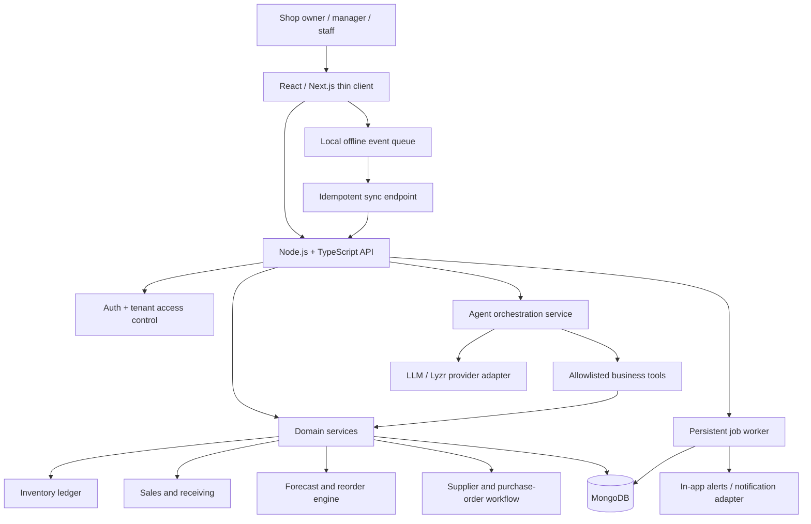
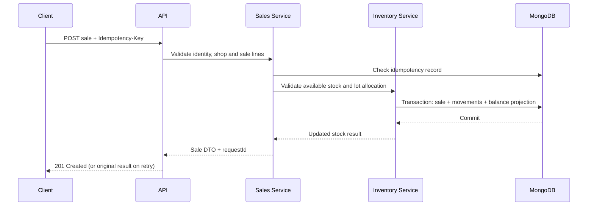
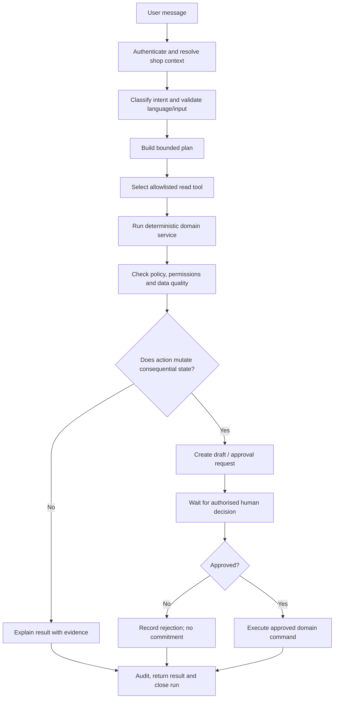
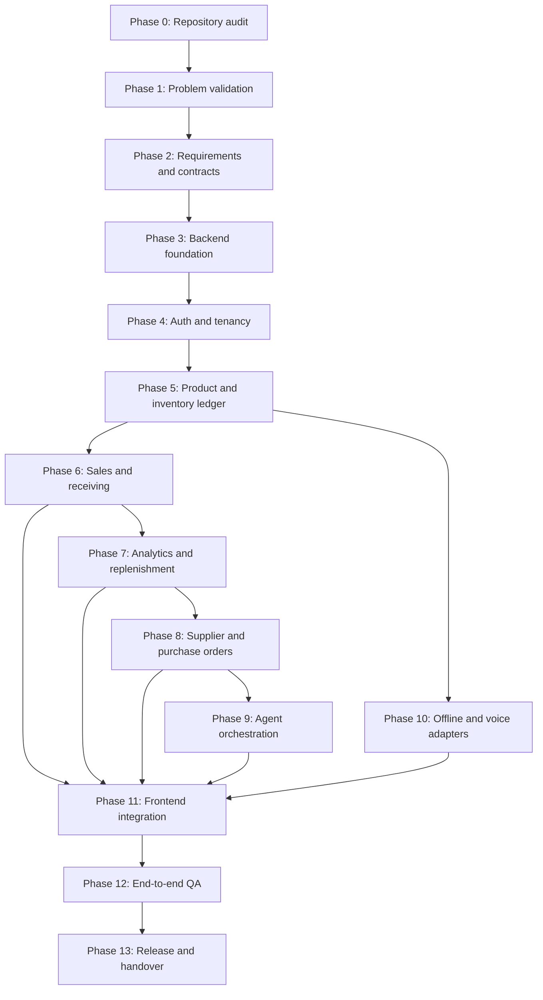

# WORKFLOWS.md

## KiranaSaathi AI — Backend-First Execution Plan

| Document control | Value |
|---|---|
| Project | KiranaSaathi AI (working name; confirm before public use) |
| Competition | Tech4Bharat — GAVS Hackathon 2026 |
| Selected challenge | Theme 5: Rural FMCG and Logistics — Problem Statement 5.1, Kirana inventory / stock management |
| Technical track | Agentic AI, with deterministic analytics and forecasting components |
| Version | 1.0 — planning baseline |
| Prepared | 14 November 2026 |
| Status | Proposed workflow; implementation state not yet inspected |
| Delivery priority | Backend correctness, data integrity, security, agent reliability, testability; frontend is a thin operator interface |

> **Important status note:** This document is an implementation plan, not evidence that the application, integrations, datasets, model evaluations, pilot results or deployments already exist. No source repository or running system was included with the request. The first execution phase must inspect the actual repository and reconcile this plan with what is already implemented. Do not overwrite working code merely to match the proposed structure.

---

# 1. Executive Summary

KiranaSaathi AI is a proposed voice-first, low-friction inventory and replenishment assistant for small kirana retailers. It is designed around the Tech4Bharat Problem Statement 5.1 discussed in the project context.

The product should help a shopkeeper answer practical operating questions:

- What products are running low?
- What should be reordered, in what quantity, and why?
- Which products are moving slowly or approaching expiry?
- How much money is tied up in slow-moving inventory?
- Which supplier option is suitable, based on recorded price and lead-time information?
- What actions need the shopkeeper's approval?

The product's central engineering principle is:

**The backend is the system of record. AI may interpret requests, explain recommendations and coordinate approved tools, but it must not bypass business rules or write directly to the database.**

The initial implementation should be a well-structured modular backend rather than a collection of loosely connected services. It should provide reliable inventory transactions, tenant isolation, auditable stock movements, idempotent APIs, explainable reorder calculations, controlled agent tools and a complete test suite. The frontend can remain intentionally simple: product and stock views, sales/receiving entry, recommendations, approval actions and a voice/text assistant surface.

## 1.1 Product outcome

Deliver a demonstrable prototype that can:

1. Register a shop and its authorised users.
2. Maintain a product catalogue and stock balances.
3. Record sales, stock receipts, returns, wastage and adjustments.
4. Track stock by batch/lot where expiry applies.
5. Calculate demand and reorder recommendations from available shop data.
6. Detect low stock, slow-moving stock and near-expiry lots.
7. Generate a purchase-order draft and require human approval before any external commitment.
8. Explain each recommendation using the data and rules that produced it.
9. Accept a small set of voice/text commands with confirmation for ambiguous or consequential actions.
10. Preserve safe operation when connectivity is intermittent, through an idempotent synchronization contract.

## 1.2 Engineering priorities

| Priority | Area | Standard |
|---|---|---|
| P0 | Inventory ledger and stock consistency | No silent stock corruption, duplicate sale or negative quantity caused by retry |
| P0 | Authentication and tenant isolation | A user can only access explicitly authorised shop data |
| P0 | Backend domain services and APIs | Validated contracts, deterministic rules, clear error handling |
| P0 | Replenishment calculation | Explainable output with data-quality and confidence indicators |
| P0 | Agent safety | Strict tools, server-side policy checks, approval before purchase commitment |
| P0 | Automated tests | Critical flows covered by unit and integration tests |
| P1 | Offline synchronization | Idempotent event upload and explicit conflict resolution |
| P1 | Voice interaction | Limited command set, ambiguity handling and confirmation |
| P1 | Observability and deployment | Health checks, structured logs, audit trail and reproducible deployment |
| P2 | Visual polish | Usable responsive interface; avoid spending core time on decorative UI |

---

# 2. Project Context and Evidence Classification

## 2.1 Confirmed competition context from the supplied conversation

- The competition is Tech4Bharat, part of GAVS 2026.
- The challenge listing contains eight themes and twenty problem statements.
- The selected direction in the prior analysis was Theme 5, Rural FMCG and Logistics, Problem Statement 5.1.
- The project direction discussed was a kirana stock intelligence and replenishment assistant.
- The competition expects practical, scalable solutions for real users, including people with low digital literacy, low-cost devices and limited connectivity.
- The competition evaluates technical merit and entrepreneurial potential.
- The proposed AI direction is Agentic AI, not a chatbot-only implementation.

## 2.2 Project decisions carried forward

| ID | Decision | Status | Reason |
|---|---|---|---|
| D-001 | Target small kirana retailers | Proposed baseline | Directly aligned with Problem 5.1 |
| D-002 | Prioritise backend reliability over visual complexity | Confirmed by latest user instruction | User explicitly prefers a stronger backend even if frontend remains simple |
| D-003 | Use an agent to orchestrate approved business tools | Proposed baseline | Demonstrates a real multi-step agent workflow without giving an LLM unrestricted authority |
| D-004 | Keep purchase creation as a draft pending shopkeeper approval | Safety requirement | Prevents unapproved financial commitments |
| D-005 | Use a ledger/event-based stock history | Architecture decision proposed here | Supports auditability, traceability and duplicate prevention |
| D-006 | Use a modular monolith initially | Architecture decision proposed here | Faster to build and easier to test than premature microservices |

## 2.3 Unverified information and assumptions

The following must not be represented as facts until verified:

- Whether the team has registered specifically under Problem 5.1.
- Whether any code repository or prototype already exists.
- Which Indian language(s) will be used in the first demo.
- Whether a real kirana shop has agreed to participate in a pilot.
- Whether transaction history, supplier catalogues or purchase invoices are available.
- Whether a POS, WhatsApp, distributor or payment integration is available.
- Whether Lyzr AI credits or any particular hosted model are provisioned and usable.
- Whether OCR, speech-to-text and text-to-speech providers have been selected.
- Whether the team has a Redis instance or a production MongoDB replica set.

Where source data or a third-party integration is unavailable, build a clearly labelled demo adapter with seeded or manually entered data. Never claim that a simulated supplier, forecast, purchase or integration is live.

## 2.4 Competition schedule and rule verification

The HackCulture page supplied in the prior conversation displayed 20 November 2026 as the registration/idea-submission deadline, 23 November as the prototype-round start, 15 December as the prototype-round end and 27 December as the offline finale. The same listing contained older conflicting FAQ dates and inconsistent wording about some participation terms. Reconfirm the current official deadline, team-size rule, intellectual-property terms and travel requirements directly with the organisers before final submission. This workflow does not supersede official competition rules.

---

# 3. Problem Definition and Product Scope

## 3.1 Problem hypothesis

Small kirana retailers may have limited visibility into stock levels, sales velocity, expiry exposure and reorder timing. Records can be fragmented across paper notes, supplier invoices, memory, spreadsheets or basic POS tools. This can contribute to stockouts, excess stock, avoidable expiry and time spent preparing orders.

This is a **problem hypothesis**, not a measured finding about every retailer. Validate it through interviews and observation before presenting it as a quantified market fact.

## 3.2 Primary users

| Persona | Need | Permissions |
|---|---|---|
| Shop owner | Understand stock, losses, cash tied in inventory and proposed purchases | Full shop-level control; approve/reject orders; manage users |
| Shop manager | Maintain stock, record sales/receipts and review recommendations | Operational access; approval permissions configurable by owner |
| Shop staff | Quickly record sales, deliveries and adjustments | Limited operational actions; no supplier or user administration |
| Platform administrator | Support the service and diagnose technical issues | Platform-level access only through audited, restricted support controls |

A supplier is an external party in the MVP. Do not assume that suppliers have application accounts or a live integration.

## 3.3 MVP scope

### In scope

- Shop and user onboarding.
- Role-based access control.
- Product catalogue with unit, SKU/barcode where available, reorder settings and optional expiry tracking.
- Stock receipt, sale, return, wastage and adjustment events.
- Lot/batch tracking for expiry-sensitive goods.
- Inventory ledger and current balance projection.
- Basic sales history and product movement summaries.
- Explainable demand estimate and reorder quantity.
- Low-stock, overstock/slow-moving and expiry alerts.
- Supplier details and manually recorded price/lead-time quotes.
- Purchase-order draft, approval, cancellation and receipt workflow.
- Agent interaction through a constrained set of tools.
- Basic offline event queue and safe synchronization contract.
- Audit events, structured logs, tests and deployment documentation.

### Explicitly out of scope for the first demonstrable release

- Automatically placing orders with suppliers.
- Making payments or moving money.
- Filing taxes or providing legal/accounting advice.
- Guaranteeing future demand or profit.
- Unrestricted autonomous changes to inventory.
- A full ERP, accounting or multi-warehouse suite.
- A public supplier marketplace unless a verified requirement and usable data exist.
- Complex deep-learning forecasting before a reliable baseline and sufficient historical data exist.
- Facial recognition, identity inference or collection of unnecessary personal data.

## 3.4 Product success criteria

The prototype is acceptable when a shop owner can complete the critical flow end to end:

1. Add a product and initial stock.
2. Record a sale or stock receipt.
3. See the stock balance update exactly once.
4. View a low-stock or reorder recommendation with an explanation.
5. Ask the assistant why the item needs reordering.
6. Generate a draft purchase order.
7. Approve or reject the draft explicitly.
8. Record received goods and see the stock ledger update.
9. Inspect the audit history for the actions.

A demo must use clearly identified sample data unless real pilot data has been obtained with permission.

---

# 4. System Architecture

## 4.1 Architecture principles

1. **Backend-owned business logic:** UI components must not calculate authoritative stock or reorder decisions independently.
2. **Single source of truth:** MongoDB stores canonical business records; derived totals are projections that can be rebuilt from the ledger.
3. **Modular monolith first:** Keep deployable complexity low while maintaining strict module boundaries.
4. **Deterministic core, probabilistic interface:** Inventory, permissions, reorder calculations and state transitions are deterministic. The LLM is used for language understanding, explanation and tool selection within a fixed allowlist.
5. **Human control:** Purchase commitments, destructive adjustments and ambiguous commands require explicit authorised confirmation.
6. **Tenant isolation everywhere:** Shop scope is derived from the authenticated user's membership, never trusted from a client-supplied tenant ID alone.
7. **Idempotency:** Retried network requests must not create duplicate sales, receipts, movements or purchase orders.
8. **Observable execution:** Every important request and agent run must have a trace/request ID and auditable outcome.
9. **Graceful degradation:** If the AI provider is unavailable, inventory and manual operations continue to work.
10. **No fabricated integrations:** Demo adapters are marked as simulated and kept separate from live integrations.

## 4.2 Recommended implementation stack

| Layer | Recommended baseline | Notes |
|---|---|---|
| Runtime | Node.js LTS + TypeScript | Keep runtime and package versions pinned |
| HTTP API | Express with modular routers/controllers | Fits the team's existing Node/Express experience; use strict service boundaries |
| Validation | Zod | Validate request, environment and tool payloads at boundaries |
| Database | MongoDB Atlas + Mongoose | Use transactions where supported; verify replica-set configuration |
| Authentication | Short-lived access token + rotated refresh token | Store refresh-token hashes; secure cookies for browser clients where practical |
| Password security | Argon2id or bcrypt with current safe parameters | Never store plaintext passwords |
| Background jobs | Persisted job collection initially; BullMQ/Redis only if provisioned | Do not rely on in-process timers for critical work |
| Agent integration | Provider adapter (Lyzr or another approved tool-calling provider) | Provider must not have raw database credentials or unrestricted code execution |
| Forecasting | Deterministic TypeScript baseline first | Add a Python/FastAPI service only if measured need justifies separate deployment |
| API documentation | OpenAPI 3.1 | Generate/maintain contracts alongside routes |
| Testing | Vitest or Jest + Supertest | Unit, integration and end-to-end coverage |
| Observability | Structured JSON logs, request IDs, health/readiness checks | Add metrics/tracing if deployment supports it |
| Deployment | Docker + managed Node host + managed MongoDB | Keep secrets in deployment environment, not in Git |

**Do not add every technology by default.** Redis, Python services, multiple databases, vector stores and microservices are optional and require a concrete use case. For the hackathon MVP, a single TypeScript backend and MongoDB are sufficient for the core workflows.

## 4.3 Logical architecture



## 4.4 Backend module boundaries

```text
src/
  app.ts
  server.ts
  config/
    env.ts
    database.ts
    logger.ts
  common/
    errors/
    middleware/
    validation/
    pagination/
    idempotency/
    types/
  modules/
    auth/
    shops/
    memberships/
    users/
    products/
    inventory/
    sales/
    suppliers/
    purchasing/
    forecasting/
    alerts/
    agent/
    sync/
    audit/
    health/
  jobs/
  adapters/
    ai-provider/
    speech-to-text/
    notifications/
    supplier/
  docs/
  tests/
```

Each module should own its routes, schemas, service, repository/data access and tests. Avoid circular module imports. Controllers should be thin and must not contain business rules.

---

# 5. Backend Domain Model and Data Integrity

## 5.1 Tenant and ownership model

Every shop-owned record must contain `shopId`. The server derives the allowed shop scope from the authenticated user's membership. Any endpoint accepting a `shopId` must verify membership and role before accessing data.

Suggested roles:

- `owner`
- `manager`
- `staff`
- `platform_support` (separate privileged path; never implicitly a shop member)

Do not use a client-provided role as proof of permission.

## 5.2 Core collections

| Collection | Responsibility | Key fields (illustrative) |
|---|---|---|
| `users` | Login identity | `email/phone`, `passwordHash`, `status`, timestamps |
| `shops` | Retail outlet | `name`, `timezone`, `defaultCurrency`, `locale`, `settings` |
| `memberships` | User-to-shop roles | `shopId`, `userId`, `role`, `status` |
| `products` | Shop product catalogue | `shopId`, `name`, `brand`, `sku`, `barcode`, `unit`, `category`, `reorderSettings`, `expiryTracked`, `status` |
| `inventoryLots` | Batch-level stock where relevant | `shopId`, `productId`, `batchCode`, `receivedAt`, `expiryDate`, `remainingQty`, `unitCost` |
| `inventoryMovements` | Immutable stock event ledger | `shopId`, `productId`, `lotId`, `movementType`, signed `quantityDelta`, `referenceType`, `referenceId`, `actorId`, `idempotencyKey`, timestamp |
| `stockBalances` | Rebuildable current-stock projection | `shopId`, `productId`, `onHandQty`, `reservedQty`, `version`, `updatedAt` |
| `sales` | Sale header and line items | `shopId`, `items`, `totals`, `recordedAt`, `actorId`, `source`, `idempotencyKey` |
| `suppliers` | Shop's supplier directory | `shopId`, `name`, contacts, delivery area, status |
| `supplierQuotes` | Recorded product/price/lead-time observations | `shopId`, `supplierId`, `items`, `validUntil`, `source`, `observedAt` |
| `purchaseOrders` | Proposed and approved purchase | `shopId`, `supplierId`, `items`, `status`, `createdBy`, `approvedBy`, totals, timestamps |
| `agentRuns` | Traceable assistant execution | `shopId`, `userId`, `intent`, `status`, `toolCalls`, `policyDecisions`, `resultSummary`, timestamps |
| `alerts` | Low stock, expiry and data-quality alerts | `shopId`, `productId`, `alertType`, `severity`, `status`, `evidence`, timestamps |
| `auditLogs` | Security and business audit events | `shopId`, `actorId`, `action`, `entityType`, `entityId`, `before/after summary`, `requestId`, timestamp |
| `idempotencyRecords` | Duplicate request protection | `shopId`, `key`, `requestHash`, `status`, `responseRef`, expiry |
| `syncEvents` | Offline-to-server synchronization | `shopId`, `deviceId`, `clientEventId`, `eventType`, payload, status, server sequence |
| `jobs` | Durable background work | `jobType`, payload reference, status, attempts, nextRunAt, lastError |

The fields above are a design baseline, not a claim about existing schemas. Finalise types and relationships during Phase 2 before implementation.

## 5.3 Inventory ledger rules

The `inventoryMovements` collection is the historical source of truth for stock changes. The `stockBalances` collection is a fast, rebuildable projection.

Allowed movement types:

- `opening_balance`
- `sale`
- `purchase_receipt`
- `customer_return`
- `supplier_return`
- `wastage`
- `manual_adjustment`
- `transfer_in` / `transfer_out` only if multi-location scope is later approved

Rules:

1. Every balance-changing action creates an immutable movement record.
2. A movement is linked to its source event where one exists (sale, receipt, return or adjustment).
3. Movement quantity uses a consistent unit for the product. Do not mix pieces, boxes and kilograms without explicit conversion rules.
4. A negative stock balance is rejected by default. Any exceptional override requires an owner/manager permission, a reason and an audit event.
5. A repeated idempotency key with the same request hash returns the original result; the same key with a different payload returns a conflict.
6. Stock movement creation and balance projection update must be atomic where MongoDB transactions are available.
7. If transactions are not supported in the deployed MongoDB topology, do not silently use a fragile multi-write sequence. Use a documented consistency strategy with durable events and reconciliation before release.
8. Corrections are new compensating movements; do not edit or delete historical movements.
9. Reconciliation must be able to recalculate balances from movements and report any mismatch.
10. For expiry-tracked stock, allocate sales using FEFO (first expiry, first out) by default; preserve lot traceability.

## 5.4 Important indexes and constraints

Create and test indexes for:

- `memberships`: unique `{ shopId, userId }`.
- `products`: unique partial `{ shopId, sku }` when SKU exists; search index/normalised name index as needed.
- `inventoryLots`: `{ shopId, productId, expiryDate }`.
- `inventoryMovements`: `{ shopId, productId, createdAt }`, plus unique `{ shopId, idempotencyKey }` for applicable movement commands.
- `stockBalances`: unique `{ shopId, productId }`.
- `sales`: unique `{ shopId, idempotencyKey }` where an idempotency key is required.
- `purchaseOrders`: `{ shopId, status, createdAt }`.
- `alerts`: `{ shopId, status, severity, createdAt }`.
- `auditLogs`: `{ shopId, entityType, entityId, createdAt }`.

Validate uniqueness and index creation against actual data before applying migrations to any existing environment.

## 5.5 Quantity and money representation

- Use explicit unit metadata and decimal-safe quantity handling. Avoid binary floating-point arithmetic for financial totals.
- Store monetary amounts as integer paise when the currency and scale are fixed to INR, or use MongoDB `Decimal128` with validated serialization.
- Store the currency code with financial records; do not assume every record is INR merely because the first pilot is in India.
- Define rounding rules centrally and test them.
- Define a canonical shop timezone; persist timestamps in UTC and convert for display and business-day reporting.

---

# 6. API Design and Contracts

## 6.1 API conventions

- Prefix: `/api/v1`.
- JSON request/response bodies.
- Validate every input using shared Zod schemas.
- Use authenticated identity and membership for shop scope.
- Use pagination for list endpoints (`cursor` preferred for large histories; limit bounded).
- Include `requestId` in responses and logs.
- Use a consistent error envelope.
- Require `Idempotency-Key` for commands that create financial or inventory events, including sale creation, stock receipts, adjustments and purchase-order creation.
- Do not expose Mongoose documents directly; map to explicit response DTOs.
- Publish an OpenAPI contract and test it against implemented endpoints.

Example success response:

```json
{
  "data": {},
  "meta": {
    "requestId": "req_example",
    "nextCursor": null
  }
}
```

Example error response:

```json
{
  "error": {
    "code": "VALIDATION_ERROR",
    "message": "The request contains invalid fields.",
    "details": [],
    "requestId": "req_example"
  }
}
```

Never return stack traces, raw database errors, secrets or provider prompts to clients.

## 6.2 Proposed endpoint map

| Method | Endpoint | Purpose | Access |
|---|---|---|---|
| `POST` | `/auth/register` | Create user identity | Public, rate-limited |
| `POST` | `/auth/login` | Authenticate | Public, rate-limited |
| `POST` | `/auth/refresh` | Rotate refresh credential | Auth/session |
| `POST` | `/auth/logout` | Revoke session | Authenticated |
| `POST` | `/shops` | Create shop | Authenticated |
| `GET` | `/shops/current` | Current shop and membership | Authenticated |
| `POST` | `/shops/:shopId/members` | Invite/add member | Owner |
| `GET/POST` | `/shops/:shopId/products` | List/create products | Member with role check |
| `GET/PATCH` | `/shops/:shopId/products/:productId` | Read/update product | Member with role check |
| `GET` | `/shops/:shopId/inventory` | Stock overview | Member |
| `POST` | `/shops/:shopId/inventory/receipts` | Record received stock | Manager/owner or authorised staff |
| `POST` | `/shops/:shopId/inventory/adjustments` | Correct stock with reason | Manager/owner |
| `GET` | `/shops/:shopId/inventory/movements` | Stock ledger history | Member |
| `POST` | `/shops/:shopId/sales` | Record sale and stock deduction | Authorised staff |
| `GET` | `/shops/:shopId/sales` | Sales history | Member with permission |
| `GET/POST` | `/shops/:shopId/suppliers` | Supplier directory | Manager/owner |
| `POST` | `/shops/:shopId/suppliers/:supplierId/quotes` | Record supplier quotation | Manager/owner |
| `GET` | `/shops/:shopId/analytics/stock` | Stock and movement summaries | Owner/manager |
| `GET` | `/shops/:shopId/forecast/:productId` | Demand estimate and evidence | Owner/manager |
| `POST` | `/shops/:shopId/replenishment/runs` | Calculate recommendations | Owner/manager |
| `GET` | `/shops/:shopId/replenishment/recommendations` | Retrieve recommendations | Member with permission |
| `POST` | `/shops/:shopId/purchase-orders` | Create draft purchase order | Owner/manager |
| `POST` | `/shops/:shopId/purchase-orders/:id/approve` | Approve draft | Owner/authorised approver |
| `POST` | `/shops/:shopId/purchase-orders/:id/reject` | Reject draft | Owner/authorised approver |
| `POST` | `/shops/:shopId/purchase-orders/:id/receive` | Record goods received | Manager/owner |
| `POST` | `/shops/:shopId/agent/conversations` | Start assistant conversation | Member |
| `POST` | `/shops/:shopId/agent/conversations/:id/messages` | Submit user message | Member |
| `GET` | `/shops/:shopId/agent/runs/:id` | Inspect agent run/result | Initiator or permitted manager |
| `POST` | `/shops/:shopId/sync/batch` | Submit offline events | Authenticated device/user |
| `GET` | `/health/live` | Process liveness | Public/infra |
| `GET` | `/health/ready` | Dependency readiness | Infra, restricted if needed |

This is a proposed contract. Final routes should be reviewed for consistency and documented in OpenAPI before the frontend is built against them.

## 6.3 HTTP status and error codes

Use stable machine-readable codes, including:

- `VALIDATION_ERROR` — malformed or invalid input.
- `UNAUTHENTICATED` — missing/invalid session.
- `FORBIDDEN` — authenticated but not authorised.
- `NOT_FOUND` — resource absent or not visible to the caller.
- `CONFLICT` — duplicate/conflicting state transition.
- `INSUFFICIENT_STOCK` — requested quantity exceeds available stock.
- `IDEMPOTENCY_CONFLICT` — same key reused with different payload.
- `APPROVAL_REQUIRED` — action needs authorised human approval.
- `DEPENDENCY_UNAVAILABLE` — required external provider unavailable.
- `RATE_LIMITED` — request limit reached.
- `INTERNAL_ERROR` — unexpected server fault.

Map these to standard HTTP statuses and keep the response shape consistent.

---

# 7. Core Backend Workflows

## 7.1 Shop onboarding and access control

1. User registers with validated contact details and a strong password or approved authentication method.
2. Server normalises the identity and checks uniqueness.
3. Password is hashed with a suitable password-hashing algorithm; plaintext credentials are discarded.
4. User creates a shop and becomes its initial owner, or accepts an invitation to an existing shop.
5. Server creates the membership record and an audit event.
6. Login issues a short-lived access credential and a refresh credential with rotation/revocation support.
7. Each protected request resolves the user's active membership and allowed role for the requested shop.
8. Failed, revoked and suspicious sessions are logged without leaking authentication details.

**Acceptance criteria**

- A user from Shop A cannot read or mutate Shop B data by changing a URL or request body.
- Staff cannot approve a purchase order unless explicitly granted that permission.
- Refresh-token rotation rejects reuse of a revoked token.
- User and membership changes are auditable.

## 7.2 Product creation and stock opening balance

1. Validate product name, unit, SKU/barcode uniqueness and reorder configuration.
2. Create the product in the authenticated shop's tenant scope.
3. If opening quantity is supplied, create an opening-balance movement and update the balance projection atomically.
4. If the item is expiry-tracked, require lot/expiry data when applicable; allow an explicit `expiryUnknown` state rather than inventing an expiry date.
5. Return the product DTO, current stock and audit reference.

Do not create a product and then silently ignore a failed opening-stock write. The command must be atomic or recoverable through an explicit workflow.

## 7.3 Sale recording



Detailed rules:

1. Validate all product IDs belong to the current shop.
2. Validate quantity, unit, price and discount boundaries.
3. Validate idempotency key and request hash.
4. Check stock availability for every line before committing.
5. For expiry-tracked products, allocate the sale from eligible lots using FEFO.
6. Create sale header/items, immutable stock movements and stock-balance projections in one transaction where supported.
7. Record actor, source (manual/POS/import/offline sync), timestamps and request ID.
8. Return the final sale and updated balances.
9. Emit an internal event/job for analytics and alert refresh; the sale itself must not wait for an LLM call.

**Failure handling:** if any line fails validation or lacks stock, reject the entire sale by default. Do not partially deduct inventory without an explicit partial-sale business rule.

## 7.4 Goods receiving

1. User selects a supplier or marks the source as unknown/manual.
2. User records received products, quantities, unit costs and optional invoice reference.
3. For expiry-tracked items, record batch/lot and expiry date where available.
4. Validate product units and supplier/shop association.
5. Create receipt record or purchase-order receipt reference, lot records and positive stock movements.
6. Update the stock projection transactionally.
7. Reconcile received quantity against the approved purchase-order draft if one exists.
8. Record discrepancies (short, excess, damaged or substituted goods) separately; never silently rewrite the approved order.

## 7.5 Returns, wastage and manual adjustment

- Customer returns must record the reason and disposition: restockable, damaged or unknown condition.
- Supplier returns reduce stock and reference the original lot/movement when known.
- Wastage records require a reason and optional evidence note.
- Manual adjustments require a reason and actor. Large adjustments may require owner approval according to a configurable threshold.
- All corrections create compensating ledger entries. Historical movements are never deleted.

## 7.6 Demand estimation and reorder calculation

Use deterministic and explainable logic for the first release. The objective is to provide a credible baseline, not to claim a sophisticated predictive model without adequate data.

### Required inputs

- Daily sales quantity by product over the available history window.
- Current on-hand stock.
- Reserved/committed stock, if reservation is implemented.
- Outstanding purchase-order quantity and expected delivery date, if recorded.
- Supplier lead time, if known.
- Product-specific minimum stock or reorder threshold.
- Optional target cover days and safety-stock settings.
- Data-quality indicators: number of days observed, missing days, unusual spikes and stockout periods.

### Baseline calculation

A transparent baseline may use a moving average or weekday-weighted average of observed sales. For example:

```text
average_daily_demand = observed_sales_quantity / valid_observation_days
lead_time_demand = average_daily_demand * estimated_lead_time_days
safety_stock = configured_or_rule_based_buffer
reorder_point = lead_time_demand + safety_stock
available_to_plan = on_hand + confirmed_inbound - reserved
suggested_qty = max(0, target_stock - available_to_plan)
```

Where:

```text
target_stock = average_daily_demand * target_cover_days + safety_stock
```

Do not treat missing sales records as zero sales. Detect possible stockout periods: low recorded sales during a period when the shelf may have been empty does not prove low demand.

### Fallback rules

- Insufficient sales history: use shopkeeper-configured minimum/reorder level and label the result `LOW_DATA`.
- Unknown lead time: use a conservative configurable default only when the user accepts it; otherwise show a range or request input.
- No supplier quote: calculate quantity but do not invent price or supplier availability.
- Abnormal sales spike: flag it and avoid allowing one event to dominate the estimate without confirmation.
- No expiry data: do not assert a product is safe or expired; label expiry coverage as incomplete.

### Recommendation response

Every recommendation should include:

- Product and unit.
- Current on-hand quantity.
- Confirmed inbound quantity, if any.
- Estimated daily demand.
- Lead-time assumption.
- Safety-stock/target-cover assumption.
- Suggested reorder quantity.
- Data window and data-quality status.
- Explanation and reason codes.
- Calculation version and timestamp.

A recommendation is advisory until a human creates and approves a purchase order.

## 7.7 Expiry and slow-moving stock alerts

1. Evaluate only lots with valid expiry data.
2. Use shop timezone for day-based alert windows.
3. Categorise alerts using configurable windows (for example, approaching expiry, expired, low stock, no recent movement); do not hardcode legal or food-safety claims.
4. Separate an alert from a recommendation: the alert reports a condition, while any discount/return/disposal action requires the owner or manager.
5. Deduplicate active alerts by shop, product/lot, alert type and window.
6. Resolve or supersede alerts when stock is sold, returned, corrected or expiry data changes.
7. Clearly label slow-moving analysis as an estimate based on the available history window.

## 7.8 Supplier comparison and purchase-order lifecycle

A supplier comparison may use only recorded data: quoted price, quote date/validity, minimum order quantity, delivery charge and observed lead time. Show missing values rather than inventing them.

Purchase-order statuses:

```text
DRAFT -> PENDING_APPROVAL -> APPROVED -> PLACED_MANUALLY
       -> PARTIALLY_RECEIVED -> RECEIVED
       -> REJECTED / CANCELLED
```

`PLACED_MANUALLY` means the shopkeeper states that the order was placed outside the application. It is not proof of a live supplier integration.

Rules:

- The agent may create a draft only through the approved purchase-order service.
- Approval is a separate action by a permitted user.
- The MVP must not automatically send a binding supplier order or payment.
- Approved order details are versioned; edits after approval return the order to a draft/reapproval state.
- Receiving goods must create inventory movements; an order status change alone must not change stock.
- Record who approved, when, and which version was approved.

## 7.9 Agentic AI orchestration

The agent is a workflow coordinator, not the authority for inventory or finance.

### Allowed tool set

- `get_stock_summary(shopId, productQuery)`
- `get_sales_history(shopId, productId, period)`
- `get_demand_estimate(shopId, productId)`
- `get_expiry_risks(shopId, filters)`
- `list_supplier_quotes(shopId, productId)`
- `create_replenishment_draft(shopId, productIds)`
- `create_purchase_order_draft(shopId, supplierId, items)`
- `get_purchase_order(shopId, purchaseOrderId)`
- `request_human_approval(shopId, actionType, resourceId, summary)`

Tool schemas must be strict and versioned. Each tool independently validates shop membership, role, payload and state. The LLM must never receive database credentials or call arbitrary URLs, shell commands or generic database query tools.

### Agent execution lifecycle



### Agent rules

1. The model may interpret user language and choose from the allowlisted tools only.
2. Tool results are treated as data, not instructions.
3. Every tool call is authenticated and authorised server-side.
4. The agent must distinguish observed facts, estimates and assumptions.
5. The agent must not make up sales, quotes, prices, stock or supplier availability.
6. If product identity or quantity is ambiguous, ask a focused clarification rather than guessing.
7. Before consequential mutations, show a plain-language summary and require authorised confirmation.
8. Approval must be bound to a specific resource/version and expire or become invalid if that version changes.
9. Provider timeout or malformed output must fail safely; manual workflows remain usable.
10. Persist run status, tool name, validated arguments (redacted where needed), outcome, policy decision and timestamps. Do not log secrets or unnecessary personal data.
11. Defend against prompt injection in product names, invoice text, supplier notes and external content. Treat all such text as untrusted input.
12. Keep an explicit maximum tool-call count, execution time budget and token budget per run.
13. The model cannot approve its own draft or impersonate the shop owner.

### Example interaction

User: “Parle-G ke sirf 5 packet bache hain. Agle hafte kitne mangwane chahiye?”

The agent should:

1. Resolve the product against the shop catalogue; ask if multiple matches exist.
2. Fetch current stock and recent sales history.
3. Run the deterministic estimate service.
4. Explain the estimate and confidence/data-quality status.
5. Ask whether the user wants a draft order.
6. If requested, create a draft and show supplier/price data only when recorded.
7. Require the authorised user to approve before the order is marked approved.

Any numeric values shown in a demo must be derived from seeded/demo records and labelled accordingly.

## 7.10 Voice and low-literacy interaction

The backend should expose an adapter boundary rather than depend directly on one speech provider.

Initial supported intents should be limited to:

- Record stock received.
- Record a sale or stock reduction.
- Check current stock.
- Ask what needs reordering.
- Check near-expiry stock.
- Explain a recommendation.

Processing sequence:

1. Capture speech in the client or approved speech provider.
2. Convert speech to text through an adapter.
3. Resolve language and intent; retain the original utterance only as long as required by the product's privacy policy.
4. Extract product, quantity and unit as structured candidate fields.
5. Validate against the catalogue and accepted units.
6. If confidence is low or multiple products match, ask for clarification.
7. Preview the interpreted action in the user's language.
8. Require confirmation for stock changes; require authorised approval for purchase-order approval.
9. Execute the normal backend command, not a special voice-only mutation path.

Do not claim regional-language support until it has been tested with speakers of that language in the target usage environment.

## 7.11 Offline-first synchronization

The offline queue is a client-side delivery mechanism; the backend remains authoritative.

- Each client event has a globally unique `clientEventId`, `deviceId`, user identity, event type, local timestamp and schema version.
- The server authenticates the user/device and checks active shop membership.
- The server validates each event as though it were a normal online command.
- Replayed events return their previously recorded outcome.
- Events are processed in a documented order per device where order matters.
- A stale event must not overwrite a newer product or stock document blindly; inventory events are appended, while conflicting edits require explicit resolution.
- The sync response reports each event as `accepted`, `duplicate`, `rejected` or `needs_review`, with a stable reason code.
- Client retry uses exponential backoff with jitter; do not create duplicate events during retries.
- Store minimal offline data and protect the device's local store where feasible.

For the first release, offline support may be limited to queued stock/sale events. Do not promise full offline analytics or model inference unless implemented and tested.

---

# 8. Security, Privacy and Reliability Requirements

## 8.1 Authentication and authorisation

- Hash passwords with Argon2id or bcrypt using reviewed parameters.
- Use short-lived access credentials and refresh-token rotation/revocation.
- Store refresh-token hashes, not raw refresh tokens.
- Set secure, HTTP-only, SameSite cookies for browser sessions where the chosen client architecture permits.
- Apply role-based checks in the service layer, not only in frontend route guards.
- Rate-limit authentication, agent and costly provider endpoints.
- Protect state-changing browser requests against CSRF where cookie-based auth is used.
- Enforce TLS in production.

## 8.2 Tenant isolation

- Every query to shop-owned collections includes the server-resolved `shopId`.
- Never accept a shop ID from the browser as sufficient authorisation.
- Validate referenced product, supplier, lot and purchase-order records belong to the same shop.
- Add automated cross-tenant access tests for every module.
- Do not include one shop's data in another shop's logs, analytics or agent context.

## 8.3 Input and application security

- Validate payloads and reject unknown or unsupported fields on sensitive commands.
- Limit payload size, file type, upload size and request rate.
- Scan/validate uploaded files before processing; treat extracted OCR text as untrusted.
- Prevent NoSQL injection by using typed query construction and never passing raw client objects into MongoDB filters.
- Escape user-provided text in the UI and sanitise any rendered rich content.
- Keep secrets in a secret manager or deployment environment; commit only `.env.example` placeholders.
- Pin dependencies and review security advisories before release.
- Apply least privilege to database and external provider credentials.

## 8.4 Privacy and data minimisation

- Collect only shop/user information needed for the workflow.
- Obtain consent before using pilot business records, voice recordings or invoices.
- Prefer storing extracted structured invoice fields over retaining raw images indefinitely.
- Define retention and deletion policies for recordings, uploads, logs and account data.
- Redact phone numbers, emails, tokens and invoice-sensitive data from logs.
- Do not use pilot data to train external models unless the user has given valid permission and provider terms allow it.

## 8.5 Reliability and graceful degradation

- AI provider failure must not block manual stock, sales or receiving operations.
- Jobs must be durable, retryable and idempotent.
- Failed jobs move to a dead-letter/error state after bounded attempts and can be inspected.
- Use timeouts, bounded retries and circuit-breaker behaviour for external providers.
- Health endpoints distinguish process liveness from dependency readiness.
- Add a reconciliation job to compare stock projections with ledger totals.
- Back up the database and test a restore before any production pilot.

---

# 9. Phase-Wise Execution Workflow

The phases below are sequential at the gate level. Independent tasks may run in parallel only when their contracts are agreed and file ownership is clear.

## Phase 0 — Repository Discovery and Safe Baseline

**Objective:** Understand the actual project before changing it.

**Inputs:** Existing repository, package files, environment examples, database schema, deployment configuration, previous documentation and available demo data.

**Tasks:**

- [ ] P0.1 Inspect repository tree, Git status, branches and recent commits.
- [ ] P0.2 Identify frontend/backend boundaries, runtime versions and package manager.
- [ ] P0.3 Read existing README, environment templates, route definitions, models and tests.
- [ ] P0.4 Run existing tests/build without modifying application code; record failures.
- [ ] P0.5 Identify existing database collections and migration/seed scripts.
- [ ] P0.6 Identify secrets or credentials accidentally committed; report and rotate if necessary.
- [ ] P0.7 Map existing features to this workflow as `implemented`, `partial`, `missing` or `unverified`.
- [ ] P0.8 Create a baseline report and list safe refactors separately from required features.

**Outputs:** `docs/REPOSITORY_AUDIT.md`, baseline test/build results, updated implementation status.

**Acceptance gate:** No unverified claim about existing work; current build/test state is recorded; no destructive change made.

## Phase 1 — Problem Validation and Submission Definition

**Objective:** Convert the challenge into a narrow, demonstrable product scope.

**Tasks:**

- [ ] P1.1 Reconfirm the exact wording and constraints of Problem Statement 5.1 from the official challenge material.
- [ ] P1.2 Interview at least 2–3 accessible kirana retailers if feasible; record consent and anonymised observations.
- [ ] P1.3 Ask how they currently track stock, sales, supplier orders, expiry and credit/cash constraints.
- [ ] P1.4 Identify the three most painful workflows; do not assume all proposed features are equally important.
- [ ] P1.5 Select one primary demo journey: stock update → recommendation → approved draft order.
- [ ] P1.6 Define the pilot language, product categories and realistic demo dataset.
- [ ] P1.7 Separate validated facts from assumptions in the submission narrative.
- [ ] P1.8 Confirm competition deadline, team eligibility, IP terms and final-round obligations with organisers.

**Outputs:** `docs/PROBLEM_VALIDATION.md`, final MVP scope, demo scenario and evidence log.

**Acceptance gate:** The chosen workflow is supported by user evidence or explicitly labelled as an unvalidated hypothesis; competition constraints are checked.

## Phase 2 — Requirements, Domain Model and API Contract

**Objective:** Lock the backend contract before parallel implementation.

**Tasks:**

- [ ] P2.1 Write functional and non-functional requirements with priority P0/P1/P2.
- [ ] P2.2 Define user roles, permissions and tenant boundaries.
- [ ] P2.3 Define product units, stock movement types and lot/expiry semantics.
- [ ] P2.4 Define sale, receipt, adjustment and purchase-order state machines.
- [ ] P2.5 Define idempotency behaviour and transaction boundaries.
- [ ] P2.6 Finalise MongoDB schemas, indexes and data-retention rules.
- [ ] P2.7 Write OpenAPI contracts and request/response examples.
- [ ] P2.8 Define error codes, pagination, request IDs and audit requirements.
- [ ] P2.9 Review the model and APIs with backend and QA owners before coding.

**Outputs:** `docs/REQUIREMENTS.md`, `docs/ARCHITECTURE.md`, OpenAPI specification, schema diagrams, decision log.

**Acceptance gate:** Every P0 user journey maps to a service, endpoint, model and testable acceptance criterion.

## Phase 3 — Backend Foundation and Engineering Standards

**Objective:** Build a stable application foundation.

**Tasks:**

- [ ] P3.1 Configure TypeScript strict mode, linting, formatting and pinned runtime/package versions.
- [ ] P3.2 Establish application bootstrap, configuration parsing and graceful shutdown.
- [ ] P3.3 Add structured logger, request IDs, central error middleware and safe response mapping.
- [ ] P3.4 Add MongoDB connection management and readiness checks.
- [ ] P3.5 Add shared Zod validation, DTO mapping and pagination utilities.
- [ ] P3.6 Add health endpoints and a minimal deployment pipeline.
- [ ] P3.7 Add unit/integration test harness and test database isolation.
- [ ] P3.8 Add secret scanning and `.env.example`; verify no real credentials are committed.

**Outputs:** Running API skeleton, coding standards, health checks, CI test/build job.

**Acceptance gate:** Application starts from documented configuration, fails clearly on invalid configuration and passes baseline CI.

## Phase 4 — Authentication, Membership and Tenant Isolation

**Objective:** Establish secure shop-level access before business data is exposed.

**Tasks:**

- [ ] P4.1 Implement user registration/login and password hashing.
- [ ] P4.2 Implement refresh rotation, logout/revocation and session handling.
- [ ] P4.3 Implement shop creation and membership lifecycle.
- [ ] P4.4 Add owner/manager/staff permission policies.
- [ ] P4.5 Add authentication, membership and authorisation middleware.
- [ ] P4.6 Add rate limits and abuse controls to auth endpoints.
- [ ] P4.7 Add cross-tenant tests for every protected route family.
- [ ] P4.8 Audit user, role and membership changes.

**Outputs:** Secure identity and access module.

**Acceptance gate:** Cross-tenant tests pass; unauthorised requests cannot reach business services; secrets are never returned or logged.

## Phase 5 — Product Catalogue and Inventory Ledger

**Objective:** Deliver the core data-integrity engine.

**Tasks:**

- [ ] P5.1 Implement product create/read/update/archive with shop-scoped validation.
- [ ] P5.2 Implement product-unit and conversion rules; reject unsupported conversions.
- [ ] P5.3 Implement inventory movement schema and immutable movement service.
- [ ] P5.4 Implement stock-balance projection and transactional update strategy.
- [ ] P5.5 Implement opening balances, manual adjustments and reason capture.
- [ ] P5.6 Implement lot/batch records and FEFO allocation for expiry-tracked items.
- [ ] P5.7 Implement idempotency records for stock commands.
- [ ] P5.8 Implement ledger-to-balance reconciliation and discrepancy reporting.
- [ ] P5.9 Add concurrent update and duplicate request tests.

**Outputs:** Product and inventory APIs, ledger, balance projection, reconciliation command/job.

**Acceptance gate:** Replaying a command cannot double-change stock; concurrent operations do not lose updates; balances reconcile to ledger; tenant isolation passes.

## Phase 6 — Sales, Receiving and Operational Events

**Objective:** Make stock changes reflect realistic shop operations.

**Tasks:**

- [ ] P6.1 Implement sale validation and atomic sale-plus-movement transaction.
- [ ] P6.2 Implement FEFO lot deduction and insufficient-stock rejection.
- [ ] P6.3 Implement stock receipt with lot and supplier references.
- [ ] P6.4 Implement customer return, supplier return and wastage workflows.
- [ ] P6.5 Implement receipt/adjustment discrepancy handling.
- [ ] P6.6 Add sales history and product movement queries.
- [ ] P6.7 Emit durable domain events/jobs after successful commits.
- [ ] P6.8 Add replay, rollback, partial-failure and idempotency tests.

**Outputs:** Sales and receiving APIs; reliable event history.

**Acceptance gate:** Critical operational events either commit completely or fail without partial stock changes; duplicate and retry tests pass.

## Phase 7 — Analytics, Demand Baseline and Replenishment Engine

**Objective:** Produce credible, explainable stock recommendations.

**Tasks:**

- [ ] P7.1 Define observation windows and data-quality rules.
- [ ] P7.2 Calculate daily sales velocity from valid sales records.
- [ ] P7.3 Detect likely missing-data and stockout periods.
- [ ] P7.4 Implement configurable lead-time and safety-stock inputs.
- [ ] P7.5 Implement baseline moving-average/weekday estimate.
- [ ] P7.6 Calculate reorder point and suggested order quantity.
- [ ] P7.7 Return reason codes, assumptions, data window and confidence/data-quality label.
- [ ] P7.8 Implement slow-moving and expiry risk summaries.
- [ ] P7.9 Build deterministic fixtures with known expected calculations.
- [ ] P7.10 Compare recommendations with a simple baseline and manually reviewed examples.

**Outputs:** Forecast/replenishment service, API endpoints, calculation documentation and test fixtures.

**Acceptance gate:** Same inputs and calculation version produce the same output; no fabricated data; low-data products are clearly labelled; test calculations match hand-checked examples.

## Phase 8 — Supplier Records and Purchase-Order Workflow

**Objective:** Convert recommendations into controlled, auditable purchase drafts.

**Tasks:**

- [ ] P8.1 Implement supplier directory and contact-data validation.
- [ ] P8.2 Implement manually recorded supplier quotes with observed date and validity.
- [ ] P8.3 Implement supplier comparison using only known quote fields.
- [ ] P8.4 Implement purchase-order draft creation and versioning.
- [ ] P8.5 Implement approval/rejection policies and immutable approval evidence.
- [ ] P8.6 Implement order receipt and reconciliation to stock movements.
- [ ] P8.7 Add state-transition validation and stale-approval rejection.
- [ ] P8.8 Ensure no external order placement/payment occurs in the MVP unless a separately approved live integration is implemented and tested.

**Outputs:** Supplier and purchase modules, approval trail, receiving linkage.

**Acceptance gate:** Only authorised users can approve; changed drafts require reapproval; receiving is the only event that increases stock for a purchase order.

## Phase 9 — Agent Orchestration and Controlled Tool Execution

**Objective:** Demonstrate genuine Agentic AI without compromising data integrity.

**Tasks:**

- [ ] P9.1 Define supported intents and refusal/clarification cases.
- [ ] P9.2 Implement AI-provider interface and at least one provider adapter.
- [ ] P9.3 Define strict JSON schemas for each allowed tool.
- [ ] P9.4 Implement tool execution through existing domain services only.
- [ ] P9.5 Implement bounded plan/tool-call loop, timeout and token/cost controls.
- [ ] P9.6 Implement agent run persistence, trace ID and redacted tool-call history.
- [ ] P9.7 Implement approval checkpoints for consequential actions.
- [ ] P9.8 Add prompt-injection tests using hostile product names, notes and invoice text.
- [ ] P9.9 Add provider-failure fallback and manual workflow continuity.
- [ ] P9.10 Evaluate answer correctness against a small, labelled scenario set.

**Outputs:** Agent service, tool registry, provider adapter, policy checks, evaluation report.

**Acceptance gate:** Agent answers are grounded in tool output; the LLM cannot bypass permissions or mutate raw database state; provider failure does not break core operations.

## Phase 10 — Offline Sync and Voice Command Adapter

**Objective:** Support limited, resilient interaction for the target user environment.

**Tasks:**

- [ ] P10.1 Define offline event schema and schema versioning.
- [ ] P10.2 Implement batch sync with per-event idempotency and per-event result status.
- [ ] P10.3 Implement replay ordering and conflict handling.
- [ ] P10.4 Add retry/backoff guidance and device registration/revocation if required.
- [ ] P10.5 Add speech-provider adapter and transcript normalisation.
- [ ] P10.6 Implement a small intent/slot schema for stock, sales and reorder queries.
- [ ] P10.7 Add confidence thresholds and confirmation prompts.
- [ ] P10.8 Test noisy/ambiguous speech cases in the selected language.

**Outputs:** Sync API, offline event contract, speech adapter and tested command set.

**Acceptance gate:** Replayed events do not duplicate stock changes; conflicts are visible; ambiguous voice commands do not mutate state.

## Phase 11 — Thin Frontend Integration

**Objective:** Provide the minimum clear operator interface for the complete backend workflows.

**Screens:**

- [ ] P11.1 Login/shop selection.
- [ ] P11.2 Simple stock overview and product search.
- [ ] P11.3 Add product and opening stock.
- [ ] P11.4 Record sale/stock receipt.
- [ ] P11.5 Recommendation list with reasons and data-quality labels.
- [ ] P11.6 Purchase draft detail with approve/reject controls.
- [ ] P11.7 Assistant conversation with tool-result explanations.
- [ ] P11.8 Movement/audit history.

**Frontend rules:**

- Keep components thin; call backend APIs for all business calculations.
- Do not store authoritative stock or permissions in local state.
- Display loading, empty, offline, conflict and error states clearly.
- Confirm before consequential actions.
- Use large controls and plain language; keep the primary task usable on a low-cost Android screen.
- Do not spend time on decorative animation until all P0 workflows work.

**Outputs:** Usable responsive client integrated against the published OpenAPI contract.

**Acceptance gate:** The demo user can complete the end-to-end scenario without direct database edits or developer-only shortcuts.

## Phase 12 — End-to-End QA, Security and Pilot Validation

**Objective:** Prove that the system works reliably and its claims are supportable.

**Tasks:**

- [ ] P12.1 Run unit, integration, contract and end-to-end suites.
- [ ] P12.2 Run cross-tenant and role-permission security tests.
- [ ] P12.3 Run duplicate/retry/concurrency and reconciliation tests.
- [ ] P12.4 Run malformed input, rate-limit and dependency-timeout tests.
- [ ] P12.5 Run offline replay and conflict tests.
- [ ] P12.6 Run agent evaluation and prompt-injection tests.
- [ ] P12.7 Conduct a usability test with representative shopkeepers if available.
- [ ] P12.8 Capture genuine measurements; separate measured results from simulated demo results.
- [ ] P12.9 Fix P0/P1 defects and re-run affected tests.
- [ ] P12.10 Produce a known-limitations report.

**Outputs:** QA report, security checklist, usability observations, verified demo evidence.

**Acceptance gate:** No open critical/high issue in authentication, tenant isolation, stock integrity or approval flow; demo claims are evidence-backed.

## Phase 13 — Deployment, Documentation and Competition Handover

**Objective:** Package a reproducible and honest submission.

**Tasks:**

- [ ] P13.1 Prepare production-like environment variables and deployment configuration.
- [ ] P13.2 Deploy backend and database using least-privilege credentials.
- [ ] P13.3 Run migrations/index checks and seed only clearly labelled demo data.
- [ ] P13.4 Verify health/readiness, logs, backups and restore procedure.
- [ ] P13.5 Publish README setup instructions and architecture diagram.
- [ ] P13.6 Publish API documentation and demo account/data instructions without exposing real user data.
- [ ] P13.7 Record known limitations and any simulated provider integrations.
- [ ] P13.8 Verify repository licence, third-party asset/API terms and competition IP conditions.
- [ ] P13.9 Run a clean-clone setup and demo rehearsal.
- [ ] P13.10 Freeze the release tag and retain a rollback point.

**Outputs:** Deployed prototype, README, OpenAPI docs, test report, demo script, release notes and handover checklist.

**Acceptance gate:** Another developer can clone, configure, run tests and reproduce the demo from the documentation; no secrets or unsubstantiated claims are present.

---

# 10. Dependencies and Critical Path



## 10.1 Parallel work that is safe

After Phase 2 contracts are approved:

- Backend foundation and OpenAPI documentation can proceed together if one owner controls shared contracts.
- QA can prepare test fixtures and acceptance tests while services are implemented.
- Frontend can build static layouts against a mocked, versioned API contract; it must not invent a different business schema.
- Agent prompt/intent evaluation can be prepared while domain services are built, but live tool execution must wait for service contracts.
- Research/user validation can continue while core backend foundation is implemented.

## 10.2 Work that must remain serial

- Tenant/auth enforcement before shop data endpoints are exposed.
- Inventory ledger before sales/receiving workflows.
- Sales/receiving records before reliable demand calculations.
- Deterministic domain services before agent tools call them.
- Purchase-order draft and approval logic before the agent can initiate that workflow.
- Integration and security tests before final release.

---

# 11. Specialist and Agent Orchestration

Use a small specialist team. A large swarm is unnecessary for a time-bounded hackathon unless the repository and team size justify it.

| Role | Responsibility | Owns | Must not do |
|---|---|---|---|
| Project orchestrator | Maintains scope, task board, dependencies, decisions and release gates | `WORKFLOWS.md`, task tracker, decision log | Make unverified implementation claims |
| Backend architect/lead | Domain model, API contracts, module boundaries and code review | Architecture and shared backend contracts | Allow frontend or LLM to bypass services |
| Backend implementation agent | Builds assigned modules and tests | Assigned module folders | Edit unrelated shared modules without coordination |
| Data/AI specialist | Forecast baseline, data quality, agent tool schemas and evaluation | Forecast/agent modules and evaluation fixtures | Invent data or let model write directly to DB |
| QA/security specialist | Independent test design, tenant isolation, threat and regression checks | Test suites and QA reports | Approve its own untested implementation without evidence |
| Frontend specialist | Thin responsive UI against stable API contracts | Frontend only | Reimplement authoritative business logic client-side |
| Domain/user researcher | Retailer interviews, workflow validation and pilot evidence | Anonymised research notes | Collect unnecessary personal/business data |

## 11.1 Coordination protocol

1. The orchestrator owns the single authoritative task tracker.
2. Every task has one directly responsible owner.
3. Shared contracts are changed through a reviewed decision, not silently.
4. Parallel coding must use separate branches/worktrees or clearly separated files.
5. Every implementation task returns: files changed, tests added/run, test result, known limitations and handoff notes.
6. The backend lead reviews all schema, auth, inventory and purchase-order changes.
7. The QA specialist independently verifies P0 acceptance criteria.
8. Merge only after CI is green and the task's acceptance criteria are met.
9. Do not allow agents to commit credentials, generated test secrets or real pilot data.
10. If a task is blocked, record the blocker and continue independent work; do not fabricate a completion state.

## 11.2 Suggested branch strategy

- `main`: releasable baseline.
- `feature/<module>-<task-id>`: isolated feature branches.
- `fix/<issue-id>`: focused corrections.
- `release/<version>`: optional release hardening branch.

Use small commits with meaningful messages. Commit after a coherent, tested unit of work—not after every trivial edit. Never force-push shared history without explicit team agreement.

---

# 12. Quality Assurance and Test Strategy

## 12.1 Test pyramid

| Layer | Coverage focus | Examples |
|---|---|---|
| Unit | Pure rules and utility logic | Reorder formula, FEFO allocation, permission policy, unit validation |
| Service/integration | Service plus database behaviour | Sale transaction, idempotency, purchase approval, tenant filters |
| API/contract | Endpoint contracts and errors | OpenAPI schema, validation errors, status codes, pagination |
| End-to-end | Complete user journeys | Record sale → recommendation → draft PO → approval → receiving |
| Security | Trust boundaries | Cross-tenant access, role escalation, injection, token rotation |
| Resilience | Failure and retry behaviour | DB timeout, provider timeout, duplicate webhook/event, job retry |
| Usability | Target-user task success | Add stock, understand reorder reason, approve a draft |

## 12.2 Mandatory critical tests

- [ ] A Shop A user cannot read Shop B products, sales, suppliers, stock or agent runs.
- [ ] A staff user cannot perform an owner-only approval.
- [ ] A sale request replayed with the same idempotency key changes stock only once.
- [ ] Reusing an idempotency key with a different payload returns a conflict.
- [ ] An insufficient-stock sale does not create partial deductions.
- [ ] Concurrent sales cannot oversell stock due to stale reads.
- [ ] FEFO consumes the earliest eligible expiry lot first.
- [ ] A purchase-order approval is invalidated if the order version changes.
- [ ] Purchase-order approval alone does not change inventory.
- [ ] Receiving goods creates the corresponding stock movements exactly once.
- [ ] Reconciliation can identify a corrupted/mismatched projection.
- [ ] Forecasts label low-data cases and do not interpret missing data as zero demand.
- [ ] Supplier comparison never invents missing prices or lead times.
- [ ] An agent cannot call a tool with another shop's identifiers.
- [ ] A prompt-injection string in a product description cannot change agent policy.
- [ ] AI provider outage does not block manual inventory operations.
- [ ] Offline event replay does not duplicate a stock movement.
- [ ] Ambiguous voice product/quantity extraction requires clarification.
- [ ] Logs redact passwords, tokens, raw audio and sensitive invoice fields.

## 12.3 Performance and reliability checks

Define targets after measuring the deployment environment. Initial engineering targets may include:

- P95 latency for ordinary read endpoints under the agreed demo load.
- P95 latency for inventory commands under the agreed demo load.
- Bounded agent execution time and tool-call count.
- No unbounded database scans on primary shop/product queries.
- Pagination for ledger, sales and audit history.
- Job retry count, dead-letter visibility and reconciliation success.

Do not advertise performance numbers until measured with a documented test setup.

## 12.4 Defect severity

| Severity | Definition | Release action |
|---|---|---|
| Critical | Cross-tenant data exposure, unauthorised mutation, stock corruption, credential leak | Stop release; fix and retest |
| High | Core workflow unavailable, duplicate purchase/stock event, approval bypass | Stop release of affected workflow |
| Medium | Incorrect/non-critical calculation, recoverable UI failure, missing alert | Fix before final if it affects demo trust; otherwise document |
| Low | Cosmetic issue or minor usability friction | Prioritise after P0 correctness |

---

# 13. Risks and Mitigations

| ID | Risk | Probability / impact | Mitigation | Owner |
|---|---|---|---|---|
| R-01 | No real shop data or user validation | Medium / High | Interview retailers; build transparent demo data; do not claim pilot outcomes | Research lead |
| R-02 | Poor/incomplete sales history makes forecasts misleading | High / High | Data-quality labels, baseline fallback, editable lead-time and reorder settings | Data/AI lead |
| R-03 | Inventory ledger and balance projection diverge | Medium / Critical | Transactional writes, idempotency, reconciliation, concurrency tests | Backend lead |
| R-04 | Cross-tenant data leak | Low–Medium / Critical | Server-derived shop scope, scoped repository methods and automated security tests | Backend/security lead |
| R-05 | LLM makes up stock, prices or supplier data | Medium / High | Tool-grounded response, schema validation, evidence and missing-data states | AI lead |
| R-06 | Agent performs an unapproved purchase action | Low / Critical | No order-placement tool in MVP; human approval and policy enforcement | Backend lead |
| R-07 | Speech recognition confuses product/quantity | High / Medium | Confirmation step, catalogue match, supported-intent limitation | AI/product lead |
| R-08 | Connectivity issues create duplicate or stale events | Medium / High | Idempotent sync IDs, replay status and conflict handling | Backend lead |
| R-09 | Scope becomes too large for hackathon schedule | High / High | Freeze P0 journey, defer P2 features and protect backend critical path | Orchestrator |
| R-10 | External AI provider unavailable or costly | Medium / Medium | Provider adapter, timeouts, usage caps and manual fallback | AI lead |
| R-11 | Competition date/rule ambiguity | Medium / High | Written organiser confirmation; retain evidence of applicable terms | Team lead |
| R-12 | IP or third-party licence uncertainty | Medium / High | Review official terms and dependency/model licences before public submission | Team lead |
| R-13 | Team merge conflicts or overlapping agent edits | Medium / Medium | Single owner per module, branches/worktrees and reviewed contracts | Orchestrator |
| R-14 | Demo dataset mistaken for real results | Medium / High | Persistent demo labels and separate measured-vs-simulated evidence | QA/presenter |

---

# 14. Decision Log

Update this table when a material decision changes.

| ID | Decision | Rationale | Alternatives considered | Status |
|---|---|---|---|---|
| DEC-001 | Modular monolith for first release | Lower operational overhead; strong module boundaries remain possible | Microservices; serverless-per-feature | Proposed |
| DEC-002 | MongoDB as primary store, subject to repository audit | Matches the team's known stack and flexible shop/product records | PostgreSQL; hybrid store | Proposed; confirm existing repo |
| DEC-003 | Inventory movements are immutable; balances are projections | Auditable history and reconciliation | Directly update quantity only | Proposed; P0 architecture rule |
| DEC-004 | Deterministic demand baseline before ML | Explainable and usable with limited history | Complex ML model from day one | Proposed |
| DEC-005 | Agent calls domain tools, never raw database | Protects permissions and business invariants | LLM-generated database queries | Mandatory |
| DEC-006 | No automated supplier order placement in MVP | Avoids unapproved financial commitments and fake integration claims | Autonomous ordering | Mandatory MVP boundary |
| DEC-007 | Backend quality before advanced UI polish | User's explicit priority | UI-first build | Confirmed |
| DEC-008 | Offline support begins with queued events | Keeps scope bounded and safe | Full offline application | Proposed |

---

# 15. Documentation and Repository Deliverables

Keep documentation useful and non-duplicative.

| File | Purpose | Owner | Update trigger |
|---|---|---|---|
| `WORKFLOWS.md` | Master execution workflow and release gates | Orchestrator | Scope, phase or priority changes |
| `README.md` | Product overview, setup and demo instructions | Team lead | Every release |
| `docs/PROBLEM_VALIDATION.md` | User interviews, observed pain points and evidence | Research lead | New field evidence |
| `docs/REQUIREMENTS.md` | Functional/non-functional requirements and acceptance criteria | Product/backend lead | Requirement changes |
| `docs/ARCHITECTURE.md` | System components, module boundaries and decisions | Backend architect | Architecture change |
| `docs/API.md` or generated OpenAPI | Endpoint contracts and examples | Backend lead | API change |
| `docs/DATA_MODEL.md` | Collections, indexes, relationships and invariants | Backend lead | Schema change |
| `docs/AGENT_POLICY.md` | Allowed tools, approval rules, limits and failure behaviour | AI/backend lead | Agent policy change |
| `docs/TESTING.md` | Test commands, coverage and test environments | QA lead | Test strategy change |
| `docs/SECURITY_PRIVACY.md` | Threat boundaries, data handling and retention | Security owner | Security/privacy change |
| `docs/DEPLOYMENT.md` | Environment configuration, deploy, backup and rollback | DevOps owner | Deployment change |
| `docs/RISK_REGISTER.md` | Active project risks | Orchestrator | Risk change |
| `docs/DECISION_LOG.md` | Approved architectural/product decisions | Orchestrator | Material decision |
| `docs/QA_REPORT.md` | Evidence from final validation | QA lead | Each release candidate |

Do not create all optional documents if they duplicate this file. The API and data-model references are especially valuable because they keep frontend, backend, agent and QA work aligned.

---

# 16. Execution Tracker

The initial status below is intentionally `Not Started` because the current repository and implementation have not been inspected in this task. Update statuses only after evidence is available.

| Phase | Name | Priority | Status | Exit evidence |
|---|---|---|---|---|
| P0 | Repository discovery | P0 | Not Started | Repository audit and baseline test report |
| P1 | Problem validation | P0 | Not Started | User evidence and final MVP scope |
| P2 | Requirements and contracts | P0 | Not Started | Approved requirements, schemas and OpenAPI |
| P3 | Backend foundation | P0 | Not Started | API boot, health checks and CI |
| P4 | Auth and tenancy | P0 | Not Started | Auth and cross-tenant tests |
| P5 | Product and inventory ledger | P0 | Not Started | Ledger, projection and reconciliation tests |
| P6 | Sales and receiving | P0 | Not Started | Atomic operational workflows |
| P7 | Forecast and replenishment | P0 | Not Started | Explainable deterministic recommendations |
| P8 | Supplier and purchase orders | P0 | Not Started | Draft/approval/receiving lifecycle |
| P9 | Agent orchestration | P0 | Not Started | Tool policy and evaluated agent workflow |
| P10 | Offline and voice | P1 | Not Started | Replay/conflict and command tests |
| P11 | Thin frontend | P1 | Not Started | Demonstrable end-to-end interface |
| P12 | QA and pilot validation | P0 | Not Started | QA report and no open critical/high issue |
| P13 | Release and handover | P0 | Not Started | Reproducible deployment and final submission pack |

## 16.1 Daily execution report

Every work session should end with a short update:

```text
Date:
Phase / Task IDs:
Completed (evidence):
Files changed:
Tests run and exact result:
Blocked by:
Known risks / limitations:
Next actions:
```

Never use “done” without a test result, review evidence or a clearly stated reason why validation is not yet possible.

---

# 17. Final Acceptance Criteria

The product is ready for a competition demo only when all P0 criteria below are satisfied or an exception is explicitly documented and disclosed.

## 17.1 Backend acceptance

- [ ] Application starts from a clean environment using documented commands.
- [ ] Configuration is validated at startup; missing secrets fail safely.
- [ ] Authentication and refresh handling are implemented and tested.
- [ ] Shop membership and role checks protect every tenant-scoped endpoint.
- [ ] Product and inventory models have reviewed validation and indexes.
- [ ] Inventory ledger is immutable and balance projection reconciles.
- [ ] Sales, receipts and adjustments are idempotent and transactionally safe.
- [ ] Negative stock and unsupported unit changes are rejected or explicitly controlled.
- [ ] Demand calculations are deterministic, explainable and data-quality aware.
- [ ] Purchase-order transitions are validated and approval is auditable.
- [ ] Agent tools use domain services, strict schemas and bounded execution.
- [ ] No agent tool can autonomously place a supplier order or make a payment in the MVP.
- [ ] AI provider failures do not disable manual operations.
- [ ] Critical logs are structured and sensitive values are redacted.
- [ ] Automated tests cover the critical flows and security boundaries.

## 17.2 Product acceptance

- [ ] A shopkeeper can understand the primary workflow without technical assistance.
- [ ] Recommendations explain what data and assumptions were used.
- [ ] Missing data is visible rather than silently fabricated.
- [ ] The system distinguishes actual, estimated and demo data.
- [ ] Voice commands ask for clarification when uncertain.
- [ ] Offline events report accepted, duplicate, rejected or review-needed outcomes.

## 17.3 Submission acceptance

- [ ] Exact challenge/problem statement is confirmed.
- [ ] Final team eligibility and submission deadline are confirmed with the organiser.
- [ ] IP and third-party licence terms have been reviewed.
- [ ] Demo scenario is reproducible from a clean setup.
- [ ] Video/pitch claims match the actual implementation.
- [ ] Pilot metrics are measured and sourced; simulated metrics are labelled.
- [ ] Known limitations and non-live integrations are disclosed.
- [ ] Public repository contains setup instructions, licence and no secrets or personal data.

---

# 18. Immediate Next Actions

Execute in this order; do not skip repository discovery:

1. **Inspect the actual codebase** and produce `docs/REPOSITORY_AUDIT.md`. Map current files and features against Phases 0–13.
2. **Confirm the challenge selection and deadline** from the current official Tech4Bharat materials and organiser communication.
3. **Validate the kirana workflow with real users** and identify the smallest painful workflow worth solving.
4. **Freeze the API and data model** for products, inventory movements, sales, receipts, recommendations and purchase orders.
5. **Build and test the inventory ledger before the AI agent.** The agent should be added only after trusted backend services exist.
6. **Demonstrate one complete vertical slice**: record a sale → stock changes once → recommendation is calculated → draft PO is created → authorised user approves → receiving updates inventory.
7. **Run independent QA and security checks**, then add the simplest frontend needed to demonstrate the verified backend.

## Definition of the first vertical slice

The first meaningful release is not a landing page or chatbot. It is a backend-tested flow with persistent data, correct inventory arithmetic, permission checks, idempotency and an auditable purchase approval. Once this slice is dependable, add voice, offline sync and additional analytics incrementally.

---

# 19. Reference Material

Use the latest official material and preserve a copy of the exact version used for submission decisions.

- Tech4Bharat official website: <https://thegavshackathon.com/>
- Challenge statements: <https://thegavshackathon.com/challenges>
- Official problem-statement brochure: <https://thegavshackathon.com/docs/Tech4Bharat-2026-Problem-Statements.pdf>
- Official FAQ: <https://thegavshackathon.com/faq>
- Official rules: <https://thegavshackathon.com/rules>
- Official prizes: <https://thegavshackathon.com/prizes>

Competition dates, eligibility, IP and travel conditions can change or be clarified by organisers. Check the latest official terms before making commitments.

---

**End of workflow document.**
